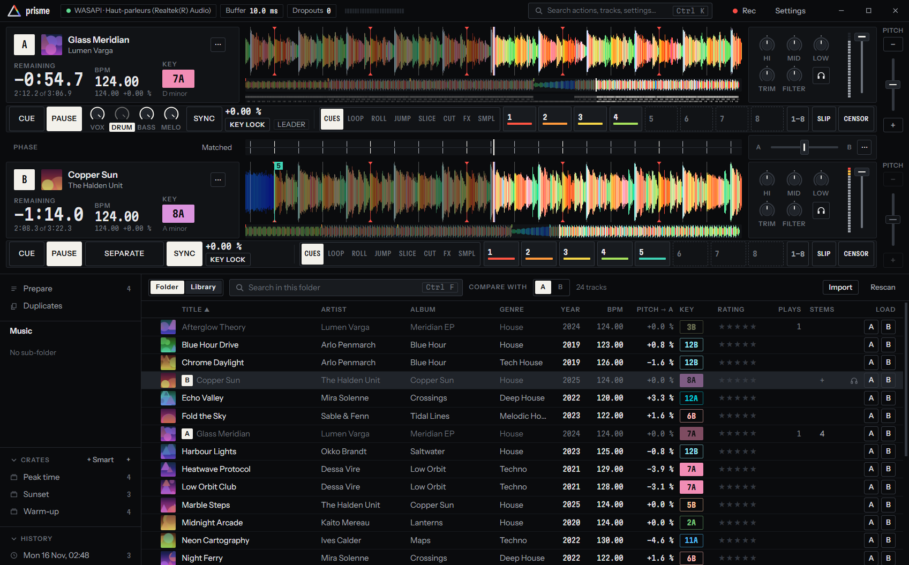
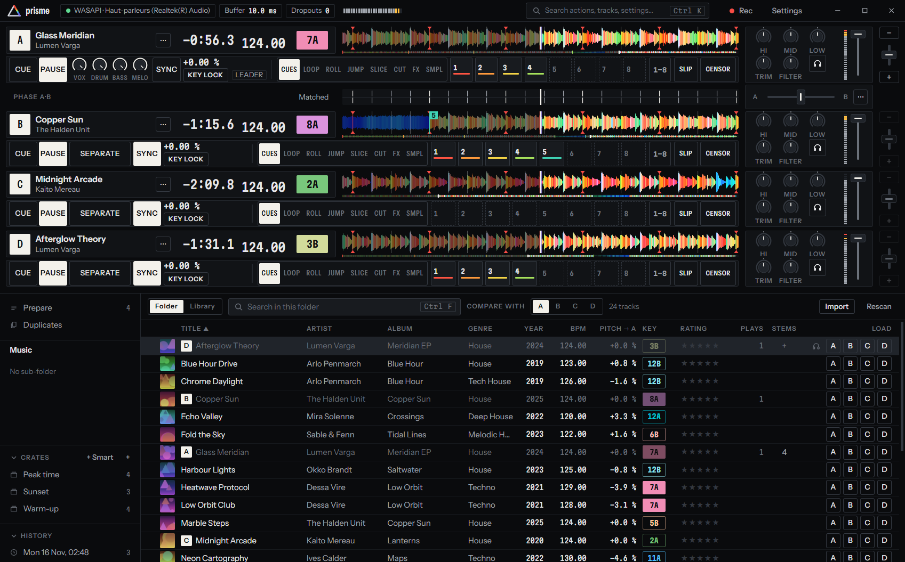
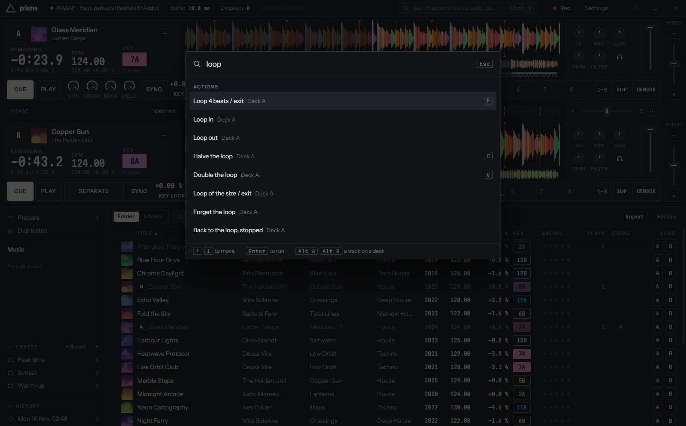

<p align="center">
  
</p>

<h1 align="center">Prisme</h1>

<p align="center">
  DJ software built for DVS: timecode vinyl drives the tracks.<br>
  A real-time audio engine in Rust, a Tauri + Angular interface.<br>
  Windows, Linux and macOS, and Android on a phone or a tablet.
</p>

<p align="center">
  
</p>

## Features

- **Vinyl control**: Serato CV02 (sides A and B) and Serato CD timecode, absolute and
  relative modes, needle drops, backspins and scratches; a decoder written from
  scratch. The deck plays on by itself when the needle reaches the end of the record.
- **Mixing**: each deck on its own outputs for a hardware mixer, or a software mixer
  (trim, 3-band EQ with kills, filter, crossfader curves and sides, master limiter,
  headphone cue, split or solo); auto gain plays every track at the same loudness. A
  booth output at its own level, the balance, a microphone with talkover and an aux input.
  Two decks or four: on an interface for two, the third and fourth are layers over the
  first two.
- **Performance**: tempo and beat sync, quantize, 16 hot cues on two pages, beat loops of
  a size set per deck, loop in/out, loop rolls, beat jumps, a slicer, fader cuts, brake
  and spinback, slip, censor, repeat, fader start, key lock and key shift. Each deck has a
  chain of three beat-synced effects (echo, ping-pong, reverb, flanger, phaser, filter,
  gate, bitcrusher), on the whole track or on one of its stems; a 16-slot sampler per
  deck; instant doubles; mix recording with its tracklist.
- **Stems**: vocals, drums, bass and melody, separated on the GPU (on its tensor cores
  where it has some) or the processor, from where the deck plays as soon as a track is
  loaded; a knob per part, cut and brought back on the bar with quantize, and lanes
  showing where each part plays.
- **Library**: MP3, AAC, ALAC, FLAC, Ogg Vorbis, WAV and AIFF; tempo, beat grid and key
  analysis in the background, instant search, crates and smart crates, prepare list,
  set history, duplicates, Serato and rekordbox import, beat grid and key editing. A
  track previewed in the headphones without a deck; Auto DJ mixes the prepare list on
  the beat. A file renamed, moved, tagged again or on a drive under another letter is
  known again, by its audio if need be, and keeps its cues.
- **Control**: every action from the keyboard and from a command palette (Ctrl K). MIDI
  controllers with MIDI learn, lights, meters and jog wheels; 56 models mapped out of the
  box. MIDI clock out.
- **Reliability**: the audio restarts after a device loss or an engine failure, decks
  come back after a crash, daily logs and a diagnostic report.
- English and French interface.

<p align="center">
  
</p>

## On a phone or a tablet

The same engine and library on Android, laid out for the fingers: the decks and the
mixer sideways, or stacked upright. A finger on the waveform nudges the track, a long
press moves it; a USB sound card plugged in takes over the outputs.

<p align="center">
  
  &nbsp;
  
</p>

## Controllers

Prisme knows 56 controller models from Allen & Heath, Behringer, Denon, DJ TechTools,
Hercules, Korg, Native Instruments, Numark, Pioneer, Reloop, Roland and Stanton: plug one
in and it plays, its lights and meters included. Each model is a JSON file in
[apps/prisme-desktop/controllers](apps/prisme-desktop/controllers), a format anyone can
read and edit:

- a [JSON schema](apps/prisme-desktop/controllers/profile.schema.json) lets an editor such
  as VS Code check a profile and complete it as it is written;
- profiles corrected or added here reach the installed copies without a new version;
- a profile of your own, in the data folder, replaces the shipped one or adds a model, and
  **Export as a profile** writes what a controller drives now, what was learnt included.

The format is described in the [controllers README](apps/prisme-desktop/controllers/README.md).
The models were converted from the mappings of [Mixxx](https://mixxx.org), whose authors
each file credits.

<p align="center">
  
</p>

## Building

Requirements: Rust (stable), Node.js 24 and pnpm, Python (it fetches the libclang the
C++ bindings are generated with), and:

- Windows 10 or 11;
- macOS 13.3 or later, with the Xcode command line tools;
- Linux: a C++ compiler and the libraries of the web view, ALSA and JACK. On Debian and
  Ubuntu: `sudo apt install build-essential libwebkit2gtk-4.1-dev libgtk-3-dev libxdo-dev
  libssl-dev libayatana-appindicator3-dev librsvg2-dev libasound2-dev libjack-jackd2-dev
  libudev-dev`.

```
scripts/setup-dev.sh        (scripts\setup-dev.ps1 on Windows)
cargo test --workspace
cd apps/prisme-desktop
cargo tauri dev
```

`cargo tauri build` produces the packages in `target/release/bundle`: the installer on
Windows, a `.deb` and an AppImage on Linux, a `.dmg` on macOS. The Android package is
built by the `Mobile` workflow, for a `mobile-1.2.3` tag or on demand.

On Linux, Prisme plays through ALSA, or through JACK (PipeWire's included) for the
lowest latency. The macOS build is not notarized by Apple: the first time, open it from
System Settings > Privacy & Security.

## Releasing

1. Set the new version in the workspace `Cargo.toml` (`[workspace.package] version`).
2. Push a tag with that version, such as `0.2.0`: CI builds the packages of the three
   systems and their signed update packages and attaches them to a draft release.
3. Publish the draft: the installed copies then offer the update.

## Architecture

```
apps/
  prisme-desktop/    the application (Tauri v2), frontend in frontend/ (Angular)
  prisme-cli/        the whole chain from the command line, without the interface
crates/
  prisme-timecode/   timecode vinyl decoder: speed, direction, absolute position
  prisme-engine/     real-time engine: decks, vinyl control, mixer, sampler
  prisme-dsp/        real-time processing: filters, EQ, effects, limiter
  prisme-audio-io/   sound cards (WASAPI, ASIO, CoreAudio, ALSA, JACK) behind a small interface
  prisme-media/      audio file decoding, tags and cover art
  prisme-analysis/   waveforms, tempo and beat grid, musical key
  prisme-library/    track database, folder scanning, background analysis
  prisme-stems/      source separation (Mel-Band RoFormer) on the GPU (wgpu) or the CPU
  prisme-import/     Serato and rekordbox import
  prisme-control/    MIDI controller messages and mappings
  prisme-session/    settings files with atomic writes
design/              the design system: DESIGN.md and the reference screens
```

The audio thread never allocates, locks or frees: the interface sends commands through
a lock-free queue, the engine publishes its state in a triple buffer, and what it
replaces (tracks, decoders) goes back to the control side to be freed there.

## Command line

```
prisme devices
prisme play "track.mp3" --pitch 1.02
prisme simulate "track.mp3" --pattern scratch --gain 0.3
prisme vinyl "track.mp3" --input "interface name" --mode absolute
prisme analyze "Music folder" --csv results.csv
prisme latency --input "interface name"
```

`simulate` generates the signal of a turntable, to try vinyl control without hardware.
`latency` measures the round trip through a cable from an output to an input: it plays
clicks at full level, so keep speakers and headphones away from that output.

## License

Prisme is free software: you can redistribute it and/or modify it under the terms of
the GNU General Public License as published by the Free Software Foundation, either
version 3 of the License, or (at your option) any later version. See [LICENSE](LICENSE).

The controller profiles are adapted from the mappings of Mixxx (GPL-2.0-or-later), each
naming the authors of the mapping it comes from.

The separation models, downloaded separately, are Kimberley Jensen's
[Mel-Band RoFormer](https://huggingface.co/KimberleyJSN/melbandroformer) (MIT licence) for
the vocals, and SYH99999's
[four-stem Mel-Band RoFormer](https://huggingface.co/SYH99999/MelBandRoformer4StemFTLarge)
(Apache 2.0 licence) for the drums and bass. The fast separation is HiDolen's
[Mini-BS-RoFormer-V2.5](https://huggingface.co/HiDolen/Mini-BS-RoFormer-V2.5-46.2M)
(CC BY-NC 4.0 licence: not for commercial use).
