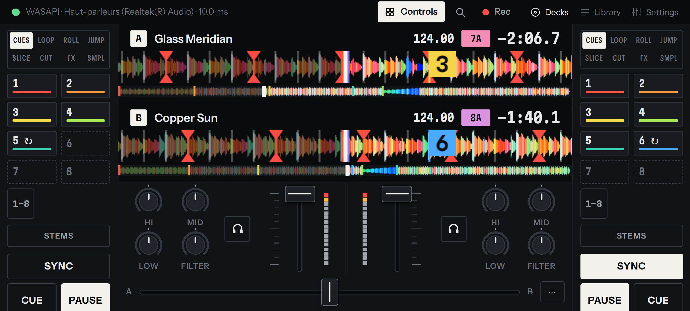
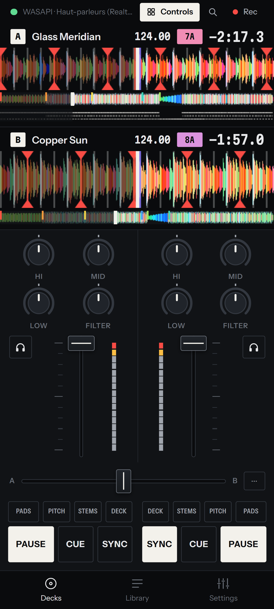

<p align="center">
  
</p>

<h1 align="center">Prisme</h1>

<p align="center">
  Free DJ software that plays your way: a controller, turntables, or just your laptop.<br>
  Two decks or four, stems on any track, 145 controllers ready when plugged in.<br>
  Windows, macOS and Linux, and Android on a phone or a tablet.
</p>

<p align="center">
  <a href="https://github.com/Shawiizz/prisme/releases/latest">Download</a> ·
  <a href="https://github.com/Shawiizz/prisme/issues">Report a problem</a>
</p>

> [!WARNING]
> Prisme is in alpha: expect bugs, and keep another DJ software at hand for a set that matters.
> Each problem [reported](https://github.com/Shawiizz/prisme/issues) helps.

<p align="center">
  
</p>

## Play your way

- **A controller**: plug in one of 145 models, MIDI or HID, and play. Pads, jog wheels,
  lights, meters and screens are mapped out of the box, and a controller Prisme does not
  know is offered to MIDI learn.
- **Turntables**: timecode records or CDs drive the tracks, needle drops, backspins and
  scratches included (Serato CV02 and Serato CD; also Traktor Scratch MK1, rekordbox,
  MixVibes and djay, not yet tried on a real record; absolute and relative modes, a decoder
  written from scratch).
- **A laptop or a phone**: every action from the keyboard, the mouse or the fingers, and
  all of them in a command palette (Ctrl K), with nothing else plugged in.

## Controllers

145 models from Akai, Allen & Heath, American Audio, Behringer, Denon, DJ TechTools,
Hercules, Korg, Native Instruments, Novation, Numark, Pioneer, Reloop, Roland, Stanton,
Vestax and more work the moment they are plugged in; one that another DJ application
holds is taken as soon as that application lets it go. MIDI controllers, and HID ones
read through hidapi on Windows, macOS and Linux: Native Instruments' Traktor Kontrol S2,
S3, S4, F1 and Z1 and the Traktor MX2, older Hercules, Pioneer CDJs in HID mode, the EKS
Otus.

- Map any control yourself (MIDI learn), lights and meters following the music; save the
  result as a profile and share it.
- Profiles corrected or added here reach the installed copies without a new version.
- Each model is a JSON file in [apps/prisme-desktop/controllers](apps/prisme-desktop/controllers),
  checked and completed by editors such as VS Code through its
  [JSON schema](apps/prisme-desktop/controllers/profile.schema.json). The format is
  described in the [controllers README](apps/prisme-desktop/controllers/README.md).
- MIDI clock out, for drum machines and synths.

Most models were converted by hand from the mappings of [Mixxx](https://mixxx.org), whose
authors each file credits. A model marked as not tried on the hardware yet is a faithful
conversion: report what works and what does not.

## Features

- **Decks and mixing**: two decks or four, even on a two-channel sound card. Each deck on
  its own outputs for a DJ mixer, or Prisme's mixer: trim, 3-band EQ with kills, filter,
  crossfader curves, master limiter, headphone cue (split or solo), booth output,
  microphone with talkover, aux input. Auto gain plays every track at the same loudness.
- **Performance**: tempo and beat sync, quantize, 16 hot cues, beat loops and rolls,
  beat jumps, a slicer, fader cuts, brake and spinback, slip, censor, key lock and key
  shift, instant doubles. Three beat-synced effects per deck (echo, ping-pong, reverb,
  flanger, phaser, filter, gate, bitcrusher), on the track or on one of its stems; a
  16-slot sampler per deck; mix recording with its tracklist.
- **Stems**: vocals, drums, bass and melody, separated on the graphics card or the
  processor from where the deck plays, a fast and a quality model to choose from. A knob
  per part, cut and brought back on the bar, and bands under the waveform showing where
  each part plays.
- **Library**: MP3, AAC, ALAC, FLAC, Ogg Vorbis, WAV and AIFF, from several music folders
  or dropped from the file manager. Tempo, beat grid (on the kicks, bars numbered from where
  the music starts) and key analysed in the background,
  instant search, crates and smart crates, a prepare list, set history, duplicates,
  Serato and rekordbox import, Auto DJ. A file renamed, moved or on another drive letter is
  known again, cues included.
- **Built for the booth**: the audio thread never waits on anything else; the sound comes
  back by itself after a device loss, the decks after a crash. Updates install themselves,
  never while a deck plays.
- English and French interface.

<p align="center">
  
</p>

## On a phone or a tablet

The same engine and library on Android, laid out for the fingers: the decks and the
mixer sideways like a controller, or stacked upright. A finger on the waveform nudges the
track; a USB sound card or controller plugged in takes over, timecode included.

<p align="center">
  
  &nbsp;
  
</p>

<p align="center">
  
</p>

## Building

Requirements: Rust (stable), Node.js 24 and pnpm, Python (it fetches the libclang the
C++ bindings are generated with), and:

- Windows 10 or 11;
- macOS 13.3 or later, with the Xcode command line tools;
- Linux: a C++ compiler and the libraries of the web view, ALSA and JACK. On Debian and
  Ubuntu: `sudo apt install build-essential libwebkit2gtk-4.1-dev libgtk-3-dev libxdo-dev
  libssl-dev libayatana-appindicator3-dev librsvg2-dev libasound2-dev libjack-jackd2-dev
  libudev-dev`.

```
scripts/setup-dev.sh        (scripts\setup-dev.ps1 on Windows)
cargo test --workspace
cd apps/prisme-desktop
cargo tauri dev
```

`cargo tauri build` produces the packages in `target/release/bundle`. The Android package
is built by the `Android` workflow.

On Linux, Prisme plays through ALSA, or through JACK (PipeWire's included) for the
lowest latency. The macOS build is not notarized by Apple: the first time, open it from
System Settings > Privacy & Security.

## Releasing

Versions, tags, file names and the words used are set in [docs/STANDARDS.md](docs/STANDARDS.md).

1. Set the new version in the workspace `Cargo.toml` (`[workspace.package] version`).
2. Push a tag with that version, such as `0.5.0`: CI builds the packages of every system,
   their signed update packages and the Android APK, and attaches them to a draft release.
3. Publish the draft: the installed copies then offer the update.

## Architecture

```
apps/
  prisme-desktop/    the application (Tauri v2), frontend in frontend/ (Angular)
  prisme-setup/      the Windows installer's window
  prisme-cli/        the whole chain from the command line, without the interface
crates/
  prisme-timecode/   timecode vinyl decoder: speed, direction, absolute position
  prisme-engine/     real-time engine: decks, vinyl control, mixer, sampler
  prisme-dsp/        real-time processing: filters, EQ, effects, limiter
  prisme-audio-io/   sound cards (WASAPI, ASIO, CoreAudio, ALSA, JACK, AAudio, USB) behind a small interface
  prisme-media/      audio file decoding, tags and cover art
  prisme-analysis/   waveforms, tempo and beat grid, musical key
  prisme-library/    track database, folder scanning, background analysis
  prisme-stems/      source separation (RoFormer models) on the GPU (wgpu) or the CPU
  prisme-import/     Serato and rekordbox import, rekordbox and playlist export
  prisme-control/    MIDI and HID controller messages, mappings and profiles, the list of actions
  prisme-actions/    what each action decides: its rules, its light, what the screen shows
  prisme-session/    settings files with atomic writes
design/              the design system: DESIGN.md and the reference screens
website/             the site and the documentation, in English and French
```

The audio thread never allocates, locks or frees: the application sends commands through
a lock-free queue, the engine publishes its state in a triple buffer, and what it
replaces (tracks, decoders) goes back to the control side to be freed there.

Every action is performed in Rust, whoever asks for it: a controller from its MIDI or HID
thread, a key, the screen. The interface only shows what the backend computes, from a
status stream that sends only what changed, and sends it gestures.

## Command line

```
prisme devices
prisme play "track.mp3" --pitch 1.02
prisme simulate "track.mp3" --pattern scratch --gain 0.3
prisme vinyl "track.mp3" --input "interface name" --mode absolute
prisme analyze "Music folder" --csv results.csv
prisme latency --input "interface name"
```

`simulate` generates the signal of a turntable, to try vinyl control without hardware.
`latency` measures the round trip through a cable from an output to an input: it plays
clicks at full level, so keep speakers and headphones away from that output.

## License

Prisme is free software: you can redistribute it and/or modify it under the terms of
the GNU General Public License as published by the Free Software Foundation, either
version 3 of the License, or (at your option) any later version. See [LICENSE](LICENSE).

The controller profiles are adapted from the mappings of Mixxx (GPL-2.0-or-later), each
naming the authors of the mapping it comes from.

The beat grids are placed with the small model of
[Beat This!](https://github.com/CPJKU/beat_this) (Institute of Computational Perception, JKU
Linz; MIT licence), run through its Rust port
[beat-this-rs](https://github.com/danigb/beat-this-rs) (MIT licence), both notices in
[`crates/prisme-analysis/models/LICENSE-beat-this`](crates/prisme-analysis/models/LICENSE-beat-this).

The separation models, downloaded separately, are Kimberley Jensen's
[Mel-Band RoFormer](https://huggingface.co/KimberleyJSN/melbandroformer) (MIT licence) for
the vocals, and SYH99999's
[four-stem Mel-Band RoFormer](https://huggingface.co/SYH99999/MelBandRoformer4StemFTLarge)
(Apache 2.0 licence) for the drums and bass. The fast separation is HiDolen's
[Mini-BS-RoFormer-V2.5](https://huggingface.co/HiDolen/Mini-BS-RoFormer-V2.5-46.2M)
(CC BY-NC 4.0 licence: not for commercial use).
