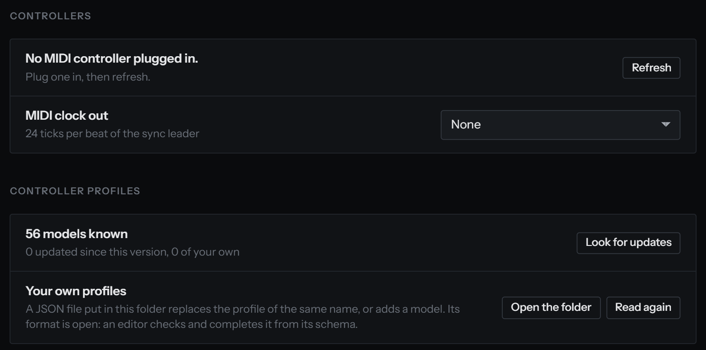

import { Steps, Aside, LinkCard, CardGrid } from '@astrojs/starlight/components';

Prisme plays with MIDI DJ controllers. For the [models it knows](/docs/controllers/supported/), the keys, faders, jog wheels, lights and level meters work as soon as you plug the controller in. You can map any other MIDI controller yourself, one control at a time, with [MIDI learn](/docs/controllers/learn/).

## Plug a controller in

Plug in a controller of a model Prisme knows and it plays at once: a notice says **connected**, with **Do not use it** if you would rather Prisme left it alone. A controller already plugged in when Prisme starts is opened too.

Any other MIDI controller is offered: a notice says **New controller**, with **Set up**, which turns it on and opens **MIDI controllers** to [learn its controls](/docs/controllers/learn/), and **Ignore**, after which it is not offered again (you can still turn it on in the settings).

## Turn a controller on or off

<Steps>

1. Plug the controller in and switch it on.

2. Open **Settings** (<kbd>Ctrl</kbd> <kbd>,</kbd>, or <kbd>⌘</kbd> <kbd>,</kbd> on a Mac) and choose **MIDI controllers**.

3. Under **Controllers**, find your controller. It is listed by the name of its MIDI port, with **Plugged in** below it. If the list says **No MIDI controller plugged in.**, check the cable and press **Refresh**.

4. Turn on the switch at the end of its row.

   When Prisme knows the model, the row says **Mapped as a** followed by the model's name: the controller is ready to play.

</Steps>

Prisme remembers the controllers you turned on, and those you turned off: it never takes these again by itself. It opens the others again at every start, and if you unplug one while playing (a cable pulled, a USB hub that resets), Prisme lets go of whatever the controller was holding (keys, a touched jog wheel), then opens it again as soon as it is back, its lights included.

<Aside type="caution" title="One program per controller">
On Windows, only one program at a time can open a MIDI port. If another DJ program has the controller open, Prisme waits for it: a notice says the controller **is used by another program**, and as soon as you close that program, Prisme takes the controller and says it is **connected**.
</Aside>

## How Prisme recognises a model

Each model Prisme knows has a profile, which lists the names its MIDI port goes by. When the name of a port contains one of them (upper or lower case alike), that profile maps the controller. When several models fit, the longest name wins, so a DDJ-SB2 is never taken for a DDJ-SB.

Under the controller's name, the settings tell you what Prisme made of it:

| Line | Meaning |
| --- | --- |
| **Mapped as a Pioneer DDJ-SB2: learn a control to change it** | A profile maps it. Learning a control replaces what the profile gave that control. |
| **Converted from the mapping of Mixxx, not yet tried on this controller** | The profile was converted from a Mixxx mapping and nobody has tried it on the hardware yet. It should work, but expect a control or a light to be off here and there. See [Supported controllers](/docs/controllers/supported/). |
| **With your own profile** | The profile comes from your data folder, not from Prisme. See [MIDI learn and your own profile](/docs/controllers/learn/#a-profile-of-your-own). |
| **Your own profile takes the place of the one Prisme gives the Pioneer DDJ-SB2: the corrections published for it no longer reach this controller.** | In yellow: your own profile is used where Prisme has one of its own for the model, so its updates are set aside. Delete your file to have Prisme's back. |
| No "Mapped as" line | Prisme does not know the model. Nothing is mapped yet: map it control by control with [MIDI learn](/docs/controllers/learn/). |

## What the controller does

### Keys, faders and knobs

Each control drives one of Prisme's actions: the same actions as the keyboard and the command palette. The [actions reference](/docs/controllers/actions/) lists all of them.

Controllers' faders and knobs pick up the setting gently. If you moved the volume on the screen, the fader on the controller does nothing until it reaches the value on the screen, then takes over from there, so the sound never jumps. If a fader seems dead, move it through the value shown on the screen.

Many profiles give the controls a second use while the controller's Shift key is held, and give the pads several pages (hot cues, loops, rolls, sampler…) chosen with the controller's mode keys, as printed on it.

### Jog wheels

- Touching the top of a jog wheel and turning it scratches the track.
- Turning it by its edge nudges a playing track, to bring it back in time, and moves through a stopped one.
- Some profiles search through the track with the jog while Shift is held: ten seconds of track per turn.
- A deck under [vinyl control](/docs/dvs/) follows its record: its jog wheel does nothing then.

The deck action **Jog wheel: a touch scratches, or only nudges** turns the scratching on a touch off and on, per deck. It is on by default.

Jog wheels and tempo faders do not wait for the interface: Prisme hands them to the audio engine as they come, with the time each message arrived, so a scratch follows your hand.

### Lights

The lights show the state of what they drive: play lights while the deck plays, sync while it is synced, a loop key while its loop plays. On top of on and off, some keys have states of their own:

- the cue key lights at the cue point and shows another state while the deck is stopped elsewhere;
- sampler pads and load keys show empty, loaded and playing apart;
- on colour pads, hot cues light in their own colour;
- some keys light while you hold them.

Each profile chooses the values its model wants, blinking included. A controller turned off in Prisme, or Prisme closing, switches its lights off.

### Level meters

Models with level meters show the level of each deck, or of the master, on their LEDs. Where the profile gives one, a clip LED lights for a second when the level reaches full scale.

### Screens and rings

Some models show numbers on their screens: the tempo, the time played or left, the tempo change. Rings of lights around jog wheels show the record turning, as a record at 33⅓; others show where the track is, or where a knob is set. [Supported controllers](/docs/controllers/supported/) says which models do what.

### Four decks

A controller with four decks (or a deck switch) drives decks C and D only when Prisme shows four decks. With two decks shown, the controls of decks C and D do nothing.

## Profiles kept up to date

Profiles get corrected and new models get added between versions of Prisme. Prisme fetches them from its GitHub repository by itself, without a new version:

- once a day at most, twenty seconds after it starts;
- only the profiles changed since your version, and only those written in a format your version reads;
- a profile damaged on the way is set aside, and the one your version ships stays.

The profiles that came drive their controllers at once. To look now, press **Look for updates** under **Controller profiles**: it says **The profiles are up to date.** or how many profiles were updated.

<Aside>
A profile of your own always wins over Prisme's for the same model: once you have [your own profile](/docs/controllers/learn/#a-profile-of-your-own) for a model, updates to that model no longer reach you, and the settings say so in yellow. The controls you learn do not do that: they stay laid over Prisme's profile as it gets updated.
</Aside>

## The MIDI controllers settings

**Settings** › **MIDI controllers** holds everything about controllers, in four parts.

### Controllers

| Item | What it does |
| --- | --- |
| A controller's row | Its port name, **Plugged in** or **not plugged in** (a controller you turned on that is not there now), and what Prisme recognised. |
| Switch | Turns the controller on in Prisme, or off. |
| **Export as a profile…** | Shown for a controller turned on and plugged in: writes what it drives now to a profile file, where you choose, to share or keep. What it drives does not change. See [Export as a profile](/docs/controllers/learn/#export-as-a-profile). |
| **Refresh** | Shown when no controller is listed: looks for controllers again. |
| **MIDI clock out** | Sends a MIDI clock, 24 ticks per beat of the sync leader, to the MIDI output you choose, so that a drum machine or a sequencer plays along. **None** sends nothing. It starts on a beat and stops when the leader stops. See [Sync](/docs/decks/sync/). |

### Controller profiles

| Item | What it does |
| --- | --- |
| **… models known** | How many models Prisme knows now, with how many were **updated since this version** and how many are **of your own**. |
| **Look for updates** | Fetches the profiles published since, as Prisme does once a day. |
| **Your own profiles** | **Open the folder** shows the folder of your own profiles; **Read again** reads it after you changed a file. A file Prisme cannot read is listed here in red, with the reason; a file that replaces a profile of Prisme's of the same name, in yellow (`pioneer-ddj-400.json replaces the profile Prisme gives the Pioneer DDJ-400`). Not shown on a phone. |

### The list of actions

Below, every action a control can drive, by group, with where it is mapped now (the controller, then the control: `DDJ-SB2 · Note 11 · ch 1`). **Learn** maps a control to it, and the **×** after a controller takes it off that controller alone. For an encoder, a menu chooses how it sends its steps. All of this is on [MIDI learn and your own profile](/docs/controllers/learn/).

## Next

<CardGrid>
	<LinkCard title="Supported controllers" href="/docs/controllers/supported/" description="Every model mapped out of the box." />
	<LinkCard title="MIDI learn and your own profile" href="/docs/controllers/learn/" description="Map a control, change a mapping, share it." />
</CardGrid>
