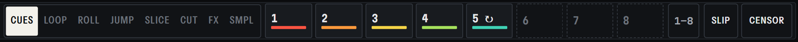

import { Steps, Aside } from '@astrojs/starlight/components';

A track has one main cue point, where **CUE** brings it back, and up to 16 hot cues you jump to
with a pad. All of them are saved with the track in your library, so they are there the next time
you load it, on any deck.

## The main cue

**CUE** sets and plays the main cue point the way a CDJ does:

| When you press CUE | What happens |
| --- | --- |
| The deck is playing | It goes back to the cue point and stops |
| The deck is stopped on the cue point | It plays while you hold **CUE**, and goes back to the cue point when you let go |
| The deck is stopped anywhere else | The cue point moves there |

Press **PLAY** while you hold **CUE** and the deck carries on playing when you let go of **CUE**,
as on a CDJ.

A track without a cue point cues from its start. With [quantize](/docs/decks/sync/#quantize) on,
a new cue point lands on the nearest beat and the deck moves onto it. On the waveform, the main
cue is a line with a flag marked **C**.

The keys are <kbd>A</kbd> for deck A and <kbd>J</kbd> for deck B. While a record drives the deck,
the **CUE** key is not shown: the turntable is the transport. See
[Playing a track](/docs/decks/playing/#play-pause-and-cue).

### Cue actions for controllers

There is a single way **CUE** behaves, the CDJ one. For other habits, these actions can be mapped
on a controller or run from the command palette:

| Action | What it does |
| --- | --- |
| **Cue (hold to preview)** | The **CUE** key itself |
| **To the cue and play** | Goes to the cue point and plays |
| **To the cue, stopped** | Goes to the cue point and stops |
| **To the cue** | Goes to the cue point, playing or not as it was |
| **The cue here** | Sets the cue point where the deck is, without stopping it |

A controller's **CUE** light shows where the deck is, as on a CDJ: on while the deck sits on its
cue point, a different state while it is stopped elsewhere (where a press would set the cue), and
off while it plays.

## Hot cues

Hot cues live on the pads, in the **CUES** mode, the one the pads start in. There are 16 per
track, on two pages of eight: the key after the pads, **1–8** or **9–16**, shows the page you see
and switches to the other.

An empty pad is dashed and shows its number. A pad with a hot cue shows its number, or the cue's
name if it has one, over a bar in its colour.

| To | Do this |
| --- | --- |
| Set a hot cue | Click an empty pad: the hot cue goes where the deck is |
| Jump to it | Click its pad |
| Delete it | <kbd>Shift</kbd>-click its pad, or right click it |

A jump keeps the deck as it was: a playing deck plays on from the hot cue, a stopped one waits
there. With quantize on, a hot cue set lands on the nearest beat, and a jump while the deck plays
keeps the beat: the deck lands at the same place of the beat it left, so the mix stays in time.

On the waveform, each hot cue is a line with a numbered flag in its colour; on the overview, a
tick.

### From the keyboard

The keyboard reaches the first page of hot cues. A key on an empty hot cue sets it; on a set one,
jumps to it.

| Hot cue | 1 | 2 | 3 | 4 | 5 | 6 | 7 | 8 |
| --- | --- | --- | --- | --- | --- | --- | --- | --- |
| Deck A | <kbd>1</kbd> | <kbd>2</kbd> | <kbd>3</kbd> | <kbd>4</kbd> | <kbd>Q</kbd> | <kbd>W</kbd> | <kbd>E</kbd> | <kbd>R</kbd> |
| Deck B | <kbd>7</kbd> | <kbd>8</kbd> | <kbd>9</kbd> | <kbd>0</kbd> | <kbd>U</kbd> | <kbd>I</kbd> | <kbd>O</kbd> | <kbd>P</kbd> |

Keys are named as on a US QWERTY keyboard; on another layout, use the keys in the same places.
Decks C and D take the keys of A and B with <kbd>Shift</kbd> held. Deleting a hot cue takes the
mouse or a controller.

On a controller, all 16 can be mapped (**Hot cue 1** to **Hot cue 16**, and **Delete hot cue 1**
to **Delete hot cue 16**). See [Actions](/docs/controllers/actions/).

### Saved loops

A hot cue set while a loop plays saves the loop instead of a point. Its pad shows **↻** after its
number. Pressing it brings the loop back and plays it from its start. To save a loop:

<Steps>

1. Set a loop and let it play (see [Loops, rolls and jumps](/docs/decks/loops/)).
2. Click an empty hot cue pad while it loops.
3. Later, press that pad to jump into the loop wherever the deck is.

</Steps>

## Colours

Each hot cue takes the colour of its slot, in the usual DJ order:

| Hot cue | 1 and 9 | 2 and 10 | 3 and 11 | 4 and 12 | 5 and 13 | 6 and 14 | 7 and 15 | 8 and 16 |
| --- | --- | --- | --- | --- | --- | --- | --- | --- |
| Colour | Red | Orange | Yellow | Green | Aqua | Blue | Violet | Pink |

The second page takes the colours of the first. A controller with coloured pads shows each hot
cue in the nearest colour it has.

## Cues from rekordbox and Serato

When you import a rekordbox or Serato library, the cues come with the tracks: each hot cue goes
to its own slot if it is free, keeping its colour and its name, which the pad shows. A memory cue
becomes the main cue if the track has none, and a saved loop without a slot takes the first free
hot cue. Cues you set in Prisme are never replaced, and a cue already at the same place is not
added twice. See [Import from other software](/docs/library/import/).

<Aside type="note">
Hot cues need a track the deck can move: with a record in absolute mode, where the record decides
the position, the pads of the **CUES** mode are greyed out. Relative mode and internal play have
them all.
</Aside>
