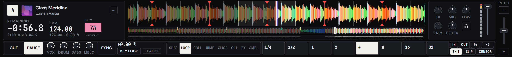

import { Steps, Aside } from '@astrojs/starlight/components';

Loops, rolls and beat jumps are counted in beats, on the track's beat grid: a track without a grid
has no beat loops, rolls or jumps (check it in [Analysis](/docs/library/analysis/)). They all
live on the pads, in the **LOOP**, **ROLL** and **JUMP** modes, with the keys that go with each
mode on the right of the pads.

With a record in absolute mode, the record decides where the track is: the pads of these modes are
greyed out. In relative mode and internal play, everything here works.

## Beat loops

In the **LOOP** mode, each pad sets a loop of so many beats from where the deck plays:

| Pad | 1 | 2 | 3 | 4 | 5 | 6 | 7 | 8 |
| --- | --- | --- | --- | --- | --- | --- | --- | --- |
| Beats | 1/4 | 1/2 | 1 | 2 | 4 | 8 | 16 | 32 |

The pad of the loop playing lights. Press it again to leave the loop; press another pad to start a
loop of that length from where the deck is.

With [quantize](/docs/decks/sync/#quantize) on, the loop starts on the nearest beat (a loop
shorter than a beat, on the nearest step of its own length), so it stays in time. Without it, the
loop starts exactly where you press.

On the waveform, the loop playing is a band of light between two lines. A loop you left stays
stored, shown as two dim lines, until you set another one.

| Key | Deck A | Deck B |
| --- | --- | --- |
| A 4-beat loop, or out of the loop playing | <kbd>F</kbd> | <kbd>H</kbd> |
| Halve the loop | <kbd>C</kbd> | <kbd>,</kbd> |
| Double the loop | <kbd>V</kbd> | <kbd>.</kbd> |

Keys are named as on a US QWERTY keyboard; on another layout, use the keys in the same places.

## The loop keys

In the **LOOP** and **ROLL** modes, the keys beside the pads are:

| Key | What it does |
| --- | --- |
| **IN** | Marks where the next loop starts. It lights until you press **OUT**. |
| **OUT** | Ends the loop where the deck is and plays it, from **IN**. Without an **IN**, it moves the end of the stored loop here. |
| **½** / **×2** | Halves or doubles the loop, keeping its start. Works on a stored loop too. |
| **RELOOP** | Turns the stored loop back on. If the deck is past its end, it goes back to its start. |
| **EXIT** | Takes the place of **RELOOP** while a loop plays: leaves it, and the track plays on. |

With quantize on, **IN** and **OUT** land on the nearest beat. When **OUT** lands on a beat the
deck has just passed, the deck goes back into the loop at the same place of the beat, so the loop
starts in time.

In the other pad modes, an **EXIT** key appears whenever a loop plays, so you can always leave it.

### A manual loop

<Steps>

1. Choose the **LOOP** mode on the pads.
2. Press **IN** where the loop should start: the key lights and a line marks the place.
3. Press **OUT** where it should end: the loop plays at once.
4. Adjust it with **½** and **×2**, or press **EXIT** to go on with the track.
5. Press **RELOOP** later to play it again.

</Steps>

To keep a loop with the track, set a hot cue while it plays: see
[Saved loops](/docs/decks/cues/#saved-loops).

## Loops with slip

With **SLIP** on, the track carries on underneath while the loop plays: when you leave the loop,
the deck lands where the track would have been, as if the loop had never happened. Without it,
the track plays on from the end of the loop. See [Slip](/docs/decks/performance/#slip).

## Loop rolls

A roll is a short loop that plays only while you hold its pad, the track carrying on underneath.
Let go, and the deck lands where it would have been. Rolls always work this way, whether **SLIP**
is on or not. In the **ROLL** mode:

| Pad | 1 | 2 | 3 | 4 | 5 | 6 | 7 | 8 |
| --- | --- | --- | --- | --- | --- | --- | --- | --- |
| Beats | 1/16 | 1/8 | 1/4 | 1/2 | 1 | 2 | 4 | 8 |

With quantize on, the roll starts on the grid, as a beat loop does. Short rolls (1/16 to 1/4) make stutters and
build-ups; longer ones repeat a phrase.

<Aside type="caution">
Hold one roll pad at a time: a second pad pressed during a roll is ignored, and letting go of any
roll pad ends the roll.
</Aside>

## Beat jumps

In the **JUMP** mode, each pad moves the deck by so many beats, back or ahead:

| Pad | 1 | 2 | 3 | 4 | 5 | 6 | 7 | 8 |
| --- | --- | --- | --- | --- | --- | --- | --- | --- |
| Beats | -32 | -16 | -4 | -1 | 1 | 4 | 16 | 32 |

A jump moves by whole beats, so the deck stays in time. If a loop plays around the deck, it moves
along with the jump: a 4-beat loop jumped 4 beats ahead loops the next 4 beats.

## The size of each deck

Each deck keeps a size, in beats, from 1/16 to 64: 4 at first, then the one you left, kept from one
start to the next. It is the length of the
jumps and of the loop that the controller actions below use. In the **JUMP** mode, the keys beside
the pads show it, with **½** and **×2** to halve or double it. The loop and jump pads of that size
have a bar in the light, so you see which ones match it.

| Action | What it does |
| --- | --- |
| **Jump back by the size**, **Jump ahead by the size** | Jumps by the deck's size |
| **Loop of the size / exit** | A loop of the deck's size, or out of the loop playing |
| **Halve the size**, **Double the size** | Changes the size |
| **Size of the jumps and the loop (a step halves or doubles it)** | The same on a knob that turns |

These actions are for a controller (see [Actions](/docs/controllers/actions/)); the buttons among
them are also in the command palette. Controller profiles can also name a loop, a roll or a jump
of any number of beats directly.

## More loop actions for controllers

| Action | What it does |
| --- | --- |
| **Loop in**, **Loop out**, **Reloop** | As **IN**, **OUT** and **RELOOP** |
| **Halve the loop**, **Double the loop** | As **½** and **×2** |
| **Loop a beat back**, **Loop a beat forward**, **Loop moved, a beat a step** | Move the loop by whole beats |
| **To the start of the loop**, **To the end of the loop** | Put the deck at either end of the stored loop |
| **Back to the loop, stopped** | Turns the stored loop on and stops at its start |
| **Forget the loop** | Takes the stored loop away |
| **Loop 4 beats / exit** | As <kbd>F</kbd> and <kbd>H</kbd> on the keyboard |
