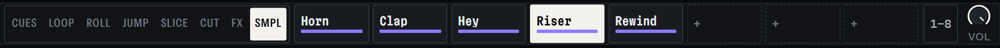

import { Steps, Aside } from '@astrojs/starlight/components';

Each deck has its own sampler: 16 slots for short sounds (a horn, a vocal shout, a drop), played
from the pads in the **SMPL** mode. The sounds go through the deck's channel, so its EQ, its
fader, its fader cuts and its effects (when they are on the whole deck rather than on a stem)
shape them too. They work on a deck with no track loaded.

## Load a sound

<Steps>

1. On the deck's pads, choose the **SMPL** mode.
2. Click an empty pad, marked **+**: a window opens to choose a sound.
3. Pick an audio file (MP3, FLAC, WAV, AIFF, M4A, AAC, MP4 or OGG). The pad shows the file's name.

</Steps>

A sound lasts 30 seconds at most: a longer file is refused with **A sampler sound lasts 30 s at
most: load longer files on a deck**.

The 16 slots are on two pages of eight: the key after the pads, **1–8** or **9–16**, switches
page. Prisme remembers the sounds of every slot and loads them again at the next start (keep the
files where they are).

## Play a sound

| To | Do this |
| --- | --- |
| Play a sound | Click its pad: it plays from its start, once, to its end |
| Play it again from the start | Click its pad again while it plays |
| Stop it | Right click its pad while it plays |
| Take it off its pad | Right click it while it is silent, or <kbd>Shift</kbd>-click it |

A pad lights while its sound plays, and several sounds can play at once. With
[quantize](/docs/decks/sync/#quantize) on and the deck playing on a beat grid, a sound waits for
the deck's next beat, so it lands in time. Otherwise it starts at once.

Sounds play at their own pitch and speed: the deck's tempo and **KEY LOCK** do not change them.

## Volume

In the **SMPL** mode, the **VOL** knob beside the pads sets how loud the deck's sampler plays, from
silent to 100 %. Double-click it to go back to 100 %. It acts on all 16 sounds of that deck, and
is kept for the next start.

On a controller, **Sampler level** sets one deck's, and **Level of every deck's sampler** sets them
all at once.

<Aside type="caution">
The sampler plays through its deck's channel: with that deck's channel fader closed, its EQ
killed, or its channel muted, you will not hear the sounds either. On an external mixer, they come
out of the deck's outputs, on the deck's channel.
</Aside>

## Velocity-sensitive pads

A controller with pads that sense how hard they are hit can play the sampler with that strength.
A profile maps a pad to the sample "as hard as the pad is hit" (`deck1.sample3.velocity` plays
deck A's sound 3); see [Controller profiles](/docs/controllers/profiles/).

The strength scales that sound alone, under the deck's sampler level: a soft hit plays the sound
quietly, and the **VOL** knob, like the sounds that follow, stays as it was.

## Smart pads and other controller actions

On a controller, each slot has several actions, to suit the pads you have:

| Action | What it does |
| --- | --- |
| **Sample 1** | Plays the sound, from its start |
| **Sample 1 while held** | Plays the sound while the key is held, and stops it when you let go |
| **Sample 1: load the selected track, play, or stop** | A smart pad: on an empty slot it loads the track selected in the library; on a loaded one it plays it; on one playing it stops it |
| **Stop sample 1** | Stops the sound |
| **Empty sample slot 1** | Takes the sound off its slot |
| **The selected track into sample slot 1** | Loads the track selected in the library into the slot |

And the same for slots 2 to 16. A sampler pad's light shows three states: empty, loaded, and
playing; profiles give each state its colour. See [Actions](/docs/controllers/actions/).

<Aside type="tip">
The smart pad and **The selected track into sample slot 1** load the file selected in the library,
so keep short sounds in a crate of their own: a track longer than 30 seconds is refused.
</Aside>
