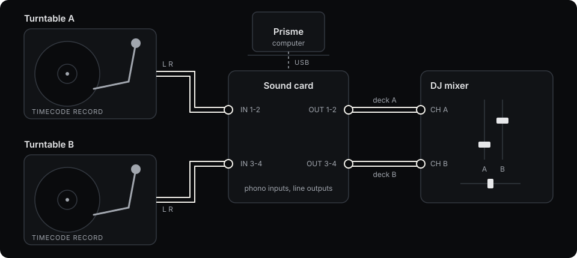

import { Steps, Aside } from '@astrojs/starlight/components';

Setting up vinyl control takes three things: the turntables wired to inputs Prisme can hear,
the record of each turntable chosen in the settings, and each deck handed to its record. The
**Turntables** page of the settings shows the signal of every turntable as it comes in, so
you can check each step as you go.

## Wire the turntables

<Steps>

1. Plug the left and right cables of turntable A into inputs 1 and 2 of your sound card, and
   those of turntable B into inputs 3 and 4. Keep left on the odd input and right on the
   even one.

2. Screw the ground wire of each turntable to the ground post of the interface or of the
   mixer. A missing ground is the first cause of hum.

3. If your interface has a phono/line switch per input, set it to **phono** for a
   turntable, **line** for a CD player.

4. Plug the outputs: with a hardware mixer, outputs 1-2 into the channel of deck A and 3-4
   into the channel of deck B, each set to line. With Prisme's software mixer, outputs 1-2
   go to the speakers and 3-4 to the headphones.

5. Put the timecode records on the platters, or the control CD in the CD players.

</Steps>

## Phono or line

A turntable's cartridge gives a very weak signal, made to go through a phono preamplifier.
Prisme does not amplify it: the timecode has to reach the sound card already brought up.

- **Interface with phono inputs** (most DJ interfaces made for DVS): plug the turntable
  straight in, switch set to phono.
- **Interface with line inputs only**: put a phono preamplifier between the turntable and
  the card, or raise the input gain of a card that has one until the signal reads well (see
  [Read the signal](#read-the-signal)).
- **CD player with the control CD**: line level already, into a line input.

Below about −50 dBFS Prisme hears no timecode at all; too much gain clips the signal and
distorts it. Aim for a full **Level** bar without clipping.

## Choose the sound card

<Steps>

1. Open **Settings** (<kbd>Ctrl</kbd> <kbd>,</kbd>, or <kbd>Cmd</kbd> <kbd>,</kbd> on a
   Mac) and go to **Audio**. Choose the **Driver type** and the **Output** as described in
   [Audio setup](/docs/start/audio/). ASIO on Windows, Core Audio on a Mac and JACK on
   Linux answer fastest, which matters with a record under your hand.

2. Go to **Turntables**. Under **Input (DVS interface)**, choose your interface.
   With ASIO, or a USB card driven by Prisme on a phone, outputs and inputs are one device:
   the row reads **Turntables plugged into the inputs of this driver** and is a switch to
   turn on.

3. A bar appears at the bottom: **The audio restarts to apply these changes.** Press
   **Apply**. (**Undo** puts the settings back as they were.)

</Steps>

Then, in the panel of each turntable below, choose the record it plays under **Timecode**
and **Side**: see [The record of each turntable](#the-record-of-each-turntable).

## Choose the inputs

Prisme gives each deck a fixed pair of inputs; there is nothing to assign by hand.

| Deck | Inputs |
| --- | --- |
| A | 1-2 |
| B | 3-4 |
| C | 5-6, on a card with at least eight inputs |
| D | 7-8, on a card with at least eight inputs |

With four decks on a card with fewer inputs (**Settings**, **DJ**, **Decks**), deck C reads
the turntable of deck A and deck D that of deck B, as the layers of a two-deck controller.
Only one deck of each pair follows the turntable at a time: putting deck C on REL or ABS
takes the turntable from deck A, which leaves the record and goes back to INT, and the
other way round. The deck that leaves the record plays on by itself as the record played it: at
its tempo, which its tempo fader moves to, and in its direction (stopped if the record stood
still).

Inputs the turntables leave free can take a microphone or an aux line, see
[Microphone and aux inputs](/docs/mixer/inputs/).

## Read the signal

**Settings**, **Turntables** shows a panel for each deck, **Turntable A**,
**Turntable B** and so on. Each has a scope and four readings.

**The scope** draws the left channel across and the right channel up. A clean timecode
traces a round circle while the record turns. The scope zooms by itself to follow the
level, so the size of the circle tells you nothing; its shape does:

| What you see | What it means |
| --- | --- |
| A thin, round circle | A clean signal. |
| A thick or fuzzy ring | Noise or hum on the signal. |
| A flattened ellipse or a line | One channel weak or missing, a cable or a cartridge to check. |
| A dot in the middle | No signal: record stopped, needle up, or nothing plugged in. |

**Signal** tells what the decoder hears:

- **locked**: a clean timecode.
- **unsteady**: the signal dropped for a moment while the record turned, a needle bounce
  for instance. Prisme holds the speed through it.
- **none**: no usable signal.

**Level** is the strength of the timecode. A full bar is what a healthy line-level timecode
gives; a bar that barely moves means too little gain.

**Speed** is how fast the record turns compared with the speed that plays the track at its
own tempo: `+1.000×` is normal play, `−1.000×` the same speed backwards, `+0.000×` stopped.

**Record** is where the needle is on the record, in minutes and seconds of music. It reads
`—` until Prisme has found the position, which takes a short stretch of clean play.

There is no calibration to run. The decoder follows the level of each record as it changes,
learns how the signal of your cartridge grows with the speed, and adjusts as you play.

<Aside type="tip">
On a deck card, the small light before the mode buttons shows the same thing at a glance
while the record drives the deck: a filled dot when the timecode is locked, a ring in the
warning color when it is unsteady, a ring in the alert color when there is none. Hover it
for the words.
</Aside>

## Hand a deck to its record

A deck plays by itself (INT) until you hand it to its turntable. On each deck card, next to
the track title, four buttons choose who drives the deck:

| Button | The deck |
| --- | --- |
| **INT** | plays by itself, with its PLAY button and tempo fader. |
| **REL** | follows the speed of the record. |
| **ABS** | follows the speed and the position of the record. |
| **THRU** | plays its inputs as they come: a real record, a CD player. |

The buttons show once Prisme reads turntables (or simulates one). Press **REL** or **ABS**
and the deck follows the record at once; press **INT** to take it back, and it plays on at the
record's tempo, in its direction. On a phone, the same
choice is at the top of the deck's panel, under **Deck A · driven by**: **Itself**,
**Vinyl REL**, **Vinyl ABS**, **Its input**.

From a controller or the keyboard, the action **Vinyl control** turns the record on or off
for a deck, in the mode it was last in, and **Passthrough: the deck plays its input**
switches THRU. Find them in the [command palette](/docs/interface/keyboard/) or map them
with [MIDI learn](/docs/controllers/learn/).

Which mode to choose is the subject of [Absolute and relative modes](/docs/dvs/modes/).

## The settings of each turntable

The panel of each turntable, in **Settings**, **Turntables**, holds the settings of its
deck. They are kept for the next start.

| Setting | What it does | Default |
| --- | --- | --- |
| **Timecode** | The record on the turntable, by maker then record: **Serato** › **Control vinyl CV02** or **Control CD**. | Control vinyl CV02 |
| **Side** | **A** or **B**, for a record whose sides carry different timecodes. Not shown for the CD. | A |
| **Vinyl control** | The deck follows its record. Same as REL or ABS on the deck card. | Off |
| **REL** / **ABS** | The mode the record drives the deck in. | ABS |
| **Record speed** | **33** or **45**: the speed the record turns at when the track plays at its own tempo. | 33 |
| **Lead-in (s)** | Where the track starts on the record, in absolute mode. Empty: the record's own. | The record's own |
| **Swap left / right** | The left and right cables are crossed: Prisme swaps them back. | Off |

### The record of each turntable

Each turntable reads its own record: deck A can play side A of a Control vinyl CV02 while
deck B plays side B, or the Control CD in a CD player. Under **Timecode**, the list gives
the records by maker; **Side** follows when the record has two sides that differ. Turn a
record over and choose its other side in its panel: the sides carry different bits, and a
deck set to the wrong one keeps its speed but never finds its position.

The choice applies at once, the audio running on, and is kept for the next start. What
depends on the record follows it: where the track starts on it (the lead-in), where it
ends, and the simulated turntable, which plays the record of deck A. Changing that one
while the simulated turntable is on starts the audio again, the decks where they were.

A settings file from a Prisme that had one timecode for every turntable gives that one to
each of them.

### Record speed: 33 or 45

Set **45** if you play the record at 45 rpm. The track then plays at its own tempo with the
platter at 45, and spreads over 35 % more groove: finer control under the hand, less music
per side (about 7 minutes on side A instead of 10). Changing it, Prisme learns the tempo of
the platter again.

### Lead-in

In absolute mode, the start of the track sits a little way into the record, so that you can
put the needle down in the first grooves and let the track begin on its own. The Serato
records start the track 28 seconds in; the control CD at its very beginning. Those 28 seconds
are the record's at 33 rpm: at 45 the grooves go by 1.35 times faster, and the track starts
20.7 seconds of music in. The field shows, greyed out, the value used at the record speed
chosen. Type another number of seconds to move the start of the
track, or empty the field to go back to the record's own. Before that point the deck plays
silence, the track waiting at its start.

### Swap left / right

If the record reads backwards while the platter turns forwards, its left and right cables
are crossed. Prisme notices it after about five seconds of steady backward play: the panel
shows **The record has been playing backwards for a while: if the platter turns
forwards, the left and right cables are crossed.** with a **Swap left / right** button,
and the deck card's light warns **Left and right cables crossed? See Settings,
Turntables**. Swap the cables, or turn the swap on.

## Check the latency

The time from the platter to the speakers is what you feel when you nudge or scratch. In
**Settings**, **Audio**, **Latency** measures it on your own setup: join an output to an
input with a cable, choose them, and press **Measure**. Prisme plays clicks at full level
for a few seconds, so keep speakers and headphones off that output. See
[Timecode troubleshooting](/docs/dvs/troubleshooting/#the-record-feels-late) to bring it
down.
