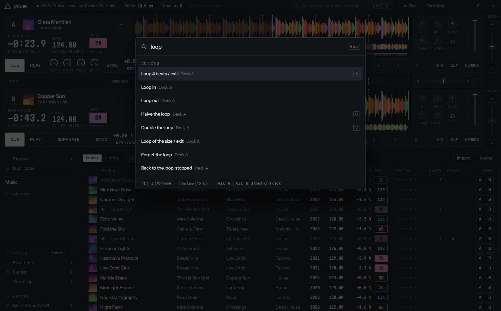

import { Aside } from '@astrojs/starlight/components';

Your left hand plays deck A, your right hand deck B, and the arrows browse the library. Whatever has no key is a few letters away in the command palette, <kbd>Ctrl</kbd> <kbd>K</kbd>.

On a Mac, <kbd>⌘</kbd> takes the place of <kbd>Ctrl</kbd> in every shortcut on this page.

## Your keyboard's layout

The shortcuts go by the place of the keys, not by the letters printed on them: the keys of deck A sit under the left hand whatever your layout. The tables below name the keys of a US (QWERTY) keyboard. On a French AZERTY keyboard, for example, deck A's play key is the one printed **S** and its cue key the one printed **Q**.

**Settings** > **Keyboard shortcuts** lists every shortcut with the keys as printed on your own keyboard. <kbd>F1</kbd> opens that page, and closes it.

## Decks

| Action | Deck A | Deck B |
| --- | --- | --- |
| Hot cues 1 to 4 | <kbd>1</kbd> <kbd>2</kbd> <kbd>3</kbd> <kbd>4</kbd> | <kbd>7</kbd> <kbd>8</kbd> <kbd>9</kbd> <kbd>0</kbd> |
| Hot cues 5 to 8 | <kbd>Q</kbd> <kbd>W</kbd> <kbd>E</kbd> <kbd>R</kbd> | <kbd>U</kbd> <kbd>I</kbd> <kbd>O</kbd> <kbd>P</kbd> |
| Cue (hold to preview) | <kbd>A</kbd> | <kbd>J</kbd> |
| Play / pause | <kbd>S</kbd> | <kbd>K</kbd> |
| Sync | <kbd>D</kbd> | <kbd>L</kbd> |
| Loop 4 beats / exit | <kbd>F</kbd> | <kbd>H</kbd> |
| Halve the loop | <kbd>C</kbd> | <kbd>,</kbd> |
| Double the loop | <kbd>V</kbd> | <kbd>.</kbd> |
| Slow down while held | <kbd>Z</kbd> | <kbd>N</kbd> |
| Speed up while held | <kbd>X</kbd> | <kbd>M</kbd> |

- **Hot cue keys**: an empty hot cue is set where the deck plays; a hot cue already set jumps there. See [Hot cues](/docs/decks/cues/).
- **Cue** works as the cue key of a CDJ. See [Playing a track](/docs/decks/playing/).
- **Sync** locks the deck to the leader, or lets it go. See [Sync and tempo](/docs/decks/sync/).
- **Slow down** and **Speed up** bend the tempo for as long as you hold the key, to nudge the beats into place; let go, the deck goes back to its tempo.

Decks C and D have no keys: play them with the mouse, a controller, or the command palette.

## Library

| Action | Keys |
| --- | --- |
| Previous track | <kbd>↑</kbd> |
| Next track | <kbd>↓</kbd> |
| Load on deck A | <kbd>Shift</kbd> <kbd>←</kbd> |
| Load on deck B | <kbd>Shift</kbd> <kbd>→</kbd> |
| Instant double on deck A | <kbd>Ctrl</kbd> <kbd>Shift</kbd> <kbd>←</kbd> |
| Instant double on deck B | <kbd>Ctrl</kbd> <kbd>Shift</kbd> <kbd>→</kbd> |
| Load on a free deck | <kbd>Enter</kbd> |
| Preview in the headphones / stop | <kbd>Space</kbd> |
| Remove from the crate or prepare list | <kbd>Del</kbd> |
| Add to the prepare list | <kbd>Ctrl</kbd> <kbd>P</kbd> |
| Select all the tracks | <kbd>Ctrl</kbd> <kbd>A</kbd> |
| Clear the selection | <kbd>Esc</kbd> |
| Search | <kbd>Ctrl</kbd> <kbd>F</kbd> |

- **Load on a free deck** takes the first deck with no track, or deck A if every deck has one.
- **Instant double** loads on the deck the track of the other deck of its pair, at the same place, playing if it plays.
- **Remove** takes the selected tracks out of the crate or the prepare list you are in. It never deletes a file.
- On a Mac keyboard, <kbd>Del</kbd> is <kbd>fn</kbd> <kbd>Delete</kbd>.

See [Browsing and searching](/docs/library/browsing/).

## General

These work everywhere, even while you type in a field or with the settings open.

| Action | Keys |
| --- | --- |
| Command palette | <kbd>Ctrl</kbd> <kbd>K</kbd> or <kbd>Ctrl</kbd> <kbd>Shift</kbd> <kbd>P</kbd> |
| Settings | <kbd>Ctrl</kbd> <kbd>,</kbd> |
| Keyboard shortcuts | <kbd>F1</kbd> |

## How the keys behave

- **A key held does not repeat.** Keys that act while held (cue, the bends) stop when you let go, or when the window loses the focus.
- **While you type** in a search box or any field, the deck and library keys type instead.
- **While the settings or the palette are open**, the deck and library keys wait. Close them with <kbd>Esc</kbd>.
- **In the library's search box**, <kbd>Esc</kbd> leaves the box, so the keys play again.
- **In the settings' search box**, <kbd>Esc</kbd> first empties the search, then closes the settings.

## Command palette

The palette finds any action, setting, crate or track by a few words, and runs it.

Open it with <kbd>Ctrl</kbd> <kbd>K</kbd>, <kbd>Ctrl</kbd> <kbd>Shift</kbd> <kbd>P</kbd>, or the search box in the middle of the title bar. Then type. It finds:

| Section | What it holds | Running it |
| --- | --- | --- |
| **Actions** | Every action done with a press, for the decks in use, the mixer, the library and the rest, with its key when it has one | Does it, once |
| **Settings** | Each page of the settings, and each setting | Opens the settings on it, the setting pointed out |
| **Crates** | Your crates, with their number of tracks | Opens the crate in the library |
| **Tracks** | Tracks of the whole library, from two letters typed, with their BPM and key | Loads the track on a free deck |

Before you type, the palette lists the pages of the settings.

Every word you type must appear in the line, in its name or in the group under it (**Deck A**, **Mixer**, **Library**…), in any order: `kill bass` finds the bass kill of each deck, `quantize` the action and the setting, `latency` the setting that measures it. Matches at the start of a word, and in the name, come first.

| Key | In the palette |
| --- | --- |
| <kbd>↑</kbd> <kbd>↓</kbd> | Move through the lines |
| <kbd>Enter</kbd> | Run the line |
| <kbd>Alt</kbd> <kbd>A</kbd>, <kbd>Alt</kbd> <kbd>B</kbd> | Load the track of the line on deck A or B |
| <kbd>Esc</kbd> | Close |

Each track line also has a button per deck, to load it there with the mouse.

<Aside type="tip">
The palette reaches what has no key: a brake, a spinback, a roll, an effect on deck C, **The library over the whole window**, **Analyse new and changed files**, or **Compare the tracks with deck B**.
</Aside>

On a phone, the search button of the top bar opens the palette over the whole screen. See [Phone and tablet](/docs/interface/phone/).

## Changing the shortcuts

The keyboard shortcuts cannot be reassigned. For keys of your own, map a MIDI controller: any action of the palette can go on any of its buttons, faders or knobs. See [MIDI learn](/docs/controllers/learn/).
