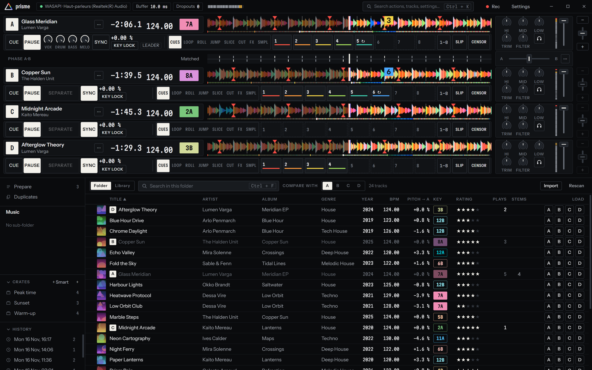
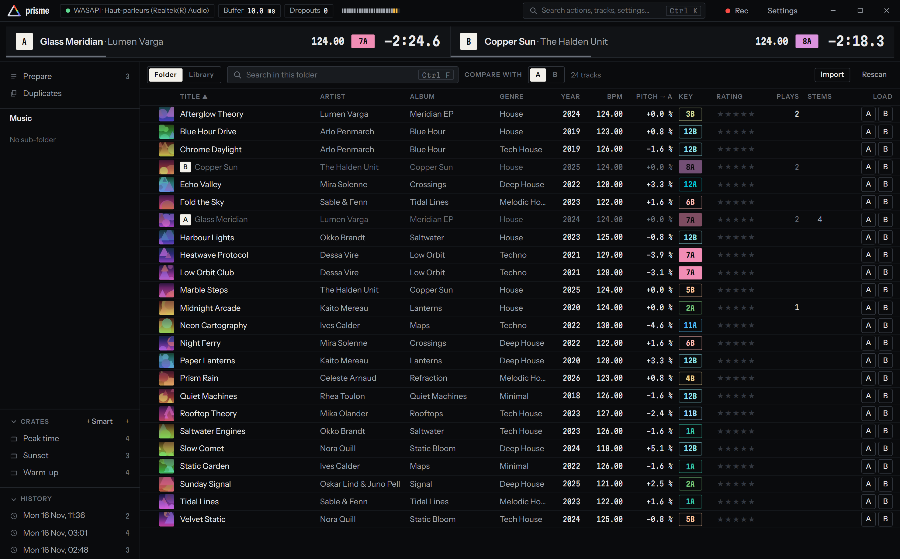

import { Steps, Aside } from '@astrojs/starlight/components';

The main screen follows how you play: the number of decks, who mixes, and what drives each deck change what each lane shows. You can also give the whole window to the library, or put the decks on a screen of their own.

## Two decks or four

Prisme starts with two decks, A and B. To play four, open **Settings** > **DJ** > **Decks** and choose **4**. The audio restarts with the new decks at once, without waiting for **Apply**: change it before the set.

### Four decks

With four decks, the lanes become compact so that the four fit with the library:

- the deck panel holds on one line: the letter, the title, who drives the deck, and the remaining time, BPM and key without their labels;
- the waveform is half as high, its overview a thin line under it, with no room for the stem lanes;
- with the software mixer, each channel spans the height of its lane.

What else changes:

- **The phase strip**, under deck A, compares the first two decks that play, and names them (**Phase A·C**).
- **The crossfader**: decks A and C are on its left, B and D on its right.
- **The keyboard** plays decks C and D with the keys of decks A and B, <kbd>Shift</kbd> held. See [Decks C and D](/docs/interface/keyboard/#decks-c-and-d).
- **The library** has a load button per deck, and **Compare with** offers the four decks.

### Four decks on an interface for two

A DJ interface with four outputs and four inputs has a pair of outputs and a turntable for two decks. On such an interface, C is a layer over A and D a layer over B, as on a controller with two jog wheels:

- C shares the outputs and the turntable of A; D those of B.
- The deck you put on **REL** or **ABS** takes the turntable. The other deck of the pair plays on by itself, at the tempo and in the direction its record gave it.

On an interface with a pair of outputs (and of inputs) per deck, eight of each, every deck has its own: C on outputs 5-6 and inputs 5-6, D on 7-8.

See [Setting up vinyl control](/docs/dvs/setup/) for the turntables.

## External mixer or software mixer

**Settings** > **Mixing** > **Mixing** changes the lanes too:

| | External mixer | Software mixer |
| --- | --- | --- |
| Channel at the end of each lane | None | Trim, EQ with kills, filter, headphones, level meter and fader |
| Beside the deck's letter | A thin meter of the level sent to its outputs | Nothing: the channel has its own meter |
| Phase strip | The phase only | The phase, the crossfader, the microphone's key and the mixer's menu |

The external mixer leaves the screen to the waveforms and the library. See [Sound card and latency](/docs/start/audio/#outputs-per-deck-or-software-mixer).

## A deck on a record

When a turntable drives a deck (**REL** or **ABS**), its lane loses what the turntable does itself:

- no **CUE** and **PLAY** keys on the rail;
- no **−** and **+** keys by the pitch fader, which shows the pitch played instead of being moved. A notch on it marks where to bring the turntable's pitch to match the other deck, and the rail shows that pitch (**→ +1.2 %**).

When the needle reaches the end of the record, the deck goes to **INT** and plays on by itself until you hand it back with **REL** or **ABS**. See [Vinyl control modes](/docs/dvs/modes/).

## The library over the whole window

To prepare a set, or to browse while a long track plays, give the whole window to the library. The decks go out of sight and a line over the library keeps each one in view: its letter, filled while it plays, the title and the artist, the BPM, the key, the time remaining and a thin line of how much has played.

<Steps>

1. Press <kbd>Ctrl</kbd> <kbd>K</kbd> and type **library**.

2. Choose **The library over the whole window**.

3. Do the same to bring the decks back.

</Steps>

A controller can do it with a key: map **The library over the whole window**, in the **General** group, with [MIDI learn](/docs/controllers/learn/).

## Decks on a screen of their own

On a laptop with two screens, or with a touch screen beside the computer, the decks can have a screen of their own: a window without borders, full screen on that screen, with the lanes alone, their waveforms growing with its height. The main window keeps the library, with the line of what plays above it, and goes wherever you like: move it, resize it, put it full screen.

<Steps>

1. Open **Settings** > **Interface**. Under **Decks on a screen of their own**, your screens are drawn as your system lays them out, numbered from the top left.

2. Click the screen for the decks. The one the main window is on cannot be chosen: move the main window to another screen first.

</Steps>

**In the main window** brings the decks back. So does closing their window with <kbd>Alt</kbd> <kbd>F4</kbd>.

Unplug their screen and the decks come back into the main window; plug it in again and they go back to it. Prisme remembers the screen for the next start. Keys pressed with the decks' window in front work as in the main window.

## Window size

Prisme opens filling its screen. To open it without the system's bars, turn on **Start in full screen** in **Settings** > **Interface**. The full-screen button in the title bar, next to minimize, or <kbd>F11</kbd>, switches at any time.

The window needs at least 1280 × 640 pixels: a 1080p laptop screen at 150 % scaling. Below 1400 pixels wide, the rail of each deck tightens: narrower keys, smaller stem knobs and pad labels. Everything stays on screen.

<Aside type="note">
On a phone or a tablet, Prisme lays itself out for the fingers instead: see [Phone and tablet](/docs/interface/phone/).
</Aside>
