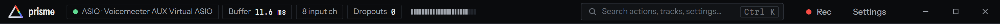

import { Aside } from '@astrojs/starlight/components';

The main screen reads from top to bottom: the title bar, a lane per deck with the phase strip after the first, then the library. Deck A is always on top or on the left, deck B under it or on its right.

## Title bar

From left to right:

- **The audio health**: the driver and the device the audio plays on, the **Buffer** length, the inputs open for turntables, and the **Dropouts** counter, amber from the first dropout. When something is wrong, a chip says so: **audio stopped**, **audio device lost, reconnecting…**, **library not saved**. Each is explained in [Sound card and latency](/docs/start/audio/#the-title-bar).
- **The master meter**: the level of what Prisme sends out.
- **The search box**, **Search actions, tracks, settings…**: it opens the [command palette](/docs/interface/keyboard/#command-palette), as <kbd>Ctrl</kbd> <kbd>K</kbd> does.
- **Update**, when a new version is out: see [Updates](/docs/start/install/#updates).
- **Rec**: records the mix, or an input. See [Recording your mix](/docs/mixer/recording/).
- **Settings**, or <kbd>Ctrl</kbd> <kbd>,</kbd>: the sound card, the turntables, the mixer, MIDI controllers, the keyboard shortcuts and the rest. See [Settings](/docs/settings/).
- On Windows and Linux, the window's minimize, maximize and close buttons. On a Mac, the usual three lights at the top left.

Drag the empty parts of the title bar to move the window.

## A deck's lane

Each deck has a lane, read from left to right: its panel, its waveform, its channel when the software mixer runs, and its pitch fader at the end. Under them, a rail holds what plays the deck and its pads.

A track dragged from the library onto a lane is loaded on that deck.

### The deck panel

- **The letter** of the deck, filled while it plays, outlined while it is stopped. With an external mixer, a thin meter beside it shows the level sent to the deck's outputs.
- **The cover, the title and the artist** of the track, or **No track loaded**.
- **Who drives the deck**, when turntables are set up: a light for the timecode signal (green when locked, hollow amber when unsteady, hollow red when lost), and **INT** (the deck plays by itself), **REL** (the record drives the speed), **ABS** (the record drives the speed and the position) and **THRU** (the deck plays its input as it comes, a real record or a CD player). See [Vinyl control modes](/docs/dvs/modes/).
- **REV** and **MUTE**, only while the track plays backwards or the channel is muted: press to undo.
- **⋯**, the deck's options: the motor (**BRAKE**, **SPINBACK**), jumps to the **START** or the **END**, reverse, mute, repeat, the range of its tempo fader, and fader start on the software mixer. See [Performance tools](/docs/decks/performance/).

Under them, three readouts made to be read from a step away:

| Readout | Large | Small |
| --- | --- | --- |
| **Remaining** | The time left | The time played, of the length |
| **BPM** | The tempo played | The track's own tempo and the pitch applied |
| **Key** | The key heard, in Camelot notation, coloured on the wheel | Its name |

The remaining time turns amber in the last 30 seconds of the track and blinks red in the last 10, the only blinking of the screen. A dot by **BPM** or **Key** means you corrected the grid or the key; the **Key** label turns amber when the pitch or a key shift moved the key heard away from the track's.

Click the BPM and key readouts to open the editor of the **beat grid, key and key shift**. See [Analysis](/docs/library/analysis/).

### The waveform

The large view scrolls around the playhead, the one white line of the screen, and shows ten seconds of real time whatever the tempo. Its height is the level; its colour is the balance of the bands mixed as light: the bass lights it red, the mids green, the highs blue, so a kick reads red, a voice green-yellow, hi-hats blue. What has played is dimmed.

Across it:

- a line across the whole height on each beat of the grid, edged in black so that it shows over any colour; on the first beat of each bar, a thicker red line pointed at by a small arrow from the top and the bottom edges;
- the hot cues, a line and a numbered flag in the cue's colour; the main cue, flagged **C**;
- a loop, a lit band between two lines; a stored loop not playing, two grey lines.

Under it, the **overview** shows the whole track: the part played dimmed, the cues as ticks, the position lit. Once the track is separated into stems, a lane per part shows where the vocals, drums, bass and melody play.

With the mouse or a finger:

| Gesture | Where | What it does |
| --- | --- | --- |
| Slide at once | Large view | Nudges the track, as the edge of a jog wheel: a playing track is pushed or held back for a moment, a stopped one moved |
| Press, hold still a moment, then slide | Large view | Puts your hand on the record: the deck follows your hand, as a record scratched, and plays on when you let go |
| Press and slide | Overview | Jumps there, then moves through the track with your hand |

On the large view, a click or a press that stays still does nothing: only a slide moves the track, so a hand resting there cannot move it. To jump, use the overview.

A deck in **THRU** says which inputs it plays as they come. An empty deck says **Load a track from the library**.

### The channel

With the software mixer, each lane has a channel between the waveform and the pitch fader:

- **HI**, **MID** and **LOW**, the three bands of the EQ. Click a knob's label to kill its band, click again to bring it back.
- **TRIM**, the gain before the EQ, ±12 dB.
- **FILTER**: to the left a low-pass, to the right a high-pass.
- **The headphones button**: lit while the deck is heard in the headphones. Double-click it to hear this deck alone.
- **The level meter** and **the fader** of the channel.

Double-click a knob to bring it back to its default. See [The mixer](/docs/mixer/mixer/).

### The pitch fader

At the end of the lane, where a turntable has it and the same way up: **faster is down**. The **−** and **+** keys move the tempo by 0.1 %, and keep going while held.

When a record or sync holds the tempo, the fader cannot be moved: it shows the pitch played. On a record, the range of the fader takes the place of **−** and **+**, and a notch marks where to bring the turntable's own pitch to match the other deck.

### The rail

Under the panel and the waveform, from left to right:

- **CUE** and **PLAY** (**PAUSE** while it plays). A deck on a record has no such keys: the record plays it.
- **Separate**, which splits the track into stems; once separated, a knob per part, its name muting it. See [Stems](/docs/sound/stems/).
- **SYNC**: tap to lock to the leader, hold to match its tempo and beats once. See [Sync and tempo](/docs/decks/sync/).
- **The pitch** played (double-click to reset it), on a record the pitch to set on the turntable (**→ +1.2 %**), **KEY LOCK**, and **LEADER** on the deck the others follow.
- **The pads**: a mode (**CUES**, **LOOP**, **ROLL**, **JUMP**, **SLICE**, **CUT**, **FX**, **SMPL**), eight pads, the key to the other page of pads where the mode has two (**1–8**, **9–16**), and the keys that go with the mode: the loop keys, slip and censor, the knobs of the effects or of the sampler. See [Hot cues](/docs/decks/cues/), [Loops](/docs/decks/loops/), [Effects](/docs/sound/effects/) and [The sampler](/docs/decks/sampler/).

When the window is narrower than 1400 pixels, the rail tightens: narrower keys, smaller stem knobs and pad labels.

## Phase strip

Between the first two lanes, the phase strip shows the beats of deck A along its top and those of deck B along its bottom, around the playheads and at the scale of the waveforms. When the beats meet, the strip says **Matched**; otherwise it tells by how many milliseconds B is **ahead** or **behind**. While both play, it warns when B will be a sixteenth off A's beat at the present tempos, and **Off the beat: adjust the pitch** once it is. With four decks, it compares the first two decks that play, and names them.

With the software mixer, the strip also holds:

- **the crossfader**, between **A** and **B**;
- **MIC**, the microphone's key, when a microphone is set up;
- **⋯**, the menu of what is set once an evening: the master and its balance, the booth, the limiter, the crossfader's curve, the headphones, the microphone and the aux line.

See [The mixer](/docs/mixer/mixer/) and [Microphone and aux inputs](/docs/mixer/inputs/).

## Library

The library fills the rest of the window.

**On the left**, the lists:

- **Prepare**, the tracks lined up for the set, which **Auto DJ** can mix by itself;
- **Duplicates**, the tracks that look like the same song;
- your music folders, under **Music**;
- **Crates**, with **+ Smart** for a smart crate and **+** for a crate;
- **History**, the tracks played for 30 seconds or more, set by set.

**Above the tracks**, the toolbar: whether to search the open list or the whole **Library**, the search box (<kbd>Ctrl</kbd> <kbd>F</kbd>), **Compare with**, the deck the keys and the pitch column are compared with, the number of tracks, the progress of the analysis and of the separation, **Import** from Serato or rekordbox, and **Rescan**.

**The tracks**, one per row. Right-click the column headers to choose the columns. At the end of each row, the headphones button previews the track in the headphones without loading it, and a button per deck loads it there. Tracks played tonight are dimmed, never hidden.

See [Browsing and searching](/docs/library/browsing/), [Crates](/docs/library/crates/) and [Auto DJ](/docs/mixer/auto-dj/).

<Aside type="tip">
Every button names what it does in a tooltip: rest the pointer on it a moment.
</Aside>

## Over the screen

- **Settings** open in a window over the main screen, with a sidebar of pages and a search over every setting. See [Settings](/docs/settings/).
- **The command palette**, <kbd>Ctrl</kbd> <kbd>K</kbd>, finds any action, setting, crate or track. See [Keyboard and command palette](/docs/interface/keyboard/).

While either is open, the keyboard shortcuts of the decks and the library wait.
