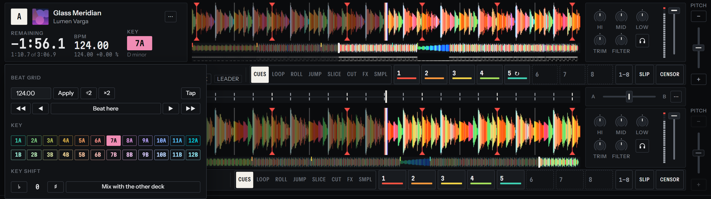

import { Steps, Aside } from '@astrojs/starlight/components';

Every track in your music folder is analysed once, in the background (see
[Adding your music](/docs/library/adding-music/#the-first-analysis)). The analysis gives it a
tempo, a beat grid and a musical key. They are what sync, quantize, the Auto DJ and the
library's key and pitch columns work from, so a wrong grid is worth fixing: it takes a few
seconds and is kept for good.

## What the analysis finds

**Tempo and beat grid.** Prisme looks for a steady tempo across the whole track, then measures
it on the kicks themselves: it finds where the attack of each kick starts, to a fraction of a
millisecond, and fits the tempo through them from the first kick to the last. The grid then
sits on the kicks' click, the knock that starts them, heard in the highs above their body: two
tracks with their grids lined up do not flam (two kicks heard instead of one), even a soft
kick against a distorted one that swells slowly, as in schranz. Serato DJ Pro puts its grids
there too, within 2 ms. Beats without a kick, as in a breakdown, are left out of the measure.

Which pulse is the beat, and where the bars start, Prisme hears with a small neural network
([Beat This!](https://github.com/CPJKU/beat_this), run on a few excerpts of the track): the
onsets alone can take a bass line playing between the kicks for the beat, and put the grid on
the off-beats. Bar 1 is the first bar where the music starts, as a track made to be mixed starts
on a bar's first beat, unless the network clearly hears the bars start on another beat.

The tempo is rounded to a whole BPM (tracks made in a DAW usually have one) only if the whole
BPM keeps the grid within 2 ms of the kicks to the end of the track; otherwise it stays as
measured, to a hundredth of a BPM or better: a track at 123.95 BPM is not shown as 124. The grid
is drawn across the waveform: a line on each beat, and on the first beat of each bar a thicker
red one with small arrows at the top and the bottom, and the bar's number. Zoomed out, the
numbers show every 4, 8 or 16 bars, on the phrases' first bars (1, 5, 9…, or 1, 17, 33…); the
bars before bar 1 count down (−1, −2…).

- The grid has **one tempo for the whole track**. That suits most electronic music. A track
  that speeds up or slows down, or was played by a live drummer, will drift off its grid.
- The tempo is reported **between 88 and 176 BPM**. That range holds house, techno and drum and
  bass at their usual tempo, but a hip-hop track at 85 BPM shows as 170, and a 180 BPM track as
  90. Fix it with **÷2** or **×2** (below).
- Tracks shorter than 10 seconds get no tempo.
- Where the kick has no clear start (a distorted, rumbling kick, as in schranz, or a kick
  buried under the bass), the grid may sit a few milliseconds off: check it by ear.

**Key.** Prisme listens to the harmony of the whole track, after correcting for a track tuned a
little off concert pitch, and picks the most likely of the 24 major and minor keys. The key
shows as a Camelot code: numbers 1 to 12 around the wheel, `A` for minor and `B` for major
(`8A` is A minor, `8B` C major). Hover a key in the library for its usual name.

Like any key detection, it can confuse a key with a close one, most often its relative major or
minor (`8A` and `8B`), or the key a fifth away (`8A` and `9A`). Those mix together anyway; when
your ears disagree, correct it.

## Correcting the grid and the key

Corrections are made on a deck, with the track loaded.

<Steps>

1. Load the track and click the **BPM** and **Key** readouts on the deck (**Beat grid, key and
   key shift**). On a phone, open the deck's panel and tap **Grid and key**.

2. Fix what is wrong with the controls below. Each change applies at once, to every deck the
   track is loaded on.

3. Close the panel by clicking outside it.

</Steps>

### Beat grid

| Control | What it does |
| --- | --- |
| BPM field and **Apply** | Sets the tempo you type (40 to 300 BPM), keeping the first beat where it is. <kbd>Enter</kbd> applies too |
| **÷2** / **×2** | **Half time** / **Double time**: the tempo divided or multiplied by two |
| **Tap** | Tap it in time with the music: after four taps the tempo you tap shows in the field. Click **Apply** to keep it |
| **◀◀** / **▶▶** | Moves the whole grid 20 ms earlier or later |
| **◀** / **▶** | Moves the whole grid 2 ms earlier or later |
| **Beat here** | Moves the grid the least so that a beat falls exactly where the deck is now, the bars with it |
| **Bar here** | The same, and a bar starts on that beat: for bars counted from the wrong beat |
| **Grid onto the other deck** | Both decks playing, the grid moves onto the beats of the other deck: see below |
| **Reset** | **Back to the analysed grid**. Shown once you changed it |

A good way to fix a grid that is off:

<Steps>

1. Check the tempo first. If the lines drift away from the kicks along the track, the tempo is
   wrong: tap it, or type it if you know it, and **Apply**.

2. Pause on a kick at the start of a bar, close to the line it should be on. Click **Beat here**.

3. Play a few bars further on and listen with the waveform zoomed in. Nudge with **◀** and **▶**
   until the lines sit on the kicks.

4. If the bars start on the wrong beat (the numbers fall a beat or two away from where the phrases
   change), pause on the first kick of a bar and click **Bar here**. An orange dot by the BPM, in
   the library and on the deck, marks the tracks whose bars the analysis is unsure of: the kick
   does not come back on bar 1 after its breaks.

</Steps>

If the analysis found no tempo at all, typing one creates a grid from the start of the track:
then use **Beat here** to put it on the beats.

Some kicks are not heard where they start: a long, distorted kick, or one whose low end comes in late, sounds a little before or after its line. Two such tracks in sync then sound slightly off, although each grid is on its kicks. Set it right by ear: play both decks, bring them together with the jog wheel or the pitch bend until they sound as one, then open the panel of the deck you moved and click **Grid onto the other deck**. Its grid moves by the gap the phase strip showed; nothing you hear changes, and **SYNC** keeps the decks that way from then on, with any track.

### Key

The panel shows the 24 keys, minor (`A`) on one row, major (`B`) on the other, the current one
filled. Click the right one. **Reset** (**Back to the detected key**) undoes your choice.

The **Key shift** section of the same panel transposes the track as it plays, without changing
its key in the library: see [Tempo, sync and key](/docs/decks/sync/).

### What happens to a correction

- A dot after the **BPM** or **Key** label on the deck tells you the grid or the key was
  corrected by hand.
- Corrections are kept in the library, apart from the analysis: analysing the file again never
  undoes them. They follow the file if you move or rename it.
- The library's BPM and key columns, the smart crates and the sorts use the corrected values.
- If **Write the tempo and key into the tags of the files** is on, the corrected tempo and key
  are written into the file too (see
  [Adding your music](/docs/library/adding-music/#writing-tempo-and-key-into-your-files)).
- A beat grid [imported from Serato or rekordbox](/docs/library/import/) counts as a
  correction: **Reset** takes you back to Prisme's own grid.

## What relies on the grid

| Feature | Uses |
| --- | --- |
| **Quantize** (**Settings** › **DJ**, on by default) | Cues, loops and jumps land on the beat; stems are cut and brought back on the bar; sampler pads start on the next beat |
| Sync | Matches the tempo, and lines the beats up with the other deck. See [Tempo, sync and key](/docs/decks/sync/) |
| Beat loops, rolls and jumps | Their length in beats. See [Loops, rolls and jumps](/docs/decks/loops/) |
| Beat-synced effects | Their timing. See [Effects](/docs/sound/effects/) |
| [Auto DJ](/docs/mixer/auto-dj/) | Where a mix starts (on a phrase), and how long it lasts in beats |
| The library's **Pitch → A** column | The tempo of each track |

Without a grid, quantize has nothing to snap to: cues and loop points go exactly where you
press. That is why a track whose tempo the analysis could not find is worth a grid typed by
hand.
