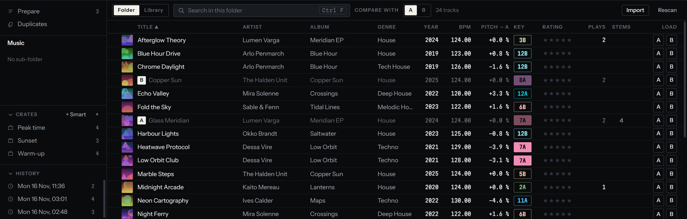

import { Aside } from '@astrojs/starlight/components';

The library sits under the decks: the lists on the left (prepare list, folders, crates,
history), the tracks of the open list on the right, with a toolbar above them. To give it the
whole window, open the command palette (<kbd>Ctrl</kbd> <kbd>K</kbd>) and run **The library
over the whole window**; run it again to bring the decks back.

## The side panel

- **Prepare**: the tracks lined up for the next minutes of your set. See
  [Crates, prepare list and history](/docs/library/crates/#the-prepare-list).
- **Duplicates**: tracks that look like the same song.
- **Folders**: your music folders, each the top of a tree. The arrow beside a folder shows the
  folders in it; click a folder to open it. Above the track list, the path from its music folder
  to the open folder: click a step to go back to it, or the arrow on its left to go up a folder.
  Prisme reopens the last folder you were in at the next start. See
  [Several folders](/docs/library/adding-music/#several-folders).
- **Folders**, **Crates** and **History**: click their title to fold them away.

Click any list to show its tracks on the right. Ordered lists (prepare list, a set of the
history, duplicates) get a `#` column with their own order.

Drag the right edge of the side panel to widen it, and the line above **Crates** or
**History** to give that section more height, the folders above giving way. Double-click a line
to put it back as it was. Prisme keeps these sizes for the next start.

## Searching

Press <kbd>Ctrl</kbd> <kbd>F</kbd> (<kbd>⌘</kbd> <kbd>F</kbd> on a Mac) or click the search
field, and type. <kbd>Esc</kbd> leaves the field.

The two buttons left of the field choose where you search:

| Button | Searches | How |
| --- | --- | --- |
| The open list (**Folder**, **Crate**, **Set**, **Prepare** or **Duplicates**) | The tracks of that list | Each word you type must appear in the title, artist, album, genre or file name, in any order, even inside a word; capitals and accents do not count. `daft around` finds *Around the World* by Daft Punk, and so does `unk orld` |
| **Library** | Every analysed track | The same way, every match shown |

There is no special syntax: no quotes, fields or operators. Opening another list clears the
search and goes back to searching that list.

<Aside type="note">
  The **Library** search covers analysed tracks only. A file copied a minute ago appears once
  its analysis is done, which the toolbar shows; a file that cannot be decoded never does.
</Aside>

## The columns

Right-click the column headers to choose which ones show; your choice is kept. All of them show
at first.

| Column | Shows |
| --- | --- |
| **Colour** | The track's colour; click the swatch to pick one of eight, or **No colour** |
| **Cover** | The cover art from the file's tags |
| **Title** | The title tag, or the file name. A letter before it says which deck the track is loaded on |
| **Artist**, **Album**, **Genre**, **Year** | From the file's tags |
| BPM | The tempo. `···` while the track waits for its analysis, `—` if it has none or could not be decoded |
| **Pitch → A** | The pitch that brings the track to the tempo of the deck you compare with (see below). Called **Pitch to match** in the column menu |
| **Key** | The key as a Camelot code (`8A`); hover it for its name. The chip is filled when it mixes with the key of the deck you compare with |
| **Rating** | Zero to five stars: click a star to rate, click the same star again to clear |
| **Plays** | How many times the track was played (see [history](/docs/library/crates/#history)) |
| STEMS | Whether the stems are separated, with a **+** to separate them. Called **Separated stems** in the column menu. See [Stems](/docs/sound/stems/) |

The **Title** column is always there. The last column holds the preview key and a load key per
deck.

Tracks you already played tonight are dimmed in every list, never hidden: you see at a glance
what you should not play twice.

## Sorting

Click a column title to sort by it, again to reverse the order. A `▲` or `▼` marks the sort.
Tracks without a value (no tag, no tempo) go last. **Rating** and **Plays** start with the
highest.

In an ordered list, click `#` to go back to the list's own order. You can only reorder the
prepare list by dragging when it is sorted by `#`, first to last.

## Compare with a deck

**Compare with** in the toolbar picks a deck, **A** by default. The library then reads every
track against what that deck plays:

- **Key**: the chip of a track is filled when its key mixes with the deck's key as you hear it
  now (the pitch, **KEY LOCK** and key shift taken into account). Compatible means the same
  code, one step around the wheel with the same letter (`8A` with `7A` or `9A`), or the same
  number with the other letter (`8A` with `8B`).
- **Pitch → A**: the change of tempo that would bring the track to that deck's tempo, like
  `+2.4 %`. Half and double tempos count: an 87 BPM track against a 174 BPM deck reads `+0.0 %`.
  The figure is dimmed when it is beyond the tempo fader range of the deck the track would go on
  (the other deck of the pair: B when you compare with A, D with C).

Click the **Pitch → A** title to sort by how well each track follows that deck. The order is,
one criterion after the other:

1. tracks not yet played tonight (nor the one on the deck);
2. the harmony of the track's key as it will sound once its tempo is matched (moved by the
   pitch, unless **KEY LOCK** is on the other deck): compatible keys first, then an energy boost
   (two steps up the wheel, `8A` to `10A`), then the others, then unknown keys;
3. a tempo your tempo fader reaches;
4. the smallest pitch change.

The order is taken when you choose the sort, and again when a new track comes on the deck. It
does not reshuffle while you ride the pitch.

## Selecting tracks

- Click a row to select it; <kbd>↑</kbd> and <kbd>↓</kbd> move the selection.
- <kbd>Ctrl</kbd>-click adds or removes a track, <kbd>Shift</kbd>-click selects a range,
  <kbd>Ctrl</kbd> <kbd>A</kbd> selects them all, <kbd>Esc</kbd> clears the selection.

With several tracks selected, a bar appears at the bottom of the list: **Prepare**, **Crate**,
**Colour**, **Genre** and **Separate the stems** apply to all of them.

## Loading a track

| To | Do |
| --- | --- |
| Load on a given deck | Click its letter at the end of the row, or drag the row onto the deck |
| Load on the first empty deck (deck A if none is empty) | Double-click the row, or press <kbd>Enter</kbd> |
| Load the selected track on deck A or B | <kbd>Shift</kbd> <kbd>←</kbd> or <kbd>Shift</kbd> <kbd>→</kbd> |
| Copy the other deck's track, where it plays (instant double) | <kbd>Ctrl</kbd> <kbd>Shift</kbd> <kbd>←</kbd> onto deck A, <kbd>Ctrl</kbd> <kbd>Shift</kbd> <kbd>→</kbd> onto deck B |

If the deck is playing, Prisme asks before replacing its track, or refuses if you turned on
**Never replace a playing deck**. See [Playing a track](/docs/decks/playing/).

To hear a track before loading it, click the headphones key on its row or press
<kbd>Space</kbd>: it plays in your headphones only, from about a third in. See
[Headphones and preview](/docs/mixer/headphones/).

## Drag and drop

Drag a row, or a selection, onto:

- a deck, to load it (the first track of the selection);
- **Prepare** in the side panel, to add the tracks to the prepare list;
- a crate in the side panel, to add them to it (not a smart crate, which picks its own tracks);
- another place in the prepare list, while you browse it, to reorder it.

## The track menu

Right-click a track (or the selection) for its menu:

| Item | Does |
| --- | --- |
| **Load on deck A**, **B**… | Only with one track selected |
| **Add to the prepare list** | Also <kbd>Ctrl</kbd> <kbd>P</kbd> |
| **Add to a crate** | Lists your crates, smart crates aside |
| **Colour** | Eight colours, or **No colour** |
| **Genre** | Type a genre, or pick one your library already has. The field starts with the genre the tracks share, else with the name of their folder. **Apply** writes it into the files' tags; **No genre** removes it |
| **Separate the stems** | Or **Separate the stems…**, which opens the settings to download the models first. Not on a phone. See [Stems](/docs/sound/stems/) |
| **Remove from the crate** / **Remove from the prepare list** | Only in a crate or the prepare list; also <kbd>Delete</kbd>. The file is never touched |

<Aside type="caution">
  Writing a genre changes your files. A file being loaded on a deck at that very moment is
  skipped: try again a moment later.
</Aside>

## Keyboard shortcuts

| Keys | Action |
| --- | --- |
| <kbd>Ctrl</kbd> <kbd>F</kbd> | Search |
| <kbd>↑</kbd> <kbd>↓</kbd> | Previous or next track |
| <kbd>Enter</kbd> | Load on a free deck |
| <kbd>Shift</kbd> <kbd>←</kbd> / <kbd>Shift</kbd> <kbd>→</kbd> | Load on deck A / deck B |
| <kbd>Ctrl</kbd> <kbd>Shift</kbd> <kbd>←</kbd> / <kbd>→</kbd> | Instant double on deck A / deck B |
| <kbd>Space</kbd> | Preview in the headphones / stop |
| <kbd>Ctrl</kbd> <kbd>P</kbd> | Add to the prepare list |
| <kbd>Delete</kbd> | Remove from the crate or prepare list |
| <kbd>Ctrl</kbd> <kbd>A</kbd> | Select all the tracks |
| <kbd>Esc</kbd> | Clear the selection |

These are the keys Prisme starts with; you can [change them](/docs/interface/keyboard/#changing-the-shortcuts).
On a Mac, <kbd>⌘</kbd> takes the place of <kbd>Ctrl</kbd>. The full list is in
[Keyboard and command palette](/docs/interface/keyboard/). A controller's browse knob, load
buttons and list buttons work the same way: see the [Actions reference](/docs/controllers/actions/).

On a controller, **Open the next list** and **Open the previous list** go through the side panel
in its order: **Prepare**, **Duplicates**, each music folder followed by the folders right under it
that hold tracks, the crates, then the sets of the history. They stop at either end.

On a phone, the library has its own layout, made for a finger: see
[Phone and tablet](/docs/interface/phone/).
