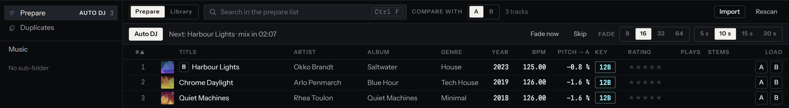

import { Steps, Aside } from '@astrojs/starlight/components';

The Auto DJ plays the [prepare list](/docs/library/crates/#the-prepare-list) for you, one track
after the other on decks A and B, each mixed into the next with the crossfader. Between tracks
with a beat grid it matches the tempo, starts the next track on a phrase and keeps the beats
together. It is there for the warm-up you do not want to stand behind, a break, or a dinner, and
you can take over at any moment.

## Before you start

The Auto DJ needs:

- **the software mixer**: it mixes with Prisme's crossfader, which an external mixer does not
  hear. Choose **Software mixer: master on outputs 1-2** under **Settings** › **Mixing**. See
  [The software mixer](/docs/mixer/mixer/).
- **decks A and B playing by themselves**, in **INT** mode: no timecode record driving them
  (**REL** or **ABS**), no input passing through (**THRU**). See
  [Absolute and relative modes](/docs/dvs/modes/).
- **tracks in the prepare list**, in the order you want them.

With four decks, the Auto DJ only uses A and B: C and D stay yours.

## Starting it

<Steps>

1. Open **Prepare** in the side panel of the library. The Auto DJ bar shows above the tracks.

2. Put the tracks in order: drag rows up and down while the list is sorted by `#`. See
   [The prepare list](/docs/library/crates/#the-prepare-list).

3. Click **Auto DJ**. The button lights, and **Auto DJ** shows beside **Prepare** in the side
   panel, wherever you are in the library.

</Steps>

How it begins depends on the decks:

- **Nothing playing**: the first track of the list is loaded on the deck the crossfader leans
  towards (A when it is in the middle), the crossfader goes all the way to that side, and the
  track starts.
- **One deck playing**: it carries on. If the crossfader is not all the way to its side yet,
  the Auto DJ brings it over at the pace of a mix.
- **Both decks playing**: the one the crossfader leans towards carries on, and the crossfader
  moves over to it, the other deck stopping at the end.

From then on, the next track waits on the other deck, cued, and the bar tells you what comes:
**Next: Strobe · mix in 1:42**.

## How it mixes

**Where the next track starts.** On its main cue if it has one, so set it where you want the
track to come in (see [Cues and hot cues](/docs/decks/cues/)). Otherwise where the sound starts,
silence at the head of the file skipped, on the first beat if the track has a grid.

**When both tracks have a beat grid** and their tempos are within 10 % of each other (half and
double tempos count: an 87 BPM track goes with 174):

1. The next track takes the tempo of the one playing.
2. The mix starts on the start of a phrase of 32 beats, the last one that leaves room for the
   whole fade before the track playing goes silent.
3. The next track comes in on the beat, and the crossfader moves across over the number of
   **beats** you chose.

**Otherwise** (no grid on one of them, or tempos too far apart), the next track plays at its own
tempo, and the crossfader moves across over the number of **seconds** you chose, ending where
the track playing goes silent.

At the end of the fade the crossfader is all the way over and the old deck stops. The track that
came in leaves the prepare list as its mix starts, and the next one is loaded on the free deck.

The Auto DJ only loads tracks and moves the crossfader, the tempo and the transport; it turns
sync lock off on the deck it starts. Your EQs, filters, effects and channel faders stay as you
set them: leave the channel faders up.

<Aside type="tip">
  Check the beat grids of the tracks you queue: a grid that is off makes a mix where the beats
  clash. See [Tempo, beat grid and key](/docs/library/analysis/).
</Aside>

## The Auto DJ bar

| Control | Does |
| --- | --- |
| **Auto DJ** | On and off. Turning it off leaves the decks as they are, playing |
| **Fade now** | **Mix into the next track now**, without waiting for the planned moment |
| **Skip** | **Skip the next track**: it leaves the prepare list, the one after comes next |
| **Fade** in beats: **8**, **16**, **32**, **64** | How long a mix lasts between two tracks with a beat grid. 16 at first |
| **Fade** in seconds: **5 s**, **10 s**, **15 s**, **30 s** | How long a mix lasts when a track has no grid. 10 s at first |

The fade lengths are kept for the next time. The Auto DJ itself is always off when Prisme
starts.

The list can change while it plays: reorder the prepare list, add or remove tracks, and the
Auto DJ puts the new first track on the waiting deck.

## Taking over

As soon as you act by hand, the Auto DJ pauses rather than fight you. It pauses when you:

- play, pause, seek, jump, trigger a hot cue on, or touch the waveform or jog of deck A or B;
- move the crossfader;
- load a track on deck A or B.

The bar then says why, for example **Paused: you moved the crossfader · press Auto DJ to go on**.
Turning the pitch, the EQs or the channel faders does not pause it, nor does anything on decks C
and D.

Click **Auto DJ** to hand back. It takes the decks as you leave them: the one playing carries on,
and if you were halfway through a mix of your own it finishes it, the crossfader moving on at
the pace of a fade. **Fade now** while paused hands back and mixes at once.

## When it stops

| The bar says | Why |
| --- | --- |
| **Nothing next: the list ends with this track** | The list is empty after the track playing. Add tracks and it goes on |
| **The prepare list has been played** | The last track ended. The Auto DJ turns off |
| **The prepare list is empty** | You turned it on with nothing to play |
| **The Auto DJ fades with the software mixer: choose it in the settings** | An external mixer is in use. The **Auto DJ** button is greyed out |
| **The Auto DJ plays decks A and B by themselves: no record, no passthrough** | Deck A or B is in **REL**, **ABS** or **THRU** mode |
| **A track could not be read: it was left out** | A file of the list failed to load; it is taken out, and the next one comes instead |

The Auto DJ runs in Prisme itself, not in its window: it keeps time with the window minimised,
or the phone's screen off.

## From the keyboard or a controller

**Auto DJ on / off**, **Mix into the next track now** and **Skip the next track** are in the
command palette (<kbd>Ctrl</kbd> <kbd>K</kbd>) and can be mapped to a controller's buttons, the
on/off one lit while the Auto DJ plays. See [MIDI learn](/docs/controllers/learn/) and the
[Actions reference](/docs/controllers/actions/).
