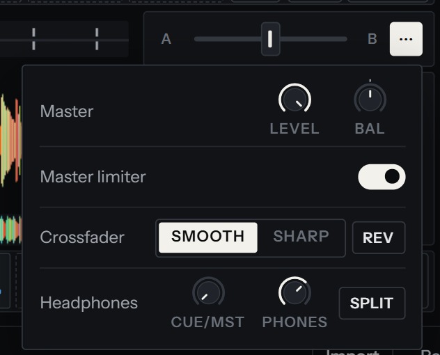

import { Steps, Aside } from '@astrojs/starlight/components';

Prisme mixes in one of two ways: each deck goes out on its own outputs to a **hardware mixer**, or
Prisme mixes the decks itself in its **software mixer** and sends one master out. Choose the first
if you have a DJ mixer and a sound card with an output pair per deck; choose the second with an
all-in-one controller, a single sound card, or a phone.

## Hardware mixer or software mixer

|  | External mixer | Software mixer |
| --- | --- | --- |
| Outputs | Deck A on 1-2, deck B on 3-4 (C and D on 5-6 and 7-8 if the device has them) | The master on 1-2, the headphones and the booth on pairs of their own |
| On the screen | A thin meter by each deck's letter, the level sent to its outputs | A channel at the end of each deck's lane, a crossfader in the phase strip |
| EQ, trim, filter, faders | On your mixer | In Prisme |
| Effects, stems, sampler, auto gain | In Prisme, before the outputs | In Prisme |
| Headphones | On your mixer; Prisme's own only for the [preview](/docs/mixer/headphones/#the-preview-player) | Prisme's [headphones](/docs/mixer/headphones/) |
| Microphone, aux line, booth, Auto DJ, recording the master | No | Yes |

On a computer Prisme starts with the external mixer; on a phone, with the software mixer.

<Steps>

1. Open **Settings** (<kbd>Ctrl</kbd> <kbd>,</kbd>) and go to **Mixing**.

2. Under **Mixing**, pick **External mixer: deck A on outputs 1-2, deck B on 3-4** or
   **Software mixer: master on outputs 1-2**.

3. Press **Apply** in the bar that appears at the bottom: the audio restarts with the new routing.
   **Undo** leaves things as they were.

</Steps>

An external mixer needs a pair of outputs per deck. If you ask for it on a device with fewer than
four outputs, Prisme runs the software mixer instead and the title bar says **External mixer needs 4
outputs**. With four decks on a four-output interface, C plays on the outputs of A and D on those of
B (see [four decks](/docs/interface/layouts/)).

## The channel

With the software mixer, each deck's lane ends with its channel, just before the pitch fader.

| Control | What it does |
| --- | --- |
| **HI**, **MID**, **LOW** | The 3-band EQ. Click a band's name to kill it. |
| **TRIM** | Gain before the EQ, from −12 dB to +12 dB. |
| **FILTER** | Left of centre a low-pass, right of centre a high-pass. |
| Headphones key | Sends the deck to the headphones. See [Headphones](/docs/mixer/headphones/). |
| Meter | The deck's level after the EQ, filter and effects, before the fader. |
| Channel fader | The deck's volume in the master. |

Every knob and fader works the same way: drag it (up or down for a knob), hold <kbd>Shift</kbd> to
move four times finer, scroll over it, or use the arrow keys. A double-click puts it back where it
started (flat for EQ, trim and filter, full for a fader). While you touch a knob, its name shows the
value: `+3.0 dB`, `−∞ dB`, `LPF 40 %`.

On a phone, the channel has no trim knob: use [auto gain](#auto-gain) to even out the tracks.

### Trim

Trim sets how loud the track comes into the channel, from −12 dB to +12 dB, flat in the middle. Use
it to match a quiet track to a loud one before you touch the EQ. With [auto gain](#auto-gain) on,
which it is unless you turned it off, you rarely need it.

### EQ and kills

The EQ splits the sound into three bands, crossing at 250 Hz and 3 kHz, like an isolator:

- In the middle, the band is untouched.
- Turned right, it rises up to +6 dB.
- Turned left, it falls, to nearly −40 dB just before the end; at the very end the band is gone
  (`−∞ dB`).

A **kill** removes a band at once and brings it back as it was. Click the name under the knob
(**HI**, **MID** or **LOW**): it lights while the band is killed, and the knob keeps its position for
when you click again. On a controller, the kill keys cut the band while held.

<Aside type="tip">
In **Settings** > **DJ**, **Magnetic knobs** makes the knobs with a mark at the top (EQ, filter, balance…)
hold at their middle when you turn through it, so you can find flat again without looking.
</Aside>

### Filter

One knob, two filters. Turned left, a low-pass closes from the top down to 40 Hz: the highs go
first, then the mids. Turned right, a high-pass rises up to 12 kHz: the bass goes first. A small
zone around the middle does nothing, so a filter knob left near the centre never colours the sound.
The filter has a slight resonant peak at its cutoff, as DJ mixer filters do.

### Channel fader

The fader sets how loud the deck plays in the master; its meter beside it shows the level before
the fader. Two options in the deck's menu (the **⋯** key on the deck) change what it does:

- **Fader start** (software mixer only): raising the fader from closed plays the deck, closing it
  stops the deck and takes it back to its cue point.
- **Mute the channel**: the deck is silent in the master but still heard in the headphones. A
  **MUTE** key lights on the deck while it is muted; press it to hear the deck again.

## Crossfader

The crossfader sits in the phase strip between the decks, **A** on its left and **B** on its right.
Double-click it to centre it.

Decks A and C are on the left side, B and D on the right. A deck can also sit in the middle, heard
whatever the crossfader does, for instance to mix with the channel faders alone. The side of each
deck is set from a controller or the command palette (<kbd>Ctrl</kbd> <kbd>K</kbd>), with the deck's
actions **On the left of the crossfader**, **Heard whatever the crossfader** and **On the right of
the crossfader**.

The rest is in the mixer's menu, the **⋯** key at the right end of the crossfader:

| Setting | What it does |
| --- | --- |
| **SMOOTH** | An equal-power curve: both decks are at about −3 dB in the middle, with no dip in the blend. For long mixes. |
| **SHARP** | Both decks at full volume over the whole travel but the last 4 % at each end, where the deck of the other side cuts. For scratching and cuts. |
| **REV** | Swaps the sides: towards the left, the decks on the right come in. For hamster style. |

The curve is also in **Settings** > **Mixing** > **Crossfader curve**.

## Master

The **Master** row of the mixer's menu holds the master's level and balance:

- **LEVEL** sets the master's overall level, from silence to 0 dB (full right, where it starts).
  A controller's master knob (**Master level**) moves it too, and it is kept for the next start.
- **BAL** leans the master to one side: full left plays it on the left speaker only, full right on
  the right only. It reads `L = R` in the middle and `L 40 %` or `R 40 %` as you turn it.
- **BOOTH** appears there when booth monitors are set up. See
  [Booth output](/docs/mixer/inputs/#booth-output).

The meter in the title bar shows the master's level, and a controller's clip light can show when
it goes past full scale.

### Master limiter

**Master limiter**, on unless you turn it off, keeps the master from clipping: whatever the faders
and EQ add up to, the master never goes past just under full scale. It looks 1 ms ahead to catch
peaks before they happen, which adds 1 ms of latency to the software mixer. The headphones are held
back by the same millisecond, so the cue and the master stay in time.

Turn it off in the mixer's menu or in **Settings** > **Mixing** > **Master limiter** if you want the
lowest latency and watch your levels yourself.

<Aside type="caution">
The limiter catches peaks; it does not make a mix that runs too hot sound good. If the master meter
sits in the red, pull the channel faders down rather than leaning on the limiter.
</Aside>

## Auto gain

**Settings** > **DJ** > **Auto gain** plays every track at the same loudness, so you do not have to
touch the trim between a quiet track and a loud one. Each track's loudness is measured as it loads,
and its level is set to that of a loud modern master: most tracks come down a little, few need a
boost. Auto gain turns a track down by 12 dB at most and up by 6 dB at most, and never so far up
that its peaks would clip.

Auto gain is on by default and works with both mixers. Turning it off or on changes the tracks
already loaded at once.

## From a controller

A controller's mixer section drives the same settings: **Volume**, **Gain** (the trim), **EQ low**,
**EQ mid**, **EQ high**, the kills (**Kill the bass while held** and so on), **Filter**, **Filter heard
or not** (which sets the filter aside and brings it back where it was), **Crossfader**, **Crossfader
curve: smooth, then sharp**, **Crossfader sides swapped**, **Master balance** and **Master level**.

When a knob or fader on the screen has moved since you last touched the controller's, the
controller's takes over only once it reaches the value on the screen: nothing jumps. See
[Controllers](/docs/controllers/) and [all actions](/docs/controllers/actions/).
