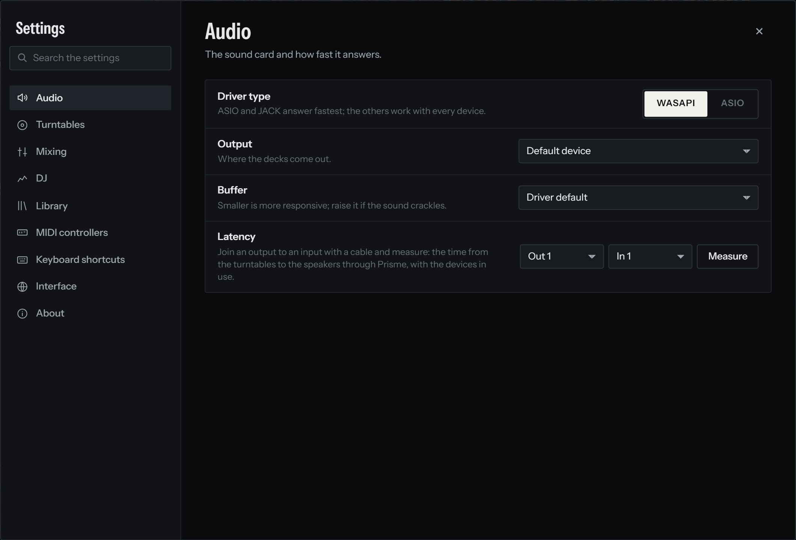

import { Aside } from '@astrojs/starlight/components';

Open **Settings** from the button at the right of the title bar, or with <kbd>Ctrl</kbd>
<kbd>,</kbd> (<kbd>Cmd</kbd> <kbd>,</kbd> on a Mac). The pages are listed on the left;
**Search the settings** above them finds any option by a word of its name or of its
description. The [command palette](/docs/interface/keyboard/) (<kbd>Ctrl</kbd>
<kbd>K</kbd>) finds settings too and opens the window on the right row.

Most settings apply at once. Those that restart the audio (the driver, the devices, the
buffer, the turntable input, the timecode, the simulated turntable and the mixing mode) wait
in a bar at the bottom, **The audio restarts to apply these changes.**, until you press
**Apply**; **Undo** drops them. The window does not close while changes wait: the bar
flashes instead.

Everything you choose is kept for the next start.

## Audio

The sound card and how fast it answers. See [Audio setup](/docs/start/audio/).

| Setting | What it does | Default |
| --- | --- | --- |
| **Driver type** | The audio system Prisme plays through. **ASIO** and **JACK** answer fastest; the others work with every device. Only those your system offers are shown: **WASAPI** and **ASIO** (with an ASIO driver installed) on Windows, **Core Audio** on a Mac, **ALSA** and **JACK** on Linux, **AAudio** and **USB** on Android. | WASAPI on Windows, Core Audio on a Mac, ALSA on Linux, AAudio on Android |
| **Output** | Where the decks come out: a device, with its number of outputs and its sample rate. With ASIO it is the **ASIO driver** (**Default driver** first), with USB the **USB sound card** (**The first plugged in**). | **Default device** |
| **Buffer** | The size of an audio period, in samples and milliseconds, from 32 to 2048 samples among those the driver accepts. Smaller is more responsive; raise it if the sound crackles. | **Driver default** |
| **Latency** | Measures the round trip from an output to an input joined by a cable: the time from the turntables to the speakers through Prisme. Choose **Out** and **In**, press **Measure**. | — |

<Aside type="caution">
**Measure** plays clicks at full level on the chosen output for a few seconds. Unplug
speakers and headphones from it first.
</Aside>

## Turntables

The timecode signal of each record, and how it drives its deck. See
[Setting up timecode vinyl](/docs/dvs/setup/).

| Setting | What it does | Default |
| --- | --- | --- |
| **Input (DVS interface)** | The device the turntables are plugged into. Deck A reads inputs 1-2, deck B inputs 3-4. With ASIO or USB it is a switch, **Turntables plugged into the inputs of this driver**. Unavailable while the simulated turntable is on. | **None** |
| **Control vinyl** | The timecode pressed on your records: **Serato CV02 side A**, **Serato CV02 side B** or **Serato control CD**. One format for every turntable. | Serato CV02 side A |
| **Simulated turntable** | A turntable played by Prisme on deck A, to try vinyl control without one: it plays four seconds, then scratches for two. | Off |

Below them, a panel for each deck (**Turntable A**, **Turntable B**…) shows the signal on a
scope with its **Signal**, **Level**, **Speed** and **Record** readings, and holds the vinyl
settings of that deck. They apply at once:

| Setting | What it does | Default |
| --- | --- | --- |
| **Vinyl control** | The deck follows its record. | Off |
| **REL** / **ABS** | Relative: the record drives the speed only. Absolute: the speed and the position. | ABS |
| **Record speed** | **33** or **45**: the speed the record turns at for the track's own tempo. | 33 |
| **Lead-in (s)** | Where the track starts on the record in absolute mode. Empty: the record's own (28 s on the Serato records at 33 rpm, 20.7 s at 45; 0 on the control CD), shown greyed out. | Empty |
| **Swap left / right** | For crossed left and right cables. | Off |

## Mixing

Your mixer or the one in Prisme, and how it sounds. See [Mixer](/docs/mixer/mixer/).

| Setting | What it does | Default |
| --- | --- | --- |
| **Mixing** | **External mixer: deck A on outputs 1-2, deck B on 3-4**, each deck to its own channel of a hardware mixer; or **Software mixer: master on outputs 1-2**. An external mixer takes one output pair per deck. Waits for **Apply**. | External mixer on a computer, software mixer on a phone |
| **Headphones** | Where the software mixer plays the cued decks: **Automatic**, a pair of outputs (**Outputs 3-4**…), or **No headphones**. Automatic takes outputs 3-4 of a DJ interface, never the surround channels of a computer. With an external mixer, only the track previewed from the library plays there, on a pair no deck uses. The row tells where they are heard now. | Automatic |
| **Booth** | The booth monitors: the master on a pair of its own, at its own level. The headphones' pair is not offered. Shown when the device has a pair to spare. | **No booth** |
| **Microphone** | The input of a microphone, among those the turntables leave free, mixed into the master; its key is beside the crossfader. Heard in the headphones only when cued there. | **None** |
| **Aux line** | A phone, a CD player or a second mixer on a free pair of inputs, mixed into the master. | **None** |
| **Talkover** | While the microphone is on with **TALK**, the music ducks by **−6 dB**, **−12 dB**, **−18 dB** or **−24 dB**. | −18 dB |
| **Crossfader curve** | **SMOOTH** for blending, **SHARP** for scratching (the sound cuts only at the very ends). | SMOOTH |
| **Master limiter** | No clipping on the master, for 1 ms of latency. | On |

More on the inputs in [Microphone and aux inputs](/docs/mixer/inputs/), on the headphones in
[Headphones](/docs/mixer/headphones/).

## DJ

Sync, tempo fader, quantize and auto gain.

| Setting | What it does | Default |
| --- | --- | --- |
| **Sync on a record in relative mode** | What SYNC does when a record drives the deck: **One shot: matches once, the pitch fader keeps working**, or **Locked: follows the leader, the pitch fader is ignored**. See [SYNC on a record](/docs/dvs/modes/#sync-on-a-record). | One shot |
| **Tempo fader range** | The travel of the tempo faders: **±8 %**, **±16 %** or **±50 %**. Sets it for every deck; each deck can then have its own in its options menu. | ±8 % |
| **Quantize** | Cues, loops and jumps land on the beat; stems are cut and brought back on the bar. | On |
| **Decks** | **2** or **4**. With four decks on an interface for two, C shares the outputs and the turntable of A, D those of B: the deck put on **REL** or **ABS** takes the turntable, the other plays on by itself at its record's tempo. Changing it restarts the audio at once. See [Layouts](/docs/interface/layouts/). | 2 |
| **Auto gain** | Every track plays at the same loudness, measured as it loads. | On |
| **Magnetic knobs** | The EQ and filter knobs hold at their middle when turned through it. | On |
| **Headphones on the deck a track is loaded on** | Loading a track puts that deck alone in the headphones, to cue it at once. | Off |
| **Never replace a playing deck** | A track loaded onto a deck that plays is refused with a word, rather than asked about. | Off |
| **Controls on the lock screen** | Android only. Play and pause each deck from the player of the lock screen. Turn it off for a gig: nothing a pocket can press. | On |

## Library

Your music files and what Prisme writes into them. See [Analysis](/docs/library/analysis/)
and [Stems](/docs/sound/stems/).

| Setting | What it does | Default |
| --- | --- | --- |
| **Music folder** | Computer only. Where Prisme finds and analyses your tracks, shown under the name. **Choose…** picks another, scanned at once; the tracks of the one before leave the library, their cues kept for when they come back. **Reset** goes back to the system's. See [Adding your music](/docs/library/adding-music/#choosing-another-folder). | The system's **Music** folder |
| **Write the tempo and key into the tags of the files** | So that Serato, rekordbox and the others find them. | On on a computer, off on a phone |
| **Replace those another program wrote** | A tempo or a key Mixed In Key or another program put in a file is kept unless this is on. Shown while the setting above is on. | Off |
| **Pause the analysis of the library while a deck plays** | The processor and the disk stay with the sound during a set. A track copied meanwhile is analysed once the decks stop, or as it is loaded. | On |
| **Separation** | **Quality**: the large models, the cleanest stems. **Fast**: one small model for every stem, several times faster, for a phone or a computer without a graphics card worth it. | Quality on a computer, Fast on a phone |
| **Vocals separation** | Quality only. The vocals model, downloaded once with its **Download** button (its size shown). A track takes a few seconds with a recent graphics card, a few minutes on the processor alone. | Not installed |
| **Drums and bass separation** | Quality only. Splits the instrumental into drums, bass and melody. Needs the vocals separation first, and takes two to three times as long. | Not installed |
| **Separation into stems** | Fast only. Vocals, drums, bass and melody from one small model, downloaded once. | Not installed |
| **Hardware acceleration** | The graphics chip separates the tracks, many times faster than the processor alone. Unavailable where there is no graphics chip worth it: **No graphics chip worth it here: the processor separates.** | On |
| **Separate the tracks as they are loaded or prepared** | A track loaded on a deck is separated right away, from where it plays; a track put in Prepare, in the background. | On where the graphics chip separates, off otherwise, until you choose |
| **Separate the whole library** | **Separate** queues every track. The stems are stored next to each track in a `.prisme` folder, so they travel with your music. | — |

## MIDI controllers

Map the controls of a controller by moving them. See [Controllers](/docs/controllers/) and
[MIDI learn](/docs/controllers/learn/).

| Setting | What it does | Default |
| --- | --- | --- |
| **Controllers** | Each controller seen, **Plugged in** or **not plugged in**, with a switch to use it. A model Prisme knows reads **Mapped as a…**. **Export as a profile…** writes what it drives now to a profile file, where you choose. A controller whose own profile takes the place of Prisme's says so in yellow. With none: **No MIDI controller plugged in.** and **Refresh**. | Off until switched on |
| **MIDI clock out** | Sends 24 ticks per beat of the sync leader to a MIDI output. | **None** |
| **Controller profiles** | How many models Prisme knows. **Look for updates** fetches the profiles published since, as Prisme does once a day. | — |
| **Your own profiles** | Computer only. **Open the folder** where your own profiles go; **Read again** after changing a file. Lists in yellow the files that replace a profile of Prisme's. | — |

Below, every action is listed with what drives it, and a **Learn** button to map a control
by moving it. See [Profiles](/docs/controllers/profiles/).

## Keyboard shortcuts

Computer only. The actions that have a key, grouped by what they do, with their keys named as
printed on your keyboard. Your keys are kept for the next start; the actions you did not change
keep the keys Prisme gives them. See
[Changing the shortcuts](/docs/interface/keyboard/#changing-the-shortcuts).

| Setting | What it does | Default |
| --- | --- | --- |
| **Your keys** | How many actions have keys of your own. **Reset all** gives every action its key from Prisme again, once you press **Reset every key**. | Prisme's keys |
| **Find any action, to give it a key** | Lists every action whose name or group holds the words typed, with a key or without. | — |
| An action's row | Its keys, or **No key**. Click them, then press a key: the action gets that key. **×** (on the row under the pointer) takes its key off; **↺** gives it Prisme's key again. A key another action has is moved only once you press **Take it**. | — |

## Interface

| Setting | What it does | Default |
| --- | --- | --- |
| **Language** | **English** or **Français**. The whole interface changes at once. | The language of your system: French if it is French, English otherwise |
| **Decks on the screen below** | Computer only. With a screen set under the main one, the library goes above and the decks below, under the fingers. Unavailable without one: **No screen under this one.** | Off |

## About

| Setting | What it does |
| --- | --- |
| **Version** | The version of Prisme. Prisme is free software, under the GNU GPL v3. |
| **Updates** | Prisme looks for a new version at each start; **Check now** looks again. When one is ready, **Install and restart**, also offered in the title bar. Not while a deck plays. |
| **Diagnostic report** | **Save a diagnostic report…** writes versions, audio setup and the end of the log to a text file, to help understand a problem. See [Logs and the diagnostic report](/docs/help/troubleshooting/#logs-and-the-diagnostic-report). |

## Kept elsewhere

Some choices are made outside this window, where you use them, and are kept for the next
start as well:

| Where | What | Default |
| --- | --- | --- |
| Each deck | **KEY LOCK**; in its options menu, fader start and its own tempo fader range; its size for the jumps and the sized loop | Off, off, the general range, 4 beats |
| The sampler | The sound in each slot, and each deck's **VOL** | Empty, 100 % |
| The software mixer | Headphone mix and level, split cue, crossfader reverse, master level, balance, booth level, microphone and aux levels, talkover | Cue only, split off, reverse off, talkover off |
| Auto DJ | The length of a mix | 16 beats, or 10 s between tracks without a beat grid |
| The library | The columns shown | All |

The microphone and aux are off again at each start, as is Auto DJ.
