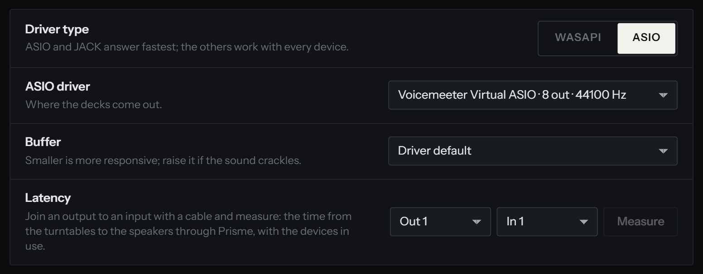

import { Steps, Aside } from '@astrojs/starlight/components';

Prisme plays through one sound card at a time. You choose it, its driver and its buffer in **Settings** > **Audio**; where the decks and the headphones come out is set in **Settings** > **Mixing**. Open the settings with the **Settings** button of the title bar or <kbd>Ctrl</kbd> <kbd>,</kbd> (<kbd>⌘</kbd> <kbd>,</kbd> on a Mac).

## Apply and Undo

Most settings apply at once. Those that restart the audio (the driver, the device, the buffer, the turntable input and the mixing mode) wait in a bar at the bottom of the settings: **The audio restarts to apply these changes.** Press **Apply** to restart the audio with them, or **Undo** to drop them. The settings window does not close while changes wait: the bar flashes instead.

<Aside type="caution">
Applying restarts the audio: the sound cuts for a moment. Do it before your set, not during it.
</Aside>

## Driver type

The **Driver type** row lists the drivers your system offers. ASIO and JACK answer fastest; the others work with every device.

| Driver | System | What it is |
| --- | --- | --- |
| **WASAPI** | Windows | Windows' shared audio. Works with every device and lets other apps play at the same time, with more latency. The default on Windows. |
| **ASIO** | Windows | The sound card's own low-latency driver, installed with the card's software. One driver carries both the outputs and the inputs. |
| **Core Audio** | macOS | The audio of macOS, low latency as it is. |
| **ALSA** | Linux | The sound card itself, or the sound server through its `default` device. The default on Linux. |
| **JACK** | Linux | The JACK server, or PipeWire in its place: low latency, and shared with other audio apps. |
| **AAudio** | Android | Android's audio: the phone itself, or the sound card plugged into it. |
| **USB** | Android | A USB sound card driven by Prisme itself, with all its channels, where Android's audio reaches only some of them. |

Choosing another driver resets the device and the buffer to that driver's defaults.

### Windows: WASAPI or ASIO

With a DJ interface, use **ASIO** if its maker provides an ASIO driver: the latency is lower and the turntable inputs come through the same driver. With ASIO the device row is called **ASIO driver**, and on the **Turntables** page a switch, **Turntables plugged into the inputs of this driver**, uses the inputs of the same card.

With **WASAPI**, the outputs and the turntable input are chosen apart: the **Output** here, the **Input (DVS interface)** on the **Turntables** page. When the output is **Default device**, Prisme follows Windows' default output if you change it.

### Linux: ALSA and JACK

**ALSA** works on every system. Choose **JACK** for the lowest latency, with a JACK server running or with PipeWire and its JACK support (`pipewire-jack` on most distributions).

### Android: AAudio and USB

**AAudio** plays where Android sends the sound: the phone's speaker or headphones, or a USB sound card plugged in. Some cards reach Android with only part of their channels; choose **USB** then, and Prisme drives the card itself. Android asks you to let Prisme open the card. With USB the device row is called **USB sound card**, and **The first plugged in** takes the first card found. See [Phone and tablet](/docs/interface/phone/#usb-sound-cards).

## Output

The **Output** row lists the devices of the chosen driver, each with its number of channels and its sample rate. **Default device** follows the system's.

- **Two outputs** (a laptop, a simple USB card): the decks are mixed by Prisme's software mixer into outputs 1-2.
- **Four outputs or more** (a DJ interface): each deck can go to its own pair of outputs, to a hardware mixer. See [below](#outputs-per-deck-or-software-mixer).

The turntables' inputs are set on the **Turntables** page: deck A reads inputs 1-2, deck B inputs 3-4. See [Setting up vinyl control](/docs/dvs/setup/).

## Buffer

The buffer is how much audio Prisme computes at a time. It sets the delay between a gesture (a hand on the record, a press of CUE) and what you hear.

The **Buffer** row offers **Driver default** and the sizes the device accepts, from 32 to 2048 samples, each with its length in milliseconds at the device's sample rate. At 48 kHz, 256 samples last 5.3 ms.

- **Smaller is more responsive.** Scratching on timecode vinyl wants a small buffer.
- **Raise it if the sound crackles.** A buffer too small for the computer makes dropouts: short gaps heard as clicks.

To find yours, start from **Driver default**, play two decks with stems and effects for a few minutes, and watch the **Dropouts** counter in the title bar. Lower the buffer one step at a time while it stays at zero; go back up one step when it moves.

With JACK, the buffer is the JACK server's: change it in your JACK or PipeWire settings.

## Measure the latency

The **Latency** row measures the real round trip through your sound card, with the devices in use: the time from the turntables to the speakers through Prisme.

<Steps>

1. Join an output of your sound card to an input with a cable.

2. Choose that output in **Out** and that input in **In**, numbered as printed on the card.

3. Press **Measure**. Prisme stops the audio, plays clicks for three seconds, times their return, and starts the audio again. The result shows in milliseconds.

</Steps>

<Aside type="danger">
The clicks play at full level. Unplug your speakers and take off your headphones from that output before you measure, and never measure during a set.
</Aside>

The master limiter of the software mixer adds 1 ms to what you measure. You can turn it off in **Settings** > **Mixing** > **Master limiter**.

## Outputs per deck or software mixer

**Settings** > **Mixing** > **Mixing** decides who mixes:

| Choice | What comes out |
| --- | --- |
| **External mixer: deck A on outputs 1-2, deck B on 3-4** | Each deck on its own pair, to the channels of a hardware mixer. The screen shows no mixer, only the level sent to each deck's outputs, a thin meter beside its letter. The default on a computer. |
| **Software mixer: master on outputs 1-2** | Prisme mixes: a channel per deck with gain, EQ, filter and fader, a crossfader, the master on outputs 1-2 and the headphones on another pair. The default on a phone. |

If you choose the external mixer but the device has too few outputs, the software mixer runs instead, and the title bar says **External mixer needs 4 outputs** when turntables are set up. Changing the mixing mode waits for **Apply**.

With four decks, an interface with a pair of outputs per deck gives each deck its own (C on 5-6, D on 7-8). On an interface with four outputs, C shares the outputs and the turntable of A, and D those of B. See [Layouts and decks](/docs/interface/layouts/#four-decks).

The software mixer itself is described in [The mixer](/docs/mixer/mixer/).

## Headphones

**Settings** > **Mixing** > **Headphones** picks the pair of outputs the headphones play on:

- **Automatic** takes outputs 3-4 of a DJ interface, never the surround channels of a computer.
- **Outputs 3-4**, **Outputs 5-6** and so on put them on a pair of your choice.
- **No headphones** sends them nowhere.

Under the row, Prisme tells where they are heard on the running device (**Now on outputs 3-4.**) or that they are **Not heard on this device.**

With the software mixer, the headphones play the decks you cue and the master, blended or split. With an external mixer, you cue on the hardware mixer: only the preview of a track from the library plays on Prisme's headphones pair, on a pair no deck uses. See [Headphones and preview](/docs/mixer/headphones/).

On an interface with four outputs or more, **Booth** sends the master to the booth monitors on a pair of its own, at its own level.

## The title bar

The left of the title bar tells how the audio is doing, at a glance:

| Chip | Meaning |
| --- | --- |
| Driver · device, green light | The audio runs on this driver and device. |
| **Buffer** 5.3 ms | The length of an audio period, as the driver really runs it. |
| *n* **input ch** | The inputs open for turntables. |
| **simulated turntable** | The simulated turntable plays deck A. |
| **Dropouts** *n* | Periods the engine could not finish in time since the audio started. Amber from the first. |
| **audio stopped** | No audio is running: open **Settings** > **Audio**. |
| **audio device lost, reconnecting…** | The device went away. Prisme starts the audio again as soon as it is back. |
| **audio engine error** | The audio engine failed. Apply the settings again to restart it. |

Next to them, the master level meter: grey up to −6 dB, amber above, its last segment red at full scale.

## Dropouts

A dropout is a period of audio the engine took longer to compute than the period lasts: the sound card got nothing in time, and you may hear a click. Hover the **Dropouts** chip to read the slowest period, in microseconds.

When the counter moves:

<Steps>

1. Raise the buffer one step in **Settings** > **Audio** and apply.

2. Close other heavy apps, and on a laptop plug in the charger: on battery, the processor may slow down.

3. On a computer without a graphics chip worth it, separating stems uses the processor. Separate your tracks before the set, or turn off **Separate the tracks as they are loaded or prepared** in **Settings** > **Library**. See [Stems](/docs/sound/stems/).

4. Keep **Pause the analysis of the library while a deck plays** on, in **Settings** > **Library**, so the analysis of new files waits for the decks to stop.

</Steps>

## When the device goes away

If the sound card is unplugged or stops, Prisme says **audio device lost, reconnecting…** and tries again, at once and then every few seconds. When the card is back, the audio restarts with the decks where they were. If the card was off when Prisme started, the audio starts on the system's default devices and moves to your card as soon as it appears. Meanwhile the sound card chip of the title bar turns orange and says which card is missing (**UMC404HD 192k not found**), so you know at a glance that the sound is not where you expect it.

## Simulated turntable

To try vinyl control without turntables, turn on **Settings** > **Turntables** > **Simulated turntable**: Prisme plays a turntable on deck A, timecode included, and the title bar says **simulated turntable**. The turntable input is disabled meanwhile. See [Setting up vinyl control](/docs/dvs/setup/).
