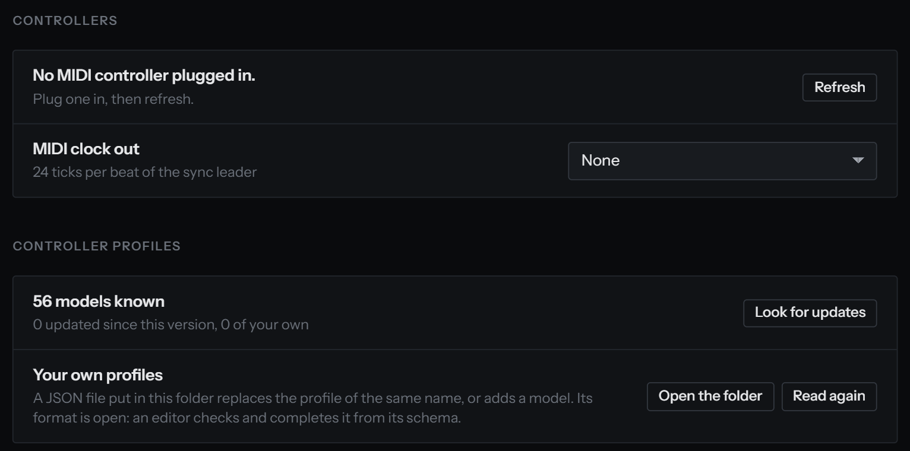

import { Steps, Aside, LinkCard, CardGrid } from '@astrojs/starlight/components';

Prisme se joue avec des contrôleurs DJ MIDI. Pour les [modèles qu’il connaît](/fr/docs/controllers/supported/), les touches, les faders, les jogs, les voyants et les vumètres fonctionnent dès que vous branchez le contrôleur. Tout autre contrôleur MIDI, vous pouvez le mapper vous-même, une commande à la fois, avec le [MIDI learn](/fr/docs/controllers/learn/).

## Brancher un contrôleur

Branchez un contrôleur d’un modèle que Prisme connaît et il joue aussitôt : une notification indique **connecté**, avec **Ne pas l’utiliser** si vous préférez que Prisme le laisse de côté. Un contrôleur déjà branché au démarrage de Prisme est ouvert lui aussi.

Tout autre contrôleur MIDI vous est proposé : une notification indique **Nouveau contrôleur**, avec **Configurer**, qui l’active et ouvre **Contrôleurs** pour [apprendre ses commandes](/fr/docs/controllers/learn/), et **Ignorer**, après quoi il n’est plus proposé (vous pouvez toujours l’activer dans les réglages).

## Activer ou désactiver un contrôleur

<Steps>

1. Branchez le contrôleur et allumez-le.

2. Ouvrez les **Réglages** (<kbd>Ctrl</kbd> <kbd>,</kbd>, ou <kbd>⌘</kbd> <kbd>,</kbd> sur Mac) et choisissez **Contrôleurs**.

3. Sous **Contrôleurs**, trouvez votre contrôleur. Il apparaît sous le nom de son port MIDI (un contrôleur HID sous son nom et ses identifiants USB, `Traktor Kontrol S4 MK2 (HID 17cc:1310)`), avec **Branché** en dessous. Si la liste indique **Aucun contrôleur branché.**, vérifiez le câble et appuyez sur **Actualiser**.

4. Activez l’interrupteur au bout de sa ligne.

   Quand Prisme connaît le modèle, la ligne indique **Reconnu comme** suivi du nom du modèle : le contrôleur est prêt à jouer.

</Steps>

Prisme se souvient des contrôleurs que vous avez activés, et de ceux que vous avez désactivés : il ne reprend jamais ceux-là de lui-même. Il rouvre les autres à chaque démarrage, et si vous en débranchez un en plein mix (un câble arraché, un hub USB qui redémarre), Prisme relâche tout ce que le contrôleur tenait (touches, jog touché), puis le rouvre dès qu’il revient, voyants compris.

## Contrôleurs HID

Certains contrôleurs ne sont pas MIDI mais HID : les Traktor Kontrol de Native Instruments, les anciens Hercules, les CDJ Pioneer en mode HID. Prisme les joue de la même façon, sous Windows, macOS et Linux : celui d’un modèle qu’il connaît s’ouvre dès qu’il est branché, voyants et vumètres compris, et vous pouvez apprendre les commandes de tout autre. Un appareil HID d’un modèle que Prisme ne connaît pas n’est pas proposé quand il est branché, la plupart des appareils HID n’étant pas des contrôleurs : il est rangé sous **Autres appareils HID**.

Les modèles HID que Prisme connaît, marqués **HID** dans [Contrôleurs pris en charge](/fr/docs/controllers/supported/) :

| Marque | Modèles |
| --- | --- |
| Native Instruments | Traktor Kontrol S2 MK1, S2 MK2, S2 MK3, S3, S4 MK2, S4 MK3, F1, Z1 ; Traktor MX2 |
| Hercules | DJ Console Mk1, DJ Console Mk2, DJ Console RMX, DJ Control MP3 |
| Pioneer | CDJ-850, CDJ-900, CDJ-2000, en mode HID |
| EKS | Otus |

Un contrôleur vu à la fois en MIDI et en HID (un Hercules dont le pilote est installé) n’est utilisé que d’une façon : en HID quand Prisme le connaît ainsi et pas en MIDI, en MIDI sinon. Les Hercules DJ Console Mk2 et RMX et les CDJ-850 et CDJ-2000 de Pioneer sont connus des deux façons : ils jouent en MIDI quand leur port est là.

### Ce qu’il faut vérifier sur le vôtre

Aucun profil HID n’a encore été essayé sur le contrôleur lui-même : chacun a été lu dans le mapping de Mixxx et joué sur un contrôleur simulé, qui ne peut pas dire ce que seul le matériel montre. Sur le vôtre, vérifiez :

- qu’il s’ouvre : une notification dit **connecté**. Sinon, fermez tout autre logiciel qui le tient (Traktor, Mixxx), et sous Linux ajoutez la règle udev ci-dessous ;
- le sens des faders de tempo (plus rapide vers vous, comme dans Mixxx), des jog wheels et des encodeurs ;
- les voyants : leur intensité, les touches atténuées, les couleurs des pads ;
- les faders en bout de course, et la vitesse des jog wheels quand vous scratchez.

Une commande ou un voyant qui ne va pas peut être [réappris](/fr/docs/controllers/learn/) sur-le-champ ; dire au projet ce que vous avez trouvé le corrige pour tous ceux qui ont le modèle. Deux modèles sont connus pour être en deçà :

- le **Traktor Kontrol S2 MK1** : le dessus de ses jog wheels est un capteur de pression que Prisme ne lit pas encore, elles recalent donc sans jamais scratcher ;
- le **Hercules DJ Console Mk2** : Mixxx l’atteint en USB d’une façon qui n’est pas du HID, Prisme peut donc ne pas le voir ; avec le pilote d’Hercules installé, il joue en MIDI.

<Aside type="note" title="Linux">
Sous Linux, Prisme doit pouvoir lire et écrire le périphérique `/dev/hidraw` du contrôleur : ajoutez une règle udev qui en donne l’accès à votre utilisateur, comme pour Mixxx.
</Aside>

<Aside type="caution" title="Un seul logiciel par contrôleur">
Sous Windows, un seul logiciel à la fois peut ouvrir un port MIDI. Si un autre logiciel DJ a ouvert le contrôleur, Prisme l’attend : une notification indique que le contrôleur **est utilisé par un autre logiciel**, et dès que vous fermez ce logiciel, Prisme prend le contrôleur et indique qu’il est **connecté**.
</Aside>

## Comment Prisme reconnaît un modèle

Chaque modèle que Prisme connaît a un profil, qui liste les noms sous lesquels son port MIDI se présente. Quand le nom d’un port contient l’un d’eux (majuscules et minuscules confondues), ce profil mappe le contrôleur. Quand plusieurs modèles correspondent, le nom le plus long l’emporte : une DDJ-SB2 n’est donc jamais prise pour une DDJ-SB. Un contrôleur HID est reconnu à ses identifiants USB, quel que soit le nom que lui donne votre système.

À côté du nom du contrôleur, un badge dit si son profil a été essayé sur le contrôleur lui-même : **Vérifié**, ou **Non vérifié** pour un profil que personne n’a encore joué sur le matériel. Un profil à vous n’affiche ni l’un ni l’autre. Sous le nom, les réglages vous disent ce que Prisme en a compris :

| Ligne | Signification |
| --- | --- |
| **Reconnu comme Pioneer DDJ-SB2 : apprenez une commande pour la changer** | Un profil le mappe. Apprendre une commande remplace ce que le profil donnait à cette commande. |
| **Converti depuis le mapping de Mixxx, pas encore essayé sur ce contrôleur** | Le profil a été converti depuis un mapping de Mixxx et personne ne l’a encore essayé sur le matériel. Il devrait fonctionner, mais attendez-vous à une commande ou un voyant décalé ici ou là. Voir [Contrôleurs pris en charge](/fr/docs/controllers/supported/). |
| **Avec votre propre profil** | Le profil vient de votre dossier de données, pas de Prisme. Voir [MIDI learn et votre propre profil](/fr/docs/controllers/learn/#un-profil-à-vous). |
| **Votre propre profil remplace celui que Prisme donne au Pioneer DDJ-SB2 : les corrections publiées pour lui n’atteignent plus ce contrôleur.** | En jaune : votre propre profil sert là où Prisme a le sien pour ce modèle, dont les mises à jour sont donc mises de côté. Supprimez votre fichier pour retrouver celui de Prisme. |
| Pas de ligne « Reconnu comme » | Prisme ne connaît pas le modèle. Rien n’est encore mappé : mappez-le commande par commande avec le [MIDI learn](/fr/docs/controllers/learn/). |

### Variantes

Quelques modèles existent en versions que leur port ne distingue pas : un autre firmware, une édition vendue avec un autre logiciel. Le Vestax VCI-100, son mod Hile et son édition MixVibes 3DEX se présentent tous comme **VCI-100**. Prisme mappe un tel contrôleur comme le modèle lui-même, et propose les autres dans un menu sous **Reconnu comme…**, avec **D’autres profils conviennent à ce contrôleur : un firmware ou une édition à part**. Choisissez celui qu’est votre contrôleur : il joue aussitôt avec ce profil, et Prisme garde ce choix pour ce contrôleur, à chaque démarrage. Le Behringer CMD DV-1 en a une aussi : **Behringer CMD DV-1 (MIDI channel 1)**, pour un DV-1 réglé pour envoyer sur le canal 1.

## Ce que fait le contrôleur

### Touches, faders et potards

Chaque commande pilote une des actions de Prisme : les mêmes que celles du clavier et de la palette de commandes. La [référence des actions](/fr/docs/controllers/actions/) les liste toutes.

Les faders et les potards des contrôleurs reprennent le réglage en douceur. Si vous avez bougé le volume à l’écran, le fader du contrôleur ne fait rien tant qu’il n’a pas atteint la valeur affichée, puis prend la main à partir de là : le son ne saute jamais. Si un fader semble mort, faites-le passer par la valeur affichée à l’écran.

Beaucoup de profils donnent aux commandes une seconde fonction tant que la touche Shift du contrôleur est maintenue, et donnent aux pads plusieurs pages (hot cues, boucles, rolls, sampler…) choisies avec les touches de mode du contrôleur, comme elles y sont sérigraphiées.

Quand une touche du contrôleur demande ce que Prisme vous fait confirmer (un morceau chargé sur un deck qui joue, les platines à allumer), la même touche pressée de nouveau répond oui, comme le bouton principal de la question. Une touche visant `general.close` (sur le Behringer CMD DV-1, ERASE pressée et relâchée seule) répond non, et ferme ce qui est ouvert comme Échap au clavier. La question montre ces touches, sous leur nom quand le profil le donne : **STORE : Charger · ERASE : Annuler**.

### Jogs

- Toucher le dessus d’un jog et le tourner scratche le morceau.
- Le tourner par la tranche pousse un morceau en lecture, pour le recaler, et fait avancer dans un morceau à l’arrêt.
- Certains profils parcourent le morceau au jog tant que Shift est maintenu : dix secondes de morceau par tour.
- Un deck en [contrôle vinyle](/fr/docs/dvs/) suit son disque : son jog ne fait alors rien.

L’action de deck **Jog : un toucher scratche, ou pousse seulement** active ou coupe le scratch au toucher, deck par deck. Elle est activée par défaut.

Un contrôleur n’attend jamais l’interface : Prisme exécute chaque commande à mesure que son message arrive, même fenêtre cachée, et transmet les jogs et les faders de pitch au moteur audio avec l’heure d’arrivée de chaque message, pour qu’un scratch suive votre main.

### Voyants

Les voyants montrent l’état de ce qu’ils pilotent : play allumé pendant que le deck joue, sync tant qu’il est synchronisé, une touche de boucle pendant que sa boucle tourne. En plus d’allumé et éteint, certaines touches ont leurs propres états :

- la touche cue s’allume au point de cue et montre un autre état quand le deck est arrêté ailleurs ;
- les pads du sampler et les touches de chargement distinguent vide, chargé et en lecture ;
- sur les pads en couleur, les hot cues s’allument de leur propre couleur ;
- certaines touches s’allument tant que vous les tenez.

Chaque profil choisit les valeurs que veut son modèle, clignotement compris. Un contrôleur désactivé dans Prisme, ou Prisme qui se ferme, éteint ses voyants.

### Vumètres

Les modèles équipés de vumètres affichent le niveau de chaque deck, ou du master, sur leurs LED. Quand le profil en prévoit une, une LED de saturation s’allume une seconde quand le niveau atteint la pleine échelle.

### Écrans et anneaux

Certains modèles affichent des valeurs sur leurs écrans : le tempo, le temps écoulé ou restant, la variation de tempo. Les anneaux lumineux autour des jogs montrent le disque qui tourne, comme un disque à 33⅓ ; d’autres montrent où en est le morceau, ou la position d’un potard. [Contrôleurs pris en charge](/fr/docs/controllers/supported/) indique quels modèles font quoi.

### Quatre decks

Un contrôleur à quatre decks (ou avec un sélecteur de deck) ne pilote les decks C et D que quand Prisme affiche quatre decks. Avec deux decks affichés, les commandes des decks C et D ne font rien.

## Des profils toujours à jour

Entre deux versions de Prisme, des profils sont corrigés et de nouveaux modèles ajoutés. Prisme les récupère tout seul depuis son dépôt GitHub, sans nouvelle version :

- une fois par jour au plus, vingt secondes après son démarrage ;
- seulement les profils modifiés depuis votre version, et seulement ceux écrits dans un format que votre version sait lire ;
- un profil abîmé en route est mis de côté, et celui livré avec votre version reste.

Les profils récupérés pilotent aussitôt leurs contrôleurs. Pour vérifier tout de suite, appuyez sur **Chercher des mises à jour** sous **Profils de contrôleurs** : il indique **Les profils sont à jour.** ou combien de profils ont été mis à jour.

<Aside>
Votre propre profil l’emporte toujours sur celui de Prisme pour le même modèle : dès que vous avez [votre propre profil](/fr/docs/controllers/learn/#un-profil-à-vous) pour un modèle, les mises à jour de ce modèle ne vous parviennent plus, et les réglages le disent en jaune. Les commandes que vous apprenez n’ont pas cet effet : elles restent posées par-dessus le profil de Prisme à mesure qu’il est mis à jour.
</Aside>

## Les réglages Contrôleurs

**Réglages** › **Contrôleurs** regroupe tout ce qui concerne les contrôleurs, en quatre parties.

### Contrôleurs

| Élément | Ce qu’il fait |
| --- | --- |
| La ligne d’un contrôleur | Le nom de son port, **Branché** ou **non branché** (un contrôleur que vous avez activé mais qui n’est pas là en ce moment), et ce que Prisme a reconnu. |
| Interrupteur | Active le contrôleur dans Prisme, ou le désactive. |
| **Exporter en profil…** | Affiché pour un contrôleur activé et branché : écrit ce qu’il pilote maintenant dans un fichier de profil, là où vous le choisissez, à partager ou garder. Ce qu’il pilote ne change pas. Voir [Exporter en profil](/fr/docs/controllers/learn/#exporter-en-profil). |
| **Actualiser** | Affiché quand aucun contrôleur n’est listé : cherche à nouveau les contrôleurs. |
| **Autres appareils HID** | Les appareils HID des modèles que Prisme ne connaît pas, repliés : la plupart ne sont pas des contrôleurs. Activez-en un pour apprendre ses commandes. |
| **Horloge MIDI en sortie** | Envoie une horloge MIDI, 24 impulsions par temps du leader de sync, vers la sortie MIDI de votre choix, pour qu’une boîte à rythmes ou un séquenceur joue avec vous. **Aucune** n’envoie rien. Elle démarre sur un temps et s’arrête quand le leader s’arrête. Voir [Sync](/fr/docs/decks/sync/). |

### Profils de contrôleurs

| Élément | Ce qu’il fait |
| --- | --- |
| **… modèles connus** | Combien de modèles Prisme connaît maintenant, dont combien **mis à jour depuis cette version** et combien **à vous**. |
| **Chercher des mises à jour** | Récupère les profils publiés depuis, comme Prisme le fait une fois par jour. |
| **Vos propres profils** | **Ouvrir le dossier** montre le dossier de vos propres profils ; **Relire** le relit après que vous avez modifié un fichier. Un fichier que Prisme ne sait pas lire est listé ici en rouge, avec la raison ; un fichier qui remplace un profil de Prisme du même nom, en jaune (`pioneer-ddj-400.json remplace le profil que Prisme donne au Pioneer DDJ-400`). Absent sur téléphone. |

### La liste des actions

En dessous, toutes les actions qu’une commande peut piloter, par groupe, avec l’endroit où elles sont mappées en ce moment (le contrôleur, puis la commande : `DDJ-SB2 · Note 11 · ch 1`). **Apprendre** y mappe une commande, et le **×** après un contrôleur la retire de ce contrôleur seul. Pour un encodeur, un menu choisit comment il envoie ses pas. **Chercher n’importe quelle action, pour l’associer**, au-dessus de la liste, ne garde que les actions dont le nom, le groupe ou l’id contient chaque mot tapé, y compris celles des decks C et D quand deux decks sont affichés ; <kbd>Esc</kbd> la vide. Tout cela est expliqué dans [MIDI learn et votre propre profil](/fr/docs/controllers/learn/).

## Pour continuer

<CardGrid>
	<LinkCard title="Contrôleurs pris en charge" href="/fr/docs/controllers/supported/" description="Tous les modèles mappés d’origine." />
	<LinkCard title="MIDI learn et votre propre profil" href="/fr/docs/controllers/learn/" description="Mapper une commande, changer un mapping, le partager." />
</CardGrid>
