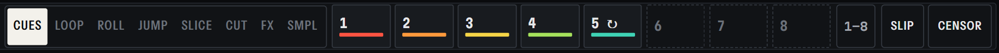

import { Steps, Aside } from '@astrojs/starlight/components';

Un morceau a un point de cue principal, où **CUE** le ramène, et jusqu’à 16 hot cues que vous
rejoignez d’un pad. Tous sont enregistrés avec le morceau dans votre bibliothèque : vous les
retrouvez au prochain chargement, sur n’importe quel deck.

## Le cue principal

**CUE** pose et joue le point de cue principal comme sur un CDJ :

| Quand vous appuyez sur CUE | Ce qui se passe |
| --- | --- |
| Le deck joue | Il revient au point de cue et s’arrête |
| Le deck est arrêté sur le point de cue | Il joue tant que vous maintenez **CUE**, et revient au point de cue quand vous relâchez |
| Le deck est arrêté ailleurs | Le point de cue se place là |

Un morceau sans point de cue part de son début. Avec le [quantize](/fr/docs/decks/sync/#quantize)
activé, un nouveau point de cue tombe sur le temps le plus proche et le deck s’y place. Sur la forme
d’onde, le cue principal est une ligne avec un drapeau marqué **C**.

Les touches sont <kbd>A</kbd> pour le deck A et <kbd>J</kbd> pour le deck B. Quand un disque pilote
le deck, la touche **CUE** n’est pas affichée : c’est la platine qui fait le transport. Voir
[Lire un morceau](/fr/docs/decks/playing/#lecture-pause-et-cue).

### Actions de cue pour les contrôleurs

**CUE** n’a qu’un seul comportement, celui du CDJ. Pour d’autres habitudes, ces actions peuvent être
assignées sur un contrôleur ou lancées depuis la palette de commandes :

| Action | Ce qu’elle fait |
| --- | --- |
| **Cue (maintenir pour pré-écouter)** | La touche **CUE** elle-même |
| **Au cue et lecture** | Va au point de cue et joue |
| **Au cue, à l’arrêt** | Va au point de cue et s’arrête |
| **Au cue** | Va au point de cue, en lecture ou non comme avant |
| **Le cue ici** | Pose le point de cue là où est le deck, sans l’arrêter |

Le voyant **CUE** d’un contrôleur montre où en est le deck, comme sur un CDJ : allumé quand le deck
est posé sur son point de cue, dans un autre état quand il est arrêté ailleurs (là où un appui
poserait le cue), et éteint pendant la lecture.

## Hot cues

Les hot cues se trouvent sur les pads, dans le mode **CUES**, celui avec lequel les pads démarrent.
Il y en a 16 par morceau, sur deux pages de huit : la touche après les pads, **1–8** ou **9–16**,
indique la page affichée et bascule sur l’autre.

Un pad vide est en pointillés et affiche son numéro. Un pad qui porte un hot cue affiche son numéro,
ou le nom du cue s’il en a un, au-dessus d’une barre de sa couleur.

| Pour | Faites ceci |
| --- | --- |
| Poser un hot cue | Cliquez sur un pad vide : le hot cue se pose là où est le deck |
| Le rejoindre | Cliquez sur son pad |
| L’effacer | <kbd>Shift</kbd>-clic sur son pad, ou clic droit |

Un saut laisse le deck tel qu’il était : un deck qui joue continue depuis le hot cue, un deck à
l’arrêt y attend. Avec le quantize activé, un hot cue posé tombe sur le temps le plus proche, et un
saut pendant la lecture garde le temps : le deck retombe au même endroit du temps qu’il a quitté,
et le mix reste en place.

Sur la forme d’onde, chaque hot cue est une ligne avec un drapeau numéroté de sa couleur ; sur la
vue d’ensemble, un petit trait.

### Au clavier

Le clavier atteint la première page de hot cues. Une touche sur un hot cue vide le pose ; sur un
hot cue déjà posé, elle y saute.

| Hot cue | 1 | 2 | 3 | 4 | 5 | 6 | 7 | 8 |
| --- | --- | --- | --- | --- | --- | --- | --- | --- |
| Deck A | <kbd>1</kbd> | <kbd>2</kbd> | <kbd>3</kbd> | <kbd>4</kbd> | <kbd>Q</kbd> | <kbd>W</kbd> | <kbd>E</kbd> | <kbd>R</kbd> |
| Deck B | <kbd>7</kbd> | <kbd>8</kbd> | <kbd>9</kbd> | <kbd>0</kbd> | <kbd>U</kbd> | <kbd>I</kbd> | <kbd>O</kbd> | <kbd>P</kbd> |

Les touches sont nommées comme sur un clavier QWERTY américain ; sur une autre disposition,
utilisez les touches aux mêmes endroits. Pour effacer un hot cue, il faut la souris ou un
contrôleur.

Sur un contrôleur, les 16 peuvent être assignés (**Hot cue 1** à **Hot cue 16**, et
**Effacer le hot cue 1** à **Effacer le hot cue 16**). Voir [Actions](/fr/docs/controllers/actions/).

### Boucles enregistrées

Un hot cue posé pendant qu’une boucle joue enregistre la boucle au lieu d’un point. Son pad affiche
**↻** après son numéro. Un appui ramène la boucle et la joue depuis son début. Pour enregistrer une
boucle :

<Steps>

1. Posez une boucle et laissez-la jouer (voir [Boucles, rolls et sauts](/fr/docs/decks/loops/)).
2. Cliquez sur un pad de hot cue vide pendant qu’elle tourne.
3. Plus tard, appuyez sur ce pad pour sauter dans la boucle, où que soit le deck.

</Steps>

## Couleurs

Chaque hot cue prend la couleur de son emplacement, dans l’ordre habituel des DJ :

| Hot cue | 1 et 9 | 2 et 10 | 3 et 11 | 4 et 12 | 5 et 13 | 6 et 14 | 7 et 15 | 8 et 16 |
| --- | --- | --- | --- | --- | --- | --- | --- | --- |
| Couleur | Rouge | Orange | Jaune | Vert | Turquoise | Bleu | Violet | Rose |

La seconde page reprend les couleurs de la première. Un contrôleur à pads de couleur affiche chaque
hot cue dans la couleur la plus proche dont il dispose.

## Cues de rekordbox et Serato

Quand vous importez une bibliothèque rekordbox ou Serato, les cues arrivent avec les morceaux :
chaque hot cue va dans son propre emplacement s’il est libre, avec sa couleur et son nom, que le
pad affiche. Un memory cue devient le cue principal si le morceau n’en a pas, et une boucle
enregistrée sans emplacement prend le premier hot cue libre. Les cues posés dans Prisme ne sont
jamais remplacés, et un cue déjà présent au même endroit n’est pas ajouté deux fois. Voir
[Importer depuis d’autres logiciels](/fr/docs/library/import/).

<Aside type="note">
Les hot cues demandent un morceau que le deck peut déplacer : avec un disque en mode absolu, où le
disque décide de la position, les pads du mode **CUES** sont grisés. Le mode relatif et la lecture
interne les ont tous.
</Aside>
