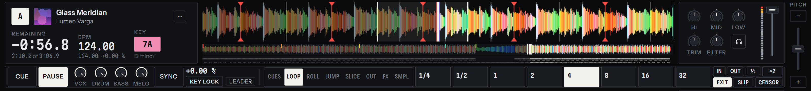

import { Steps, Aside } from '@astrojs/starlight/components';

Les boucles, les rolls et les sauts de temps se comptent en temps, sur la grille rythmique du
morceau : un morceau sans grille n’a ni boucles automatiques, ni rolls, ni sauts (vérifiez-la dans
[Analyse](/fr/docs/library/analysis/)). Tout se trouve sur les pads, dans les modes **LOOP**,
**ROLL** et **JUMP**, avec les touches propres à chaque mode à droite des pads.

Avec un disque en mode absolu, c’est le disque qui décide de la position dans le morceau : les pads
de ces modes sont grisés. En mode relatif et en lecture interne, tout ce qui suit fonctionne.

## Boucles automatiques

Dans le mode **LOOP**, chaque pad pose une boucle d’un certain nombre de temps à partir de
l’endroit où joue le deck :

| Pad | 1 | 2 | 3 | 4 | 5 | 6 | 7 | 8 |
| --- | --- | --- | --- | --- | --- | --- | --- | --- |
| Temps | 1/4 | 1/2 | 1 | 2 | 4 | 8 | 16 | 32 |

Le pad de la boucle en cours s’allume. Appuyez de nouveau dessus pour sortir de la boucle ; appuyez
sur un autre pad pour lancer une boucle de cette longueur là où est le deck.

Avec le [quantize](/fr/docs/decks/sync/#quantize) activé, la boucle démarre sur le temps le plus
proche (une boucle plus courte qu’un temps, sur le pas le plus proche de sa propre longueur), et
reste ainsi en place. Sans lui, la boucle démarre exactement là où vous appuyez.

Sur la forme d’onde, la boucle en cours est une bande de lumière entre deux lignes. Une boucle dont
vous êtes sorti reste en mémoire, affichée par deux lignes atténuées, jusqu’à ce que vous en posiez
une autre.

| Touche | Deck A | Deck B |
| --- | --- | --- |
| Une boucle de 4 temps, ou sortie de la boucle en cours | <kbd>F</kbd> | <kbd>H</kbd> |
| Diviser la boucle par deux | <kbd>C</kbd> | <kbd>,</kbd> |
| Doubler la boucle | <kbd>V</kbd> | <kbd>.</kbd> |

Les touches sont nommées comme sur un clavier QWERTY américain ; sur une autre disposition,
utilisez les touches aux mêmes endroits. Les decks C et D prennent les touches de A et B avec
<kbd>Shift</kbd> enfoncée.

## Les touches de boucle

Dans les modes **LOOP** et **ROLL**, les touches à côté des pads sont :

| Touche | Ce qu’elle fait |
| --- | --- |
| **IN** | Marque le début de la prochaine boucle. Elle reste allumée jusqu’à ce que vous appuyiez sur **OUT**. |
| **OUT** | Termine la boucle là où est le deck et la joue, depuis **IN**. Sans **IN**, elle déplace ici la fin de la boucle en mémoire. |
| **½** / **×2** | Divise la boucle par deux ou la double, en gardant son début. Fonctionne aussi sur une boucle en mémoire. |
| **RELOOP** | Réactive la boucle en mémoire. Si le deck a dépassé sa fin, il revient à son début. |
| **EXIT** | Prend la place de **RELOOP** pendant qu’une boucle joue : en sort, et le morceau continue. |

Avec le quantize activé, **IN** et **OUT** tombent sur le temps le plus proche. Quand **OUT** tombe
sur un temps que le deck vient de dépasser, le deck revient dans la boucle au même endroit du
temps, pour que la boucle démarre en place.

Dans les autres modes de pads, une touche **EXIT** apparaît dès qu’une boucle joue, pour que vous
puissiez toujours en sortir.

### Une boucle manuelle

<Steps>

1. Choisissez le mode **LOOP** sur les pads.
2. Appuyez sur **IN** là où la boucle doit commencer : la touche s’allume et une ligne marque
   l’endroit.
3. Appuyez sur **OUT** là où elle doit finir : la boucle joue aussitôt.
4. Ajustez-la avec **½** et **×2**, ou appuyez sur **EXIT** pour reprendre le morceau.
5. Appuyez plus tard sur **RELOOP** pour la rejouer.

</Steps>

Pour garder une boucle avec le morceau, posez un hot cue pendant qu’elle joue : voir
[Boucles enregistrées](/fr/docs/decks/cues/#boucles-enregistrées).

## Boucles et slip

Avec **SLIP** activé, le morceau continue en dessous pendant que la boucle joue : quand vous sortez
de la boucle, le deck retombe là où le morceau en serait, comme si la boucle n’avait jamais eu
lieu. Sans lui, le morceau reprend depuis la fin de la boucle. Voir
[Slip](/fr/docs/decks/performance/#slip).

## Loop rolls

Un roll est une courte boucle qui ne joue que tant que vous maintenez son pad, le morceau
continuant en dessous. Relâchez, et le deck retombe là où il en serait. Les rolls fonctionnent
toujours ainsi, que **SLIP** soit activé ou non. Dans le mode **ROLL** :

| Pad | 1 | 2 | 3 | 4 | 5 | 6 | 7 | 8 |
| --- | --- | --- | --- | --- | --- | --- | --- | --- |
| Temps | 1/16 | 1/8 | 1/4 | 1/2 | 1 | 2 | 4 | 8 |

Avec le quantize activé, le roll démarre sur la grille, comme une boucle automatique. Les rolls
courts (1/16 à 1/4) font des stutters et des montées ; les plus longs répètent une phrase.

<Aside type="caution">
Maintenez un seul pad de roll à la fois : un second pad pressé pendant un roll est ignoré, et
relâcher n’importe quel pad de roll met fin au roll.
</Aside>

## Sauts de temps

Dans le mode **JUMP**, chaque pad déplace le deck d’un certain nombre de temps, en arrière ou en
avant :

| Pad | 1 | 2 | 3 | 4 | 5 | 6 | 7 | 8 |
| --- | --- | --- | --- | --- | --- | --- | --- | --- |
| Temps | -32 | -16 | -4 | -1 | 1 | 4 | 16 | 32 |

Un saut se fait en temps entiers, le deck reste donc en place. Si une boucle joue autour du deck,
elle se déplace avec le saut : une boucle de 4 temps qui saute de 4 temps en avant boucle les 4
temps suivants.

## La taille de chaque deck

Chaque deck garde une taille, en temps : 4 au démarrage de Prisme, de 1/16 à 64. C’est la longueur
des sauts et de la boucle qu’utilisent les actions de contrôleur ci-dessous. Dans le mode **JUMP**,
les touches à côté des pads l’affichent, avec **½** et **×2** pour la diviser par deux ou la
doubler. Les pads de boucle et de saut de cette taille portent une barre dans la lumière, pour voir
lesquels lui correspondent.

| Action | Ce qu’elle fait |
| --- | --- |
| **Saut arrière de la taille**, **Saut avant de la taille** | Saute de la taille du deck |
| **Boucle de la taille / sortie** | Une boucle de la taille du deck, ou sortie de la boucle en cours |
| **Diviser la taille par deux**, **Doubler la taille** | Change la taille |
| **Taille des sauts et de la boucle (un cran la divise ou la double)** | La même chose sur un bouton rotatif |

Ces actions sont faites pour un contrôleur (voir [Actions](/fr/docs/controllers/actions/)) ; celles
qui sont des boutons se trouvent aussi dans la palette de commandes. Les profils de contrôleurs
peuvent aussi désigner directement une boucle, un roll ou un saut de n’importe quel nombre de temps.

## Autres actions de boucle pour les contrôleurs

| Action | Ce qu’elle fait |
| --- | --- |
| **Loop in**, **Loop out**, **Reloop** | Comme **IN**, **OUT** et **RELOOP** |
| **Diviser la boucle par deux**, **Doubler la boucle** | Comme **½** et **×2** |
| **Boucle un temps en arrière**, **Boucle un temps en avant**, **Boucle déplacée, un temps par cran** | Déplacent la boucle par temps entiers |
| **Au début de la boucle**, **À la fin de la boucle** | Placent le deck à l’une ou l’autre extrémité de la boucle en mémoire |
| **Retour à la boucle, à l’arrêt** | Réactive la boucle en mémoire et s’arrête à son début |
| **Oublier la boucle** | Supprime la boucle en mémoire |
| **Boucle de 4 temps / sortie** | Comme <kbd>F</kbd> et <kbd>H</kbd> au clavier |
