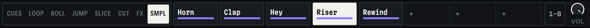

import { Steps, Aside } from '@astrojs/starlight/components';

Chaque deck a son propre sampler : 16 emplacements pour des sons courts (une sirène, un cri, un
drop), joués aux pads dans le mode **SMPL**. Les sons passent par la voie du deck : son EQ, son
fader, ses coupures au fader et ses effets (quand ils portent sur tout le deck plutôt que sur un
stem) les façonnent aussi. Ils fonctionnent sur un deck sans morceau chargé.

## Charger un son

<Steps>

1. Sur les pads du deck, choisissez le mode **SMPL**.
2. Cliquez sur un pad vide, marqué **+** : une fenêtre s’ouvre pour choisir un son.
3. Choisissez un fichier audio (MP3, FLAC, WAV, AIFF, M4A, AAC, MP4 ou OGG). Le pad affiche le nom
   du fichier.

</Steps>

Un son dure 30 secondes au plus : un fichier plus long est refusé avec
**Un son du sampler dure 30 s au plus : chargez les fichiers plus longs sur un deck**.

Les 16 emplacements sont sur deux pages de huit : la touche après les pads, **1–8** ou **9–16**,
change de page. Prisme retient les sons de chaque emplacement et les recharge au prochain démarrage
(laissez les fichiers où ils sont).

## Jouer un son

| Pour | Faites ceci |
| --- | --- |
| Jouer un son | Cliquez sur son pad : il joue depuis son début, une fois, jusqu’à sa fin |
| Le rejouer depuis le début | Cliquez de nouveau sur son pad pendant qu’il joue |
| L’arrêter | Clic droit sur son pad pendant qu’il joue |
| Le retirer de son pad | Clic droit dessus quand il est silencieux, ou <kbd>Shift</kbd>-clic |

Un pad s’allume pendant que son son joue, et plusieurs sons peuvent jouer en même temps. Avec le
[quantize](/fr/docs/decks/sync/#quantize) activé et le deck en lecture sur une grille rythmique, un
son attend le prochain temps du deck, pour tomber en place. Sinon, il part tout de suite.

Les sons jouent à leur propre hauteur et à leur propre vitesse : le tempo du deck et **KEY LOCK** ne
les changent pas.

## Volume

Dans le mode **SMPL**, le bouton **VOL** à côté des pads règle le volume du sampler du deck, du
silence à 100 %. Double-cliquez dessus pour revenir à 100 %. Il agit sur les 16 sons de ce deck, et
est gardé pour le prochain démarrage.

Sur un contrôleur, **Niveau du sampler** règle celui d’un deck, et
**Niveau du sampler de chaque deck** les règle tous à la fois.

<Aside type="caution">
Le sampler joue par la voie de son deck : si le fader de voie de ce deck est fermé, son EQ coupé ou
sa voie coupée, vous n’entendrez pas les sons non plus. Sur une table de mixage externe, ils sortent
par les sorties du deck, sur la voie du deck.
</Aside>

## Pads sensibles à la vélocité

Un contrôleur dont les pads sentent la force de frappe peut jouer le sampler avec cette force. Un
profil assigne un pad au sample « selon la force de frappe » (`deck1.sample3.velocity` joue le
son 3 du deck A) ; voir [Profils de contrôleurs](/fr/docs/controllers/profiles/).

La force règle le niveau du sampler du deck avant que le son ne joue, le même niveau que le bouton
**VOL**. Une frappe douce rend donc aussi plus faibles les sons suivants de ce deck, jusqu’à ce
qu’une frappe plus forte ou le bouton le remonte.

## Smart pads et autres actions pour contrôleur

Sur un contrôleur, chaque emplacement a plusieurs actions, selon les pads dont vous disposez :

| Action | Ce qu’elle fait |
| --- | --- |
| **Sample 1** | Joue le son, depuis son début |
| **Sample 1 tant que c’est appuyé** | Joue le son tant que la touche est tenue, et l’arrête quand vous relâchez |
| **Sample 1 : charger le morceau sélectionné, jouer ou arrêter** | Un smart pad : sur un emplacement vide, il charge le morceau sélectionné dans la bibliothèque ; sur un emplacement chargé, il le joue ; sur un son qui joue, il l’arrête |
| **Arrêter le sample 1** | Arrête le son |
| **Vider l’emplacement de sample 1** | Retire le son de son emplacement |
| **Le morceau sélectionné dans l’emplacement de sample 1** | Charge dans l’emplacement le morceau sélectionné dans la bibliothèque |

Et de même pour les emplacements 2 à 16. Le voyant d’un pad de sampler a trois états : vide, chargé
et en lecture ; les profils donnent sa couleur à chaque état. Voir
[Actions](/fr/docs/controllers/actions/).

<Aside type="tip">
Le smart pad et **Le morceau sélectionné dans l’emplacement de sample 1** chargent le fichier
sélectionné dans la bibliothèque : rangez donc les sons courts dans un bac à part, car un morceau
de plus de 30 secondes est refusé.
</Aside>
