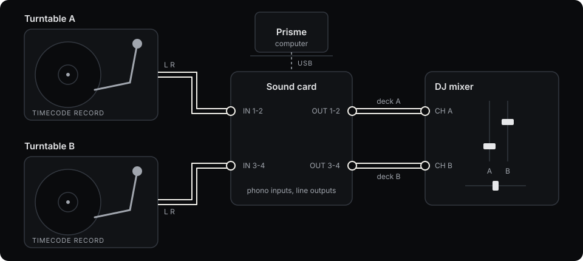

import { Steps, Aside } from '@astrojs/starlight/components';

Mettre en place le contrôle vinyle demande trois choses : des platines branchées sur des
entrées que Prisme entend, le disque de chaque platine choisi dans les réglages, et chaque
deck confié à son disque. La page **Platines** des réglages montre le signal de chaque
platine à mesure qu’il arrive : vous pouvez donc vérifier chaque étape au fur et à mesure.

## Brancher les platines

<Steps>

1. Branchez les câbles gauche et droit de la platine A sur les entrées 1 et 2 de votre carte
   son, et ceux de la platine B sur les entrées 3 et 4. Gardez la gauche sur l’entrée impaire
   et la droite sur l’entrée paire.

2. Vissez le fil de masse de chaque platine sur la borne de masse de l’interface ou de la
   table de mixage. Une masse absente est la première cause de ronflement.

3. Si votre interface a un sélecteur phono/ligne par entrée, mettez-le sur **phono** pour une
   platine vinyle, sur **ligne** pour une platine CD.

4. Branchez les sorties : avec une table de mixage, les sorties 1-2 sur la voie du deck A et
   les 3-4 sur la voie du deck B, chacune réglée sur ligne. Avec la table de mixage logicielle
   de Prisme, les sorties 1-2 vont aux enceintes et les 3-4 au casque.

5. Posez les disques timecode sur les plateaux, ou le CD de contrôle dans les platines CD.

</Steps>

## Phono ou ligne

La cellule d’une platine sort un signal très faible, fait pour passer par un préampli phono.
Prisme ne l’amplifie pas : le timecode doit arriver à la carte son déjà remonté.

- **Interface avec entrées phono** (la plupart des interfaces DJ faites pour le DVS) :
  branchez la platine directement, sélecteur sur phono.
- **Interface avec entrées ligne seulement** : placez un préampli phono entre la platine et
  la carte, ou montez le gain d’entrée d’une carte qui en a un jusqu’à ce que le signal se
  lise bien (voir [Lire le signal](#lire-le-signal)).
- **Platine CD avec le CD de contrôle** : déjà au niveau ligne, sur une entrée ligne.

En dessous d’environ −50 dBFS, Prisme n’entend plus aucun timecode ; trop de gain fait
saturer le signal et le déforme. Visez une barre **Niveau** pleine, sans saturation.

## Choisir la carte son

<Steps>

1. Ouvrez les **Réglages** (<kbd>Ctrl</kbd> <kbd>,</kbd>, ou <kbd>Cmd</kbd> <kbd>,</kbd> sur
   Mac) et allez dans **Audio**. Choisissez le **Type de pilote** et la **Sortie** comme
   expliqué dans [Réglage de l’audio](/fr/docs/start/audio/). ASIO sur Windows, Core Audio
   sur Mac et JACK sur Linux répondent le plus vite, ce qui compte quand on a un disque sous
   la main.

2. Allez dans **Platines**. Sous **Entrée (interface DVS)**, choisissez votre interface. Avec
   ASIO, ou une carte USB pilotée par Prisme sur un téléphone, sorties et entrées ne forment
   qu’un seul périphérique : la ligne s’intitule **Platines branchées sur les entrées de ce
   pilote** et c’est un interrupteur à activer.

3. Une barre apparaît en bas : **L’audio redémarre pour appliquer ces changements.** Appuyez
   sur **Appliquer**. (**Annuler** remet les réglages comme avant.)

</Steps>

Puis, dans le panneau de chaque platine plus bas, choisissez le disque qu’elle joue sous
**Timecode** et **Face** : voir [Le disque de chaque platine](#le-disque-de-chaque-platine).

## Choisir les entrées

Prisme attribue à chaque deck une paire d’entrées fixe ; il n’y a rien à assigner à la main.

| Deck | Entrées |
| --- | --- |
| A | 1-2 |
| B | 3-4 |
| C | 5-6, sur une carte d’au moins huit entrées |
| D | 7-8, sur une carte d’au moins huit entrées |

Avec quatre decks sur une carte qui a moins d’entrées (**Réglages**, **DJ**, **Decks**), le
deck C lit la platine du deck A et le deck D celle du deck B, comme les couches d’un
contrôleur à deux decks. Un seul deck de chaque paire suit la platine à la fois : mettre le
deck C en REL ou ABS prend la platine au deck A, qui lâche le disque et repasse en INT, et
inversement. Le deck qui lâche le disque continue tout seul comme le disque le jouait : à son
tempo, sur lequel se place son fader de tempo, et dans son sens (à l’arrêt si le disque ne
tournait pas).

Les entrées que les platines laissent libres peuvent accueillir un micro ou une ligne aux,
voir [Entrées micro et aux](/fr/docs/mixer/inputs/).

## Lire le signal

**Réglages**, **Platines** affiche un panneau par deck, **Platine A**, **Platine B**, et
ainsi de suite. Chacun a un oscilloscope et quatre indications.

**L’oscilloscope** trace le canal gauche à l’horizontale et le canal droit à la verticale.
Un timecode propre dessine un cercle bien rond pendant que le disque tourne. L’oscilloscope
zoome tout seul pour suivre le niveau : la taille du cercle ne dit donc rien, c’est sa forme
qui compte :

| Ce que vous voyez | Ce que cela veut dire |
| --- | --- |
| Un cercle fin et bien rond | Un signal propre. |
| Un anneau épais ou flou | Du bruit ou du ronflement sur le signal. |
| Une ellipse aplatie ou un trait | Un canal faible ou absent : un câble ou une cellule à vérifier. |
| Un point au milieu | Pas de signal : disque arrêté, diamant levé, ou rien de branché. |

**Signal** indique ce qu’entend le décodeur :

- **verrouillé** : un timecode propre.
- **instable** : le signal a décroché un instant pendant que le disque tournait, un saut de
  diamant par exemple. Prisme maintient la vitesse pendant ce temps.
- **aucun** : pas de signal exploitable.

**Niveau** est la force du timecode. Une barre pleine correspond à ce que donne un timecode
sain au niveau ligne ; une barre qui bouge à peine signifie trop peu de gain.

**Vitesse** est la vitesse du disque comparée à celle qui joue le morceau à son tempo
d’origine : `+1.000×` est la lecture normale, `−1.000×` la même vitesse à l’envers, `+0.000×`
l’arrêt.

**Disque** est l’endroit où se trouve le diamant sur le disque, en minutes et secondes de
musique. Il affiche `—` tant que Prisme n’a pas trouvé la position, ce qui demande un court
passage de lecture propre.

Il n’y a aucun calibrage à lancer. Le décodeur suit le niveau de chaque disque à mesure qu’il
change, apprend comment le signal de votre cellule grandit avec la vitesse, et s’ajuste
pendant que vous jouez.

<Aside type="tip">
Sur la carte d’un deck, le petit voyant avant les boutons de mode montre la même chose d’un
coup d’œil quand le disque pilote le deck : un point plein quand le timecode est verrouillé,
un anneau couleur avertissement quand il est instable, un anneau couleur alerte quand il n’y
en a pas. Survolez-le pour lire le détail.
</Aside>

## Confier un deck à son disque

Un deck joue tout seul (INT) tant que vous ne le confiez pas à sa platine. Sur chaque carte
de deck, à côté du titre du morceau, quatre boutons choisissent qui pilote le deck :

| Bouton | Le deck |
| --- | --- |
| **INT** | joue tout seul, avec son bouton PLAY et son fader de tempo. |
| **REL** | suit la vitesse du disque. |
| **ABS** | suit la vitesse et la position du disque. |
| **THRU** | joue ses entrées telles quelles : un vrai disque, une platine CD. |

Les boutons apparaissent dès que Prisme lit des platines (ou en simule une). Appuyez sur
**REL** ou **ABS** et le deck suit aussitôt le disque ; appuyez sur **INT** pour le
reprendre, et il continue au tempo du disque, dans son sens. Sur un téléphone, le même choix se trouve en haut du panneau du deck, sous
**Deck A · piloté par** : **Lui-même**, **Vinyle REL**, **Vinyle ABS**, **Son entrée**.

Depuis un contrôleur ou le clavier, l’action **Contrôle vinyle** active ou coupe le disque
pour un deck, dans le dernier mode utilisé, et **Passthrough : le deck joue son entrée**
bascule en THRU. Vous les trouverez dans la [palette de commandes](/fr/docs/interface/keyboard/)
ou pouvez les assigner avec le [MIDI learn](/fr/docs/controllers/learn/).

Le choix du mode fait l’objet de [Modes absolu et relatif](/fr/docs/dvs/modes/).

## Les réglages de chaque platine

Le panneau de chaque platine, dans **Réglages**, **Platines**, contient les réglages de son
deck. Ils sont conservés pour le prochain démarrage.

| Réglage | Effet | Par défaut |
| --- | --- | --- |
| **Timecode** | Le disque sur la platine, par marque puis par disque : **Serato** › **Control vinyl CV02** ou **Control CD**. | Control vinyl CV02 |
| **Face** | **A** ou **B**, pour un disque dont les faces portent des timecodes différents. Absent pour le CD. | A |
| **Contrôle vinyle** | Le deck suit son disque. Comme REL ou ABS sur la carte du deck. | Désactivé |
| **REL** / **ABS** | Le mode dans lequel le disque pilote le deck. | ABS |
| **Vitesse du disque** | **33** ou **45** : la vitesse à laquelle tourne le disque quand le morceau joue à son tempo d’origine. | 33 |
| **Amorce (s)** | Où commence le morceau sur le disque, en mode absolu. Vide : celle du disque. | Celle du disque |
| **Inverser gauche / droite** | Les câbles gauche et droit sont croisés : Prisme les remet dans l’ordre. | Désactivé |

### Le disque de chaque platine

Chaque platine lit son propre disque : le deck A peut jouer la face A d’un Control vinyl CV02
pendant que le deck B joue la face B, ou le Control CD dans une platine CD. Sous
**Timecode**, la liste donne les disques par marque ; **Face** suit quand le disque a deux
faces qui diffèrent. Retournez un disque et choisissez son autre face dans son panneau : les
faces portent des bits différents, et un deck réglé sur la mauvaise garde sa vitesse mais ne
trouve jamais sa position.

Le choix s’applique aussitôt, sans couper l’audio, et il est gardé pour le prochain
démarrage. Ce qui dépend du disque le suit : où le morceau commence dessus (l’amorce), où il
finit, et la platine simulée, qui joue le disque du deck A. Changer celui-ci pendant que la
platine simulée est activée redémarre l’audio, les decks là où ils étaient.

Avec quatre decks sur une interface prévue pour deux platines, les decks C et D lisent les
platines de A et B, donc leurs disques : leurs panneaux indiquent **Celui de la platine A**
(ou **B**), et le disque se choisit dans le panneau de A ou de B, pour les deux decks à la
fois. Des disques enregistrés différents pour deux tels decks cèdent, au démarrage de
l’audio, à celui du deck sur le disque (le premier si aucun ne l’est).

Un fichier de réglages d’un Prisme qui n’avait qu’un timecode pour toutes les platines le
donne à chacune.

### Vitesse du disque : 33 ou 45

Choisissez **45** si vous jouez le disque à 45 tours. Le morceau joue alors à son tempo
d’origine avec le plateau à 45, et s’étale sur 35 % de sillon en plus : un contrôle plus fin
sous la main, moins de musique par face (environ 7 minutes sur la face A au lieu de 10). Quand
vous le changez, Prisme réapprend le tempo du plateau.

### Amorce

En mode absolu, le début du morceau se trouve un peu après le bord du disque, pour que vous
puissiez poser le diamant dans les premiers sillons et laisser le morceau démarrer tout seul.
Les disques Serato font commencer le morceau à 28 secondes ; le CD de contrôle tout au début.
Ces 28 secondes sont celles du disque à 33 tours : à 45, les sillons défilent 1,35 fois plus
vite, et le morceau commence après 20,7 secondes de musique. Le champ affiche en grisé la valeur
utilisée à la vitesse de disque choisie. Tapez un autre nombre de secondes pour déplacer le
début du morceau, ou videz le champ pour revenir à celle du disque. Avant ce point, le deck
joue du silence, le morceau attendant à son début.

### Inverser gauche / droite

Si le disque est lu à l’envers alors que le plateau tourne à l’endroit, ses câbles gauche et
droit sont croisés. Prisme s’en aperçoit après environ cinq secondes de lecture continue à
l’envers : le panneau affiche **Le disque est lu à l’envers depuis un moment : si le plateau
tourne à l’endroit, les câbles gauche et droit sont inversés.** avec un bouton **Inverser
gauche / droite**, et le voyant de la carte du deck prévient **Câbles gauche et droit
inversés ? Voir Réglages, Platines**. Croisez les câbles, ou activez l’inversion.

## Vérifier la latence

Le temps qui sépare le plateau des enceintes, c’est ce que vous ressentez quand vous poussez
le disque ou scratchez. Dans **Réglages**, **Audio**, **Latence** le mesure sur votre propre
installation : reliez une sortie à une entrée avec un câble, choisissez-les, et appuyez sur
**Mesurer**. Prisme joue des clics à plein niveau pendant quelques secondes : gardez les
enceintes et le casque à l’écart de cette sortie. Voir
[Dépannage du timecode](/fr/docs/dvs/troubleshooting/#le-disque-répond-en-retard) pour la
faire baisser.
