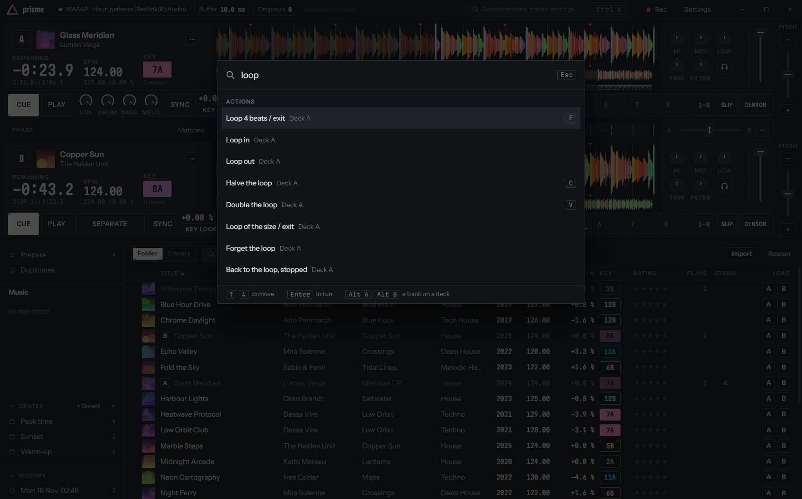

import { Aside } from '@astrojs/starlight/components';

La main gauche joue le deck A, la main droite le deck B, et les flèches parcourent la bibliothèque. Ce qui n’a pas de touche est à quelques lettres, dans la palette de commandes : <kbd>Ctrl</kbd> <kbd>K</kbd>.

Sur Mac, <kbd>⌘</kbd> remplace <kbd>Ctrl</kbd> dans tous les raccourcis de cette page.

## La disposition de votre clavier

Les raccourcis suivent la place des touches, pas les lettres imprimées dessus : les touches du deck A tombent sous la main gauche, quelle que soit la disposition. Les tableaux ci-dessous nomment les touches d’un clavier américain (QWERTY). Sur un clavier français AZERTY, par exemple, la touche de lecture du deck A est celle marquée **S**, et sa touche cue celle marquée **Q**.

**Réglages** > **Raccourcis clavier** liste tous les raccourcis, avec les touches telles qu’elles sont imprimées sur votre clavier. <kbd>F1</kbd> ouvre cette page, et la referme.

## Decks

| Action | Deck A | Deck B |
| --- | --- | --- |
| Hot cues 1 à 4 | <kbd>1</kbd> <kbd>2</kbd> <kbd>3</kbd> <kbd>4</kbd> | <kbd>7</kbd> <kbd>8</kbd> <kbd>9</kbd> <kbd>0</kbd> |
| Hot cues 5 à 8 | <kbd>Q</kbd> <kbd>W</kbd> <kbd>E</kbd> <kbd>R</kbd> | <kbd>U</kbd> <kbd>I</kbd> <kbd>O</kbd> <kbd>P</kbd> |
| Cue (maintenir pour pré-écouter) | <kbd>A</kbd> | <kbd>J</kbd> |
| Lecture / pause | <kbd>S</kbd> | <kbd>K</kbd> |
| Sync | <kbd>D</kbd> | <kbd>L</kbd> |
| Boucle de 4 temps / sortie | <kbd>F</kbd> | <kbd>H</kbd> |
| Diviser la boucle par deux | <kbd>C</kbd> | <kbd>,</kbd> |
| Doubler la boucle | <kbd>V</kbd> | <kbd>.</kbd> |
| Ralentir tant que maintenu | <kbd>Z</kbd> | <kbd>N</kbd> |
| Accélérer tant que maintenu | <kbd>X</kbd> | <kbd>M</kbd> |

- **Touches de hot cue** : un hot cue vide se pose là où joue le deck ; un hot cue déjà posé y fait sauter. Voir [Hot cues](/fr/docs/decks/cues/).
- **Cue** fonctionne comme la touche cue d’un CDJ. Voir [Lire un morceau](/fr/docs/decks/playing/).
- **Sync** cale le deck sur le leader, ou le libère. Voir [Sync et tempo](/fr/docs/decks/sync/).
- **Ralentir** et **Accélérer** infléchissent le tempo tant que vous tenez la touche, pour recaler les temps ; relâchez, le deck revient à son tempo.

Les decks C et D n’ont pas de touches : jouez-les à la souris, avec un contrôleur ou depuis la palette de commandes.

## Bibliothèque

| Action | Touches |
| --- | --- |
| Morceau précédent | <kbd>↑</kbd> |
| Morceau suivant | <kbd>↓</kbd> |
| Charger sur le deck A | <kbd>Shift</kbd> <kbd>←</kbd> |
| Charger sur le deck B | <kbd>Shift</kbd> <kbd>→</kbd> |
| Double instantané sur le deck A | <kbd>Ctrl</kbd> <kbd>Shift</kbd> <kbd>←</kbd> |
| Double instantané sur le deck B | <kbd>Ctrl</kbd> <kbd>Shift</kbd> <kbd>→</kbd> |
| Charger sur un deck libre | <kbd>Enter</kbd> |
| Écouter au casque / arrêter | <kbd>Espace</kbd> |
| Retirer de la crate ou de la préparation | <kbd>Suppr</kbd> |
| Ajouter à la préparation | <kbd>Ctrl</kbd> <kbd>P</kbd> |
| Sélectionner tous les morceaux | <kbd>Ctrl</kbd> <kbd>A</kbd> |
| Vider la sélection | <kbd>Esc</kbd> |
| Chercher | <kbd>Ctrl</kbd> <kbd>F</kbd> |

- **Charger sur un deck libre** prend le premier deck sans morceau, ou le deck A si tous en ont un.
- **Double instantané** charge sur le deck le morceau de l’autre deck de sa paire, au même endroit, en lecture s’il joue.
- **Retirer** sort les morceaux sélectionnés de la crate ou de la liste de préparation où vous êtes. Aucun fichier n’est jamais supprimé.
- Sur un clavier Mac, <kbd>Suppr</kbd> s’obtient avec <kbd>fn</kbd> <kbd>Delete</kbd>.

Voir [Parcourir et chercher](/fr/docs/library/browsing/).

## Général

Ces raccourcis marchent partout, même pendant que vous tapez dans un champ ou avec les réglages ouverts.

| Action | Touches |
| --- | --- |
| Palette de commandes | <kbd>Ctrl</kbd> <kbd>K</kbd> ou <kbd>Ctrl</kbd> <kbd>Shift</kbd> <kbd>P</kbd> |
| Réglages | <kbd>Ctrl</kbd> <kbd>,</kbd> |
| Raccourcis clavier | <kbd>F1</kbd> |

## Le comportement des touches

- **Une touche maintenue ne se répète pas.** Les touches qui agissent tant qu’on les tient (cue, les ralentis et accélérations) s’arrêtent quand vous les relâchez, ou quand la fenêtre perd le focus.
- **Pendant que vous tapez** dans une recherche ou n’importe quel champ, les touches des decks et de la bibliothèque écrivent du texte.
- **Quand les réglages ou la palette sont ouverts**, les touches des decks et de la bibliothèque attendent. Fermez-les avec <kbd>Esc</kbd>.
- **Dans la recherche de la bibliothèque**, <kbd>Esc</kbd> quitte le champ, et les touches jouent à nouveau.
- **Dans la recherche des réglages**, <kbd>Esc</kbd> vide d’abord la recherche, puis ferme les réglages.

## Palette de commandes

La palette trouve n’importe quelle action, réglage, crate ou morceau en quelques mots, et le lance.

Ouvrez-la avec <kbd>Ctrl</kbd> <kbd>K</kbd>, <kbd>Ctrl</kbd> <kbd>Shift</kbd> <kbd>P</kbd>, ou le champ de recherche au milieu de la barre de titre. Puis tapez. Elle trouve :

| Section | Ce qu’elle contient | En la lançant |
| --- | --- | --- |
| **Actions** | Toutes les actions qui se font d’une pression, pour les decks utilisés, la table de mixage, la bibliothèque et le reste, avec leur touche quand elles en ont une | L’action est faite, une fois |
| **Réglages** | Chaque page des réglages, et chaque réglage | Les réglages s’ouvrent dessus, le réglage mis en évidence |
| **Crates** | Vos crates, avec leur nombre de morceaux | La crate s’ouvre dans la bibliothèque |
| **Morceaux** | Les morceaux de toute la bibliothèque, dès deux lettres tapées, avec leur BPM et leur tonalité | Le morceau se charge sur un deck libre |

Avant que vous tapiez, la palette liste les pages des réglages.

Chaque mot tapé doit figurer dans la ligne, dans son nom ou dans le groupe indiqué dessous (**Deck A**, **Table de mixage**, **Bibliothèque**…), dans n’importe quel ordre : `kill bass` trouve le kill des basses de chaque deck, `quantize` l’action et le réglage, `latency` le réglage qui la mesure. Les correspondances en début de mot, et dans le nom, passent en premier.

| Touche | Dans la palette |
| --- | --- |
| <kbd>↑</kbd> <kbd>↓</kbd> | Passer d’une ligne à l’autre |
| <kbd>Enter</kbd> | Lancer la ligne |
| <kbd>Alt</kbd> <kbd>A</kbd>, <kbd>Alt</kbd> <kbd>B</kbd> | Charger le morceau de la ligne sur le deck A ou B |
| <kbd>Esc</kbd> | Fermer |

Chaque ligne de morceau a aussi un bouton par deck, pour l’y charger à la souris.

<Aside type="tip">
La palette atteint ce qui n’a pas de touche : un frein, un spinback, un roll, un effet sur le deck C, **La bibliothèque sur toute la fenêtre**, **Analyser les fichiers nouveaux et modifiés** ou **Comparer les morceaux au deck B**.
</Aside>

Sur un téléphone, le bouton de recherche de la barre du haut ouvre la palette en plein écran. Voir [Téléphone et tablette](/fr/docs/interface/phone/).

## Changer les raccourcis

Les raccourcis clavier ne peuvent pas être réassignés. Pour avoir vos propres touches, assignez un contrôleur MIDI : n’importe quelle action de la palette peut aller sur n’importe lequel de ses boutons, faders ou potards. Voir [MIDI learn](/fr/docs/controllers/learn/).
