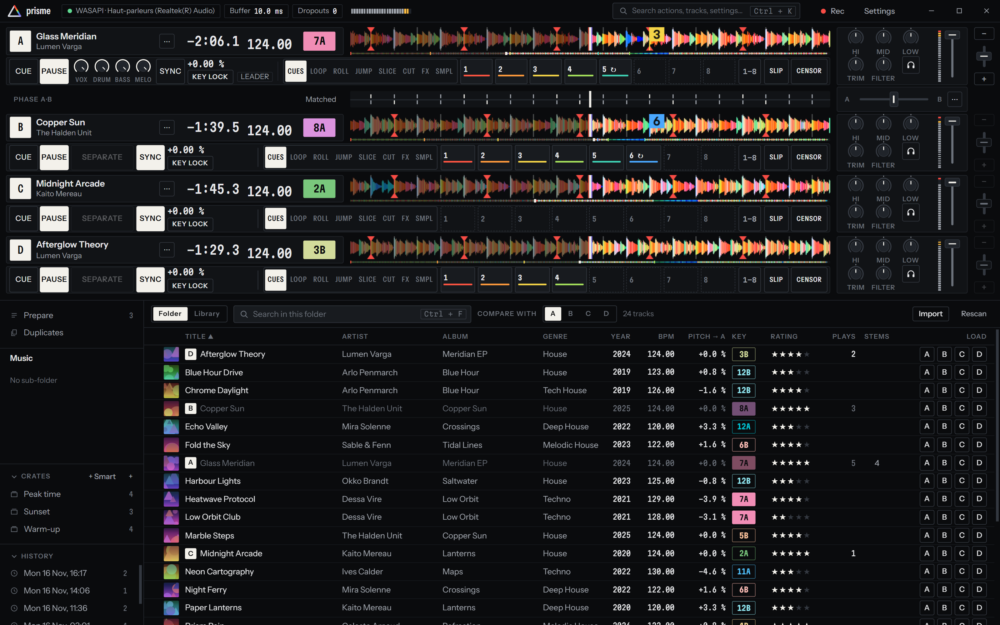
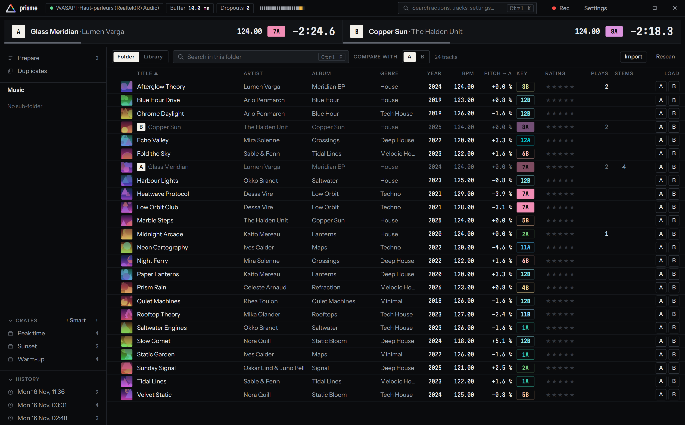

import { Steps, Aside } from '@astrojs/starlight/components';

L’écran principal s’adapte à votre façon de jouer : le nombre de decks, qui mixe et ce qui pilote chaque deck changent ce que montre chaque couloir. Vous pouvez aussi donner toute la fenêtre à la bibliothèque, ou mettre les decks sur un écran à part.

## Deux decks ou quatre

Prisme démarre avec deux decks, A et B. Pour jouer sur quatre, ouvrez **Réglages** > **DJ** > **Decks** et choisissez **4**. L’audio redémarre aussitôt avec les nouveaux decks, sans attendre **Appliquer** : changez-le avant le set.

### Quatre decks

Avec quatre decks, les couloirs deviennent compacts pour que les quatre tiennent avec la bibliothèque :

- le panneau du deck tient sur une ligne : la lettre, le titre, ce qui pilote le deck, et le temps restant, le BPM et la tonalité sans leurs étiquettes ;
- la forme d’onde est deux fois moins haute, sa vue d’ensemble une fine ligne en dessous, sans place pour les bandes des stems ;
- avec la table de mixage logicielle, chaque voie occupe toute la hauteur de son couloir.

Ce qui change aussi :

- **La bande de phase**, sous le deck A, compare les deux premiers decks qui jouent, et les nomme (**Phase A·C**).
- **Le crossfader** : les decks A et C sont à sa gauche, B et D à sa droite.
- **Le clavier** joue les decks C et D avec les touches des decks A et B, <kbd>Shift</kbd> enfoncée. Voir [Decks C et D](/fr/docs/interface/keyboard/#decks-c-et-d).
- **La bibliothèque** a un bouton de chargement par deck, et **Comparer à** propose les quatre decks.

### Quatre decks sur une interface pour deux

Une interface DJ à quatre sorties et quatre entrées a une paire de sorties et une platine pour deux decks. Sur une telle interface, C est une couche par-dessus A et D une couche par-dessus B, comme sur un contrôleur à deux jogs :

- C partage les sorties et la platine de A ; D celles de B.
- Le deck que vous mettez en **REL** ou **ABS** prend la platine. L’autre deck de la paire continue tout seul, au tempo et dans le sens que lui donnait son disque.

Sur une interface avec une paire de sorties (et d’entrées) par deck, huit de chaque, chaque deck a les siennes : C sur les sorties 5-6 et les entrées 5-6, D sur 7-8.

Voir [Configurer le contrôle vinyle](/fr/docs/dvs/setup/) pour les platines.

## Table de mixage externe ou logicielle

**Réglages** > **Mixage** > **Mixage** change aussi les couloirs :

| | Table de mixage externe | Table de mixage logicielle |
| --- | --- | --- |
| Voie au bout de chaque couloir | Aucune | Trim, égaliseur avec kills, filtre, casque, vumètre et fader |
| À côté de la lettre du deck | Un fin vumètre du niveau envoyé à ses sorties | Rien : la voie a son propre vumètre |
| Bande de phase | La phase seulement | La phase, le crossfader, la touche du micro et le menu de la table |

La table de mixage externe laisse l’écran aux formes d’onde et à la bibliothèque. Voir [Carte son et latence](/fr/docs/start/audio/#sorties-par-deck-ou-table-de-mixage-logicielle).

## Un deck sur un disque

Quand une platine pilote un deck (**REL** ou **ABS**), son couloir perd ce que la platine fait elle-même :

- pas de touches **CUE** et **PLAY** sur le rail ;
- pas de touches **−** et **+** près du fader de pitch, qui montre le pitch joué au lieu de bouger. Un cran sur le fader marque où amener le pitch de la platine pour caler l’autre deck, et le rail affiche ce pitch (**→ +1,2 %**).

Quand le diamant arrive en fin de disque, le deck passe en **INT** et continue tout seul jusqu’à ce que vous rendiez la main au disque avec **REL** ou **ABS**. Voir [Modes du contrôle vinyle](/fr/docs/dvs/modes/).

## La bibliothèque sur toute la fenêtre

Pour préparer un set, ou pour fouiller pendant qu’un long morceau joue, donnez toute la fenêtre à la bibliothèque. Les decks disparaissent et une ligne au-dessus de la bibliothèque garde chacun en vue : sa lettre, pleine pendant la lecture, le titre et l’artiste, le BPM, la tonalité, le temps restant et un fin trait qui montre ce qui a déjà joué.

<Steps>

1. Appuyez sur <kbd>Ctrl</kbd> <kbd>K</kbd> et tapez **bibliothèque**.

2. Choisissez **La bibliothèque sur toute la fenêtre**.

3. Faites de même pour faire revenir les decks.

</Steps>

Un contrôleur peut le faire avec une touche : assignez **La bibliothèque sur toute la fenêtre**, dans le groupe **Général**, avec le [MIDI learn](/fr/docs/controllers/learn/).

## Decks sur un écran à part

Sur un portable à deux écrans, ou avec un écran tactile à côté de l’ordinateur, les decks peuvent avoir un écran à eux : une fenêtre sans bordure, en plein écran sur cet écran, avec les decks seuls. La fenêtre principale garde la bibliothèque, avec la ligne de ce qui joue au-dessus, et va où vous voulez : déplacez-la, redimensionnez-la, mettez-la en plein écran.

<Steps>

1. Ouvrez **Réglages** > **Interface**. Sous **Decks sur un écran à part**, vos écrans sont dessinés comme votre système les dispose, numérotés depuis le haut à gauche.

2. Cliquez sur l’écran des decks. Celui où est la fenêtre principale ne peut pas être choisi : déplacez d’abord la fenêtre principale sur un autre écran.

</Steps>

**Dans la fenêtre principale** ramène les decks. Fermer leur fenêtre avec <kbd>Alt</kbd> <kbd>F4</kbd> aussi.

Débranchez leur écran et les decks reviennent dans la fenêtre principale ; rebranchez-le et ils y retournent. Prisme retient l’écran pour le prochain démarrage. Les touches pressées avec la fenêtre des decks au premier plan marchent comme dans la fenêtre principale.

### Leur disposition

**Disposition des decks à part**, dans **Réglages** > **Interface**, règle comment les decks remplissent leur écran :

- **Contrôleur** : les formes d’onde sur toute la largeur, l’une sur l’autre, le titre et les chiffres de chaque deck sur un bandeau le long de la sienne. En dessous, disposés comme sur un contrôleur : le transport et les pads de chaque deck de son côté, son pitch fader au bord extérieur, et les voies du mixer au milieu avec le crossfader dessous.
- **Couloirs** : un couloir par deck, comme dans la fenêtre principale. Avec deux decks sur un écran assez haut, le temps restant, le BPM et la tonalité sont plus grands, et chaque voie a ses potards les uns sur les autres à côté d’un fader sur toute la hauteur.
- **Automatique**, par défaut : les couloirs sur un écran bien plus large que haut (plus de 2,6 fois plus large, comme une bande de 3840 × 1100), où ce qui est sous les formes d’onde de la disposition contrôleur leur laisserait trop peu de hauteur ; sinon la disposition contrôleur.

## Taille de la fenêtre

Prisme s’ouvre en remplissant son écran. Pour l’ouvrir sans les barres du système, activez **Démarrer en plein écran** dans **Réglages** > **Interface**. Le bouton plein écran de la barre de titre, à côté de réduire, ou <kbd>F11</kbd>, bascule à tout moment.

La fenêtre demande au moins 1280 × 640 pixels : un écran de portable 1080p à 150 % de mise à l’échelle. En dessous de 1400 pixels de large, le rail de chaque deck se resserre : touches plus étroites, boutons de stems et noms des pads plus petits. Tout reste à l’écran.

<Aside type="note">
Sur un téléphone ou une tablette, Prisme se dispose plutôt pour les doigts : voir [Téléphone et tablette](/fr/docs/interface/phone/).
</Aside>
