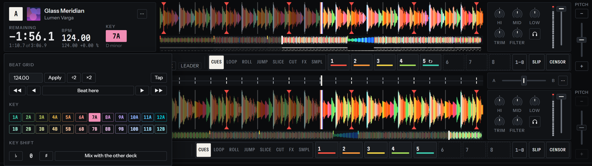

import { Steps, Aside } from '@astrojs/starlight/components';

Chaque morceau de votre dossier de musique est analysé une fois, en tâche de fond (voir
[Ajouter votre musique](/fr/docs/library/adding-music/#la-première-analyse)). L’analyse lui donne
un tempo, une grille rythmique et une tonalité. C’est sur eux que s’appuient la sync, le
quantize, l’Auto DJ et les colonnes de tonalité et de pitch de la bibliothèque : une grille
fausse vaut donc la peine d’être corrigée. Cela prend quelques secondes, et c’est gardé pour de
bon.

## Ce que trouve l’analyse

**Tempo et grille rythmique.** Prisme cherche un tempo stable sur tout le morceau, puis le mesure
sur les kicks eux-mêmes : il trouve où commence l’attaque de chaque kick, à une fraction de
milliseconde près, et ajuste le tempo sur elles, du premier kick au dernier. La grille se pose
ensuite sur le clic des kicks, le coup qui les lance, entendu dans les aigus au-dessus de leur
corps : deux morceaux aux grilles alignées ne font pas entendre deux kicks au lieu d’un, même
un kick sec contre un kick saturé qui gonfle lentement, comme en schranz. Serato DJ Pro pose
ses grilles au même endroit, à 2 ms près. Les temps sans kick, comme dans un break, sont
laissés hors de la mesure.

Quelle pulsation est le temps, et où commencent les mesures, Prisme l’entend avec un petit réseau
de neurones ([Beat This!](https://github.com/CPJKU/beat_this), sur quelques extraits du
morceau) : les attaques seules peuvent prendre pour le temps une basse qui joue entre les kicks,
et poser la grille sur les contretemps. La mesure 1 est la première mesure où la musique
commence, un morceau fait pour être mixé commençant sur le premier temps d’une mesure, sauf si
le réseau entend clairement les mesures commencer sur un autre temps.

Les premiers kicks d’une intro peuvent être des coups hors des mesures, et le réseau prend
souvent le troisième temps d’une mesure pour le premier. Prisme regarde donc aussi où
commencent les sections du morceau : là où le kick revient, où une basse entre. Il compare
chaque temps au même temps une et deux mesures avant et après, ce qui annule le motif à
l’intérieur de la mesure et ne laisse que les changements ; chaque début de section vote
ensuite pour son temps de la mesure, le kick et la basse pesant le plus. La mesure 1 s’y déplace
quand les sections le disent clairement, de deux temps, ou d’un seul si le réseau n’entend pas
de mesures : une voix ou un groupe entre souvent un temps avant la mesure, et c’est alors le
réseau qu’il faut croire.

Le tempo n’est arrondi à un BPM entier (les morceaux produits dans un DAW en ont généralement
un) que si ce BPM entier garde la grille à moins de 2 ms des kicks jusqu’à la fin du morceau ;
sinon il reste tel que mesuré, au centième de BPM près ou mieux : un morceau à 123,95 BPM ne
s’affiche pas à 124. La grille est dessinée sur la forme d’onde : un trait sur chaque temps et,
sur le premier temps de chaque mesure, un trait rouge plus épais avec de petites flèches en haut
et en bas, et le numéro de la mesure. Dézoomée, les numéros s’affichent toutes les 4, 8 ou 16
mesures, sur les premières mesures des phrases (1, 5, 9…, ou 1, 17, 33…) ; avant la mesure 1,
les mesures se comptent à rebours (−1, −2…).

- La plupart des morceaux ont **un seul tempo pour tout le morceau**, comme la musique
  électronique. Un morceau qui accélère et ralentit nettement (un groupe, un batteur en live : ses
  kicks s’écartent de plus de 30 ms environ d’un tempo unique) reçoit une grille épinglée sur ses
  kicks, affichée avec son tempo moyen ; un point sur le trait d’un temps marque chaque épingle.
  Un morceau qui dérive moins garde un seul tempo : épinglez sa grille à la main (voir plus bas),
  ou importez la grille réglée dans Serato ou rekordbox (voir [Import](/fr/docs/library/import/)).
  La waveform dessine ces grilles et **SYNC** les suit.
- Le tempo est donné **entre 88 et 176 BPM**. Cette plage couvre la house, la techno et la drum
  and bass à leur tempo habituel, mais un morceau de hip-hop à 85 BPM s’affiche à 170, et un
  morceau à 180 BPM à 90. Corrigez-le avec **÷2** ou **×2** (plus bas).
- Les morceaux de moins de 10 secondes n’ont pas de tempo.
- Là où le kick n’a pas de début net (un kick saturé qui gronde, comme en schranz, ou un kick
  noyé sous la basse), la grille peut tomber à quelques millisecondes à côté : vérifiez-la à
  l’oreille.

**Tonalité.** Prisme écoute l’harmonie de tout le morceau, après avoir compensé un morceau
accordé un peu à côté du diapason, et choisit la plus probable des 24 tonalités majeures et
mineures. La tonalité s’affiche en code Camelot : des chiffres de 1 à 12 autour de la roue, `A`
pour mineur et `B` pour majeur (`8A` est la mineur, `8B` do majeur). Survolez une tonalité dans
la bibliothèque pour voir son nom habituel.

Comme toute détection de tonalité, elle peut confondre une tonalité avec une tonalité voisine, le
plus souvent son relatif majeur ou mineur (`8A` et `8B`), ou la tonalité à une quinte (`8A` et
`9A`). Celles-ci se mixent de toute façon ensemble ; quand vos oreilles ne sont pas d’accord,
corrigez-la.

## Corriger la grille et la tonalité

Les corrections se font sur un deck, avec le morceau chargé.

<Steps>

1. Chargez le morceau et cliquez sur les affichages **BPM** et **Tonalité** du deck (**Grille
   rythmique, tonalité et transposition**). Sur un téléphone, ouvrez le panneau du deck et
   touchez **Grille et tonalité**.

2. Corrigez ce qui ne va pas avec les commandes ci-dessous. Chaque changement s’applique
   aussitôt, sur chaque deck où le morceau est chargé.

3. Fermez le panneau en cliquant à côté.

</Steps>

### Grille rythmique

| Commande | Effet |
| --- | --- |
| Champ BPM et **Appliquer** | Règle le tempo que vous tapez (de 40 à 300 BPM), en gardant le premier temps où il est. <kbd>Enter</kbd> applique aussi |
| **÷2** / **×2** | **Moitié du tempo** / **Double du tempo** : le tempo divisé ou multiplié par deux |
| **Tap** | Tapez en rythme avec la musique : après quatre frappes, le tempo que vous tapez s’affiche dans le champ. Cliquez sur **Appliquer** pour le garder |
| **◀◀** / **▶▶** | Déplace toute la grille 20 ms plus tôt ou plus tard |
| **◀** / **▶** | Déplace toute la grille 2 ms plus tôt ou plus tard |
| **Temps ici** | Déplace la grille le moins possible pour qu’un temps tombe exactement là où est le deck, les mesures avec elle |
| **Mesure ici** | La même chose, et une mesure commence sur ce temps : pour des mesures comptées depuis le mauvais temps |
| **Épingler ici** | Épingle le temps le plus proche du deck là où est le deck, pour un morceau dont le tempo dérive (joué en live, un vieux disque) : les temps entre cette épingle et celles de part et d’autre s’étirent ou se resserrent pour tomber juste. Voir plus bas |
| **Retirer l’épingle** | Retire l’épingle la plus proche du deck |
| **Caler la grille sur l’autre deck** | Les deux decks jouent, la grille se cale sur les temps de l’autre deck : voir plus bas |
| **Rétablir** | **Revenir à la grille analysée**. Affiché une fois la grille modifiée |

Une bonne méthode pour corriger une grille décalée :

<Steps>

1. Vérifiez d’abord le tempo. Si les traits s’éloignent des kicks au fil du morceau, le tempo est
   faux : tapez-le avec **Tap**, ou saisissez-le si vous le connaissez, puis **Appliquer**.

2. Mettez en pause sur un kick en début de mesure, près du trait sur lequel il devrait être.
   Cliquez sur **Temps ici**.

3. Jouez quelques mesures plus loin et écoutez, la forme d’onde zoomée. Ajustez avec **◀** et
   **▶** jusqu’à ce que les traits tombent sur les kicks.

4. Si les mesures commencent sur le mauvais temps (les numéros tombent un ou deux temps à côté
   des changements de phrase), mettez en pause sur le premier kick d’une mesure et cliquez sur
   **Mesure ici**. Un point orange près du BPM, dans la bibliothèque et sur le deck, signale les
   morceaux dont l’analyse n’est pas sûre des mesures : leurs sections ne commencent pas clairement
   sur un même temps de la mesure.

</Steps>

Si l’analyse n’a trouvé aucun tempo, en taper un crée une grille depuis le début du morceau :
utilisez ensuite **Temps ici** pour la caler sur les temps.

Un morceau joué par un groupe, ou un disque des années soixante-dix, peut accélérer et ralentir :
aucun tempo unique ne garde sa grille sur les kicks. Épinglez-la dessus :

<Steps>

1. Calez d’abord la mesure 1, avec **Temps ici** ou **Mesure ici** au début du morceau.

2. Continuez la lecture. Là où les traits quittent les kicks, mettez en pause sur un kick et
   cliquez sur **Épingler ici** : ce temps va là où est le deck, et les temps depuis la mesure 1
   se répartissent jusqu’à lui. Plus loin, de même : chaque épingle étire ou resserre les temps
   depuis la précédente. Après la dernière épingle, la grille continue au tempo qu’elle avait
   avant elle.

3. Une épingle mal placée : mettez en pause près d’elle et cliquez sur **Retirer l’épingle**.
   Avec une seule épingle, la grille retrouve un tempo unique.

</Steps>

Un point sur le trait d’un temps marque chaque épingle sur la waveform. Le BPM affiché est le
tempo moyen de la première épingle à la dernière ; **SYNC** suit le tempo du moment de la grille,
temps par temps (voir [Tempo, sync et tonalité](/fr/docs/decks/sync/)).

Certains kicks ne s’entendent pas là où ils commencent : un kick long et saturé, ou dont le grave arrive en retard, sonne un peu avant ou après son trait. Deux morceaux de ce genre synchronisés sonnent alors légèrement décalés, alors que chaque grille est sur ses kicks. Corrigez à l’oreille : faites jouer les deux decks, calez-les au jog ou au pitch bend jusqu’à ce qu’ils sonnent comme un seul, puis ouvrez le panneau du deck que vous avez déplacé et cliquez sur **Caler la grille sur l’autre deck**. Sa grille se décale de l’écart que montrait la bande de phase ; rien de ce que vous entendez ne change, et **SYNC** garde ensuite les decks ainsi, avec n’importe quel morceau.

### Tonalité

Le panneau affiche les 24 tonalités, les mineures (`A`) sur une ligne, les majeures (`B`) sur
l’autre, la tonalité actuelle pleine. Cliquez sur la bonne. **Rétablir** (**Revenir à la
tonalité détectée**) annule votre choix.

La section **Transposition** du même panneau transpose le morceau pendant la lecture, sans
changer sa tonalité dans la bibliothèque : voir [Tempo, sync et tonalité](/fr/docs/decks/sync/).

### Ce que devient une correction

- Un point après le libellé **BPM** ou **Tonalité** sur le deck indique que la grille ou la
  tonalité a été corrigée à la main.
- Les corrections sont gardées dans la bibliothèque, à part de l’analyse : réanalyser le fichier
  ne les annule jamais. Elles suivent le fichier si vous le déplacez ou le renommez.
- Les colonnes BPM et tonalité de la bibliothèque, les crates intelligentes et les tris utilisent
  les valeurs corrigées.
- Si **Écrire le tempo et la tonalité dans les tags des fichiers** est activé, le tempo et la
  tonalité corrigés sont aussi écrits dans le fichier (voir
  [Ajouter votre musique](/fr/docs/library/adding-music/#écrire-le-tempo-et-la-tonalité-dans-vos-fichiers)).
- Une grille rythmique [importée depuis Serato ou rekordbox](/fr/docs/library/import/) compte
  comme une correction : **Rétablir** vous ramène à la grille de Prisme.

## Ce qui dépend de la grille

| Fonction | Utilise |
| --- | --- |
| **Quantize** (**Réglages** › **DJ**, activé par défaut) | Cues, boucles et sauts tombent sur le temps ; les stems se coupent et reviennent sur la mesure ; les pads du sampler partent sur le temps suivant |
| Sync | Cale le tempo, et aligne les temps sur l’autre deck. Voir [Tempo, sync et tonalité](/fr/docs/decks/sync/) |
| Boucles, rolls et sauts en temps | Leur longueur en temps. Voir [Boucles, rolls et sauts](/fr/docs/decks/loops/) |
| Effets synchronisés sur le temps | Leur timing. Voir [Effets](/fr/docs/sound/effects/) |
| [Auto DJ](/fr/docs/mixer/auto-dj/) | Où commence un enchaînement (sur une phrase), et combien de temps il dure en temps |
| La colonne **Pitch → A** de la bibliothèque | Le tempo de chaque morceau |

Sans grille, le quantize n’a rien sur quoi se caler : les cues et les points de boucle tombent
exactement là où vous appuyez. C’est pourquoi un morceau dont l’analyse n’a pas trouvé le tempo
mérite une grille tapée à la main.
