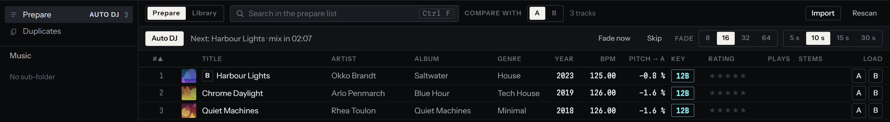

import { Steps, Aside } from '@astrojs/starlight/components';

L’Auto DJ joue la [liste de préparation](/fr/docs/library/crates/#la-liste-de-préparation) à votre
place, un morceau après l’autre sur les decks A et B, chacun enchaîné sur le suivant au crossfader.
Entre deux morceaux qui ont une grille rythmique, il cale le tempo, lance le morceau suivant sur une
phrase et garde les temps ensemble. Il est là pour le warm-up que vous ne voulez pas assurer, une
pause ou un dîner, et vous pouvez reprendre la main à tout moment.

## Avant de commencer

L’Auto DJ a besoin :

- **de la table de mixage logicielle** : il mixe avec le crossfader de Prisme, qu’une table externe
  n’entend pas. Choisissez **Table de mixage logicielle : master sur les sorties 1-2** sous
  **Réglages** › **Mixage**. Voir [La table de mixage logicielle](/fr/docs/mixer/mixer/).
- **des decks A et B jouant seuls**, en mode **INT** : aucun disque timecode pour les piloter
  (**REL** ou **ABS**), aucune entrée qui passe à travers (**THRU**). Voir
  [Modes absolu et relatif](/fr/docs/dvs/modes/).
- **de morceaux dans la liste de préparation**, dans l’ordre voulu.

Avec quatre decks, l’Auto DJ n’utilise que A et B : C et D restent à vous.

## Le lancer

<Steps>

1. Ouvrez **Préparation** dans le panneau latéral de la bibliothèque. La barre de l’Auto DJ s’affiche
   au-dessus des morceaux.

2. Mettez les morceaux dans l’ordre : glissez les lignes vers le haut ou le bas quand la liste est
   triée par `#`. Voir [La liste de préparation](/fr/docs/library/crates/#la-liste-de-préparation).

3. Cliquez sur **Auto DJ**. Le bouton s’allume, et **Auto DJ** s’affiche à côté de **Préparation**
   dans le panneau latéral, où que vous soyez dans la bibliothèque.

</Steps>

Son démarrage dépend des decks :

- **Rien ne joue** : le premier morceau de la liste est chargé sur le deck vers lequel penche le
  crossfader (A s’il est au milieu), le crossfader part complètement de ce côté et le morceau démarre.
- **Un deck joue** : il continue. Si le crossfader n’est pas encore complètement de son côté, l’Auto
  DJ l’y amène au rythme d’un enchaînement.
- **Les deux decks jouent** : celui vers lequel penche le crossfader continue, et le crossfader passe
  de son côté, l’autre deck s’arrêtant à la fin.

Dès lors, le morceau suivant attend sur l’autre deck, calé sur son cue, et la barre vous dit ce qui
arrive : **Ensuite : Strobe · enchaînement dans 1:42**.

## Comment il mixe

**Où démarre le morceau suivant.** Sur son cue principal s’il en a un : placez-le donc là où vous
voulez que le morceau entre (voir [Cues et hot cues](/fr/docs/decks/cues/)). Sinon là où commence le
son, en sautant le silence en tête de fichier, sur le premier temps si le morceau a une grille.

**Quand les deux morceaux ont une grille rythmique** et que leurs tempos sont à moins de 10 % l’un de
l’autre (les tempos moitié et double comptent : un morceau à 87 BPM va avec un à 174) :

1. Le morceau suivant prend le tempo de celui qui joue.
2. L’enchaînement commence au début d’une phrase de 32 temps, la dernière qui laisse la place à tout
   le fondu avant que le morceau en cours se taise.
3. Le morceau suivant entre sur le temps, et le crossfader traverse sur le nombre de **temps** que
   vous avez choisi.

**Sinon** (pas de grille sur l’un des deux, ou des tempos trop éloignés), le morceau suivant joue à
son propre tempo, et le crossfader traverse sur le nombre de **secondes** que vous avez choisi, pour
arriver au bout là où le morceau en cours se tait.

À la fin du fondu, le crossfader est complètement passé et l’ancien deck s’arrête. Le morceau entré
quitte la liste de préparation au début de son enchaînement, et le suivant est chargé sur le deck
libéré.

L’Auto DJ ne fait que charger les morceaux et bouger le crossfader, le tempo et le transport ; il
désactive le sync lock sur le deck qu’il lance. Vos EQ, filtres, effets et faders de voie restent
comme vous les avez réglés : laissez les faders de voie ouverts.

<Aside type="tip">
  Vérifiez les grilles rythmiques des morceaux que vous mettez en file : une grille décalée donne un
  enchaînement où les temps se cognent. Voir [Tempo, grille rythmique et tonalité](/fr/docs/library/analysis/).
</Aside>

## La barre de l’Auto DJ

| Commande | Rôle |
| --- | --- |
| **Auto DJ** | Marche et arrêt. L’arrêter laisse les decks comme ils sont, en lecture |
| **Enchaîner** | **Enchaîner sur le morceau suivant maintenant**, sans attendre le moment prévu |
| **Passer** | **Passer le morceau suivant** : il quitte la liste de préparation, celui d’après vient à sa place |
| **Fondu** en temps : **8**, **16**, **32**, **64** | La durée d’un enchaînement entre deux morceaux qui ont une grille. 16 au départ |
| **Fondu** en secondes : **5 s**, **10 s**, **15 s**, **30 s** | La durée d’un enchaînement quand un morceau n’a pas de grille. 10 s au départ |

Les durées de fondu sont gardées pour la fois suivante. L’Auto DJ lui-même est toujours arrêté au
démarrage de Prisme.

La liste peut changer pendant qu’il joue : réordonnez la liste de préparation, ajoutez ou retirez des
morceaux, et l’Auto DJ met le nouveau premier morceau sur le deck en attente.

## Reprendre la main

Dès que vous agissez à la main, l’Auto DJ se met en pause plutôt que de lutter contre vous. Il se met
en pause quand vous :

- lancez, mettez en pause, déplacez la lecture, sautez, déclenchez un hot cue, ou touchez la forme
  d’onde ou le jog du deck A ou B ;
- bougez le crossfader ;
- chargez un morceau sur le deck A ou B.

La barre dit alors pourquoi, par exemple **En pause : vous avez bougé le crossfader · appuyez sur
Auto DJ pour reprendre**. Tourner le pitch, les EQ ou les faders de voie ne le met pas en pause, ni
rien de ce qui se passe sur les decks C et D.

Cliquez sur **Auto DJ** pour lui rendre la main. Il prend les decks comme vous les laissez : celui qui
joue continue, et si vous étiez au milieu d’un enchaînement à vous, il le termine, le crossfader
avançant au rythme d’un fondu. **Enchaîner** pendant la pause lui rend la main et enchaîne aussitôt.

## Quand il s’arrête

| La barre affiche | Pourquoi |
| --- | --- |
| **Rien ensuite : la liste se termine sur ce morceau** | La liste est vide après le morceau en cours. Ajoutez des morceaux et il continue |
| **La liste de préparation a été jouée** | Le dernier morceau est fini. L’Auto DJ s’arrête |
| **La liste de préparation est vide** | Vous l’avez lancé sans rien à jouer |
| **L’Auto DJ fond avec la table de mixage logicielle : choisissez-la dans les réglages** | Une table externe est utilisée. Le bouton **Auto DJ** est grisé |
| **L’Auto DJ joue les decks A et B seuls : sans disque, sans passthrough** | Le deck A ou B est en mode **REL**, **ABS** ou **THRU** |
| **Un morceau n’a pas pu être lu : il a été retiré** | Un fichier de la liste n’a pas pu être chargé ; il est retiré, et le suivant vient à sa place |

L’Auto DJ tourne dans Prisme lui-même, pas dans sa fenêtre : il tient le temps fenêtre réduite ou
écran du téléphone éteint.

## Depuis le clavier ou un contrôleur

**Auto DJ marche / arrêt**, **Enchaîner sur le morceau suivant maintenant** et **Passer le morceau
suivant** sont dans la palette de commandes (<kbd>Ctrl</kbd> <kbd>K</kbd>) et peuvent être assignés
aux boutons d’un contrôleur, celui de marche / arrêt allumé tant que l’Auto DJ joue. Voir
[MIDI learn](/fr/docs/controllers/learn/) et la
[référence des actions](/fr/docs/controllers/actions/).
