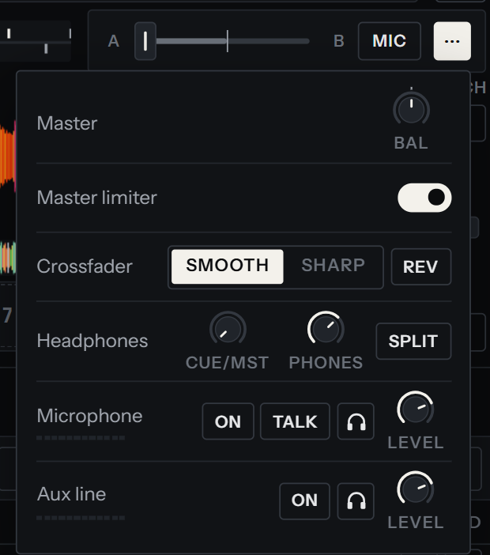

import { Steps, Aside } from '@astrojs/starlight/components';

La [table de mixage logicielle](/fr/docs/mixer/mixer/) peut prendre deux sources en direct sur votre
carte son, un **micro** et une **ligne aux** (un téléphone, un lecteur CD, une seconde table), et les
mélanger au master. Elle peut aussi envoyer le master à un **retour cabine** sur une paire de sorties
à lui, à son propre niveau.

<Aside type="note">
Ces trois fonctions demandent la table logicielle. Avec une table externe, branchez plutôt le micro,
la source aux et le retour cabine sur votre table.
</Aside>

## Quelles entrées sont libres

Prisme réserve une paire d’entrées à la platine de chaque deck  les entrées 1-2 pour le deck A, 3-4
pour le deck B, et ainsi de suite tant que l’interface en a. Un micro ou une ligne aux ne peut prendre
que les entrées qui suivent. Sur une interface DJ à quatre entrées avec deux decks, il n’en reste
aucune  avec six entrées, 5-6 sont libres.

Si toutes les entrées sont prises, les réglages affichent **Les platines prennent toutes les entrées
de ce périphérique.** et le choix est grisé.

## Micro

<Steps>

1. Branchez le micro sur une entrée libre de votre carte son.

2. Dans **Réglages** > **Mixage** > **Micro**, choisissez son entrée  une entrée seule
   (**Entrée 5**), placée au milieu de la stéréo, ou une paire (**Entrées 5-6**).

3. Fermez les réglages. Une touche **MIC** apparaît au bout du crossfader, et le menu de la table (la
   touche **⋯** à côté) a une ligne **Micro**.

4. Appuyez sur **MIC** pour ouvrir le micro dans le master. Appuyez de nouveau pour le fermer.

</Steps>

La ligne **Micro** du menu de la table contient 

| Commande | Ce qu’elle fait |
| --- | --- |
| Vumètre | Le niveau du micro, après son potard **LEVEL**, même quand il est fermé. |
| **ON** | Ouvre le micro dans le master, comme la touche **MIC**. |
| **TALK** | Active ou coupe le talkover (voir plus bas). |
| Touche casque | Fait entendre le micro au casque, ouvert ou non, pour le vérifier avant de parler. |
| **LEVEL** | Muet tout à gauche, 0 dB aux trois quarts de la course, +12 dB tout à droite. |

Le micro est fermé et retiré du casque à chaque démarrage de Prisme, pour qu’il ne s’ouvre jamais par
surprise. Son entrée et son niveau sont conservés.

Votre voix entre dans la carte son et en ressort en passant par Prisme  elle arrive aux enceintes
avec le retard de cet aller-retour. Gardez un petit buffer (voir [Réglage audio](/fr/docs/start/audio/))
si vous parlez beaucoup sur la musique. Vous n’entendez pas le micro dans le master de votre casque,
seulement quand vous le pré-écoutez.

### Talkover

Le talkover baisse la musique tant que le micro est ouvert et la remonte quand vous le fermez  vous
parlez par-dessus la musique sans aller chercher un fader.

1. Dans le menu de la table, appuyez sur **TALK** sur la ligne **Micro**. L’info-bulle de la touche
   **MIC** devient alors **Micro ouvert / fermé  la musique baisse tant qu’il est ouvert**.
2. Choisissez de combien la musique baisse dans **Réglages** > **Mixage** > **Talkover**  **−6 dB**,
   **−12 dB**, **−18 dB** (par défaut) ou **−24 dB**.

La musique baisse en un dixième de seconde quand vous ouvrez le micro et remonte en une demi-seconde
environ quand vous le fermez. Tout baisse sauf le micro  les decks et la ligne aux. Le talkover reste
activé d’une session à l’autre.

## Ligne aux

La ligne aux fait entrer une source stéréo dans le master  le téléphone ou l’ordinateur d’un DJ invité,
un lecteur CD, la sortie d’une autre table.

1. Branchez la source sur une paire d’entrées libre.
2. Dans **Réglages** > **Mixage** > **Ligne aux**, choisissez la paire (**Entrées 5-6**…). La ligne
   aux ne prend que des paires.
3. Ouvrez le menu de la table  la ligne **Ligne aux** a son vumètre, **ON**, une touche casque et
   **LEVEL**, comme celle du micro.

Appuyez sur **ON** pour la faire entrer dans le master. La ligne aux rejoint le master comme un deck 
elle passe par le limiteur avec lui, est enregistrée avec lui, s’entend dans le retour cabine et baisse
sous le micro quand le talkover est activé. Elle n’est pas sur le crossfader.

Si le micro et la ligne aux ont besoin des mêmes entrées, chaque liste ne propose que ce que l’autre
laisse. Une source réglée sur des entrées que l’interface actuelle n’a pas affiche **Pas sur ce
périphérique.** et revient quand vous rebranchez cette interface.

## Retour cabine

Les enceintes de la cabine jouent le master sur une paire de sorties à elles, à un niveau réglé à
part de celui de la salle.

<Steps>

1. Branchez les enceintes de la cabine sur une paire de sorties libre de votre carte son.

2. Dans **Réglages** > **Mixage** > **Retour cabine**, choisissez cette paire (**Sorties 5-6**…). Les
   sorties 1-2 sont celles du master  une paire qui chevauche celle du casque ne s’entend pas, et le
   réglage affiche alors **Pas sur ce périphérique.**

3. Réglez le niveau avec le potard **BOOTH**, sur la ligne **Master** du menu de la table. Il va du
   silence à 0 dB, le niveau du master lui-même.

</Steps>

Le retour cabine reçoit le master après le limiteur du master, sans la balance **BAL**  vous pouvez
pencher les enceintes de la salle d’un côté et garder la cabine centrée. Le réglage **Retour cabine**
n’apparaît que si l’interface a une paire de sorties en plus de celle du master.

## Depuis un contrôleur

Les actions de la table pour ces sources sont **Niveau du micro**, **Micro ouvert / fermé**, **Micro
au casque**, **Niveau de la ligne aux**, **Ligne aux ouverte / fermée**, **Ligne aux au casque**,
**Talkover  la musique baisse sous le micro** et **Niveau du retour cabine**. Voir
[toutes les actions](/fr/docs/controllers/actions/).
