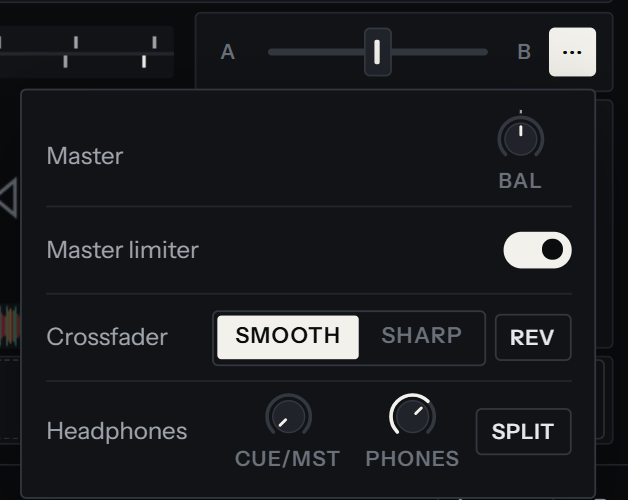

import { Steps, Aside } from '@astrojs/starlight/components';

Prisme mixe de deux façons  soit chaque deck sort sur ses propres sorties vers une **table de
mixage externe**, soit Prisme mixe lui-même les decks dans sa **table de mixage logicielle** et envoie
un seul master. Prenez la première si vous avez une table DJ et une carte son avec une paire de
sorties par deck  la seconde avec un contrôleur tout-en-un, une seule carte son ou un téléphone.

## Table externe ou table logicielle

|  | Table externe | Table logicielle |
| --- | --- | --- |
| Sorties | Deck A sur 1-2, deck B sur 3-4 (C et D sur 5-6 et 7-8 si l’interface les a) | Le master sur 1-2, le casque et le retour cabine sur des paires à eux |
| À l’écran | Un fin vumètre à côté de la lettre de chaque deck, le niveau envoyé à ses sorties | Une voie au bout de la colonne de chaque deck, un crossfader dans la bande de phase |
| EQ, gain, filtre, faders | Sur votre table | Dans Prisme |
| Effets, stems, sampler, gain automatique | Dans Prisme, avant les sorties | Dans Prisme |
| Casque | Sur votre table  celui de Prisme seulement pour l’[écoute au casque](/fr/docs/mixer/headphones/#écoute-au-casque) | Le [casque](/fr/docs/mixer/headphones/) de Prisme |
| Micro, ligne aux, retour cabine, Auto DJ, enregistrement du master | Non | Oui |

Sur un ordinateur, Prisme démarre avec la table externe  sur un téléphone, avec la table logicielle.

<Steps>

1. Ouvrez les **Réglages** (<kbd>Ctrl</kbd> <kbd>,</kbd>) et allez dans **Mixage**.

2. Sous **Mixage**, choisissez **Table de mixage externe  deck A sur les sorties 1-2, deck B sur 3-4**
   ou **Table de mixage logicielle  master sur les sorties 1-2**.

3. Appuyez sur **Appliquer** dans la barre qui apparaît en bas  l’audio redémarre avec le nouveau
   routage. **Annuler** laisse tout comme avant.

</Steps>

Une table externe demande une paire de sorties par deck. Si vous la choisissez sur une interface de
moins de quatre sorties, Prisme passe sur la table logicielle et la barre de titre affiche **Table
externe  4 sorties nécessaires**. Avec quatre decks sur une interface à quatre sorties, C joue sur
les sorties de A et D sur celles de B (voir [quatre decks](/fr/docs/interface/layouts/)).

## La voie

Avec la table logicielle, la colonne de chaque deck se termine par sa voie, juste avant le fader de
pitch.

| Commande | Ce qu’elle fait |
| --- | --- |
| **HI**, **MID**, **LOW** | L’égaliseur 3 bandes. Cliquez sur le nom d’une bande pour la couper. |
| **TRIM** | Le gain avant l’EQ, de −12 dB à +12 dB. |
| **FILTER** | À gauche du centre un passe-bas, à droite du centre un passe-haut. |
| Touche casque | Envoie le deck au casque. Voir [Casque](/fr/docs/mixer/headphones/). |
| Vumètre | Le niveau du deck après l’EQ, le filtre et les effets, avant le fader. |
| Fader de voie | Le volume du deck dans le master. |

Tous les potards et faders fonctionnent de la même façon  faites-les glisser (vers le haut ou le bas
pour un potard), maintenez <kbd>Shift</kbd> pour un réglage quatre fois plus fin, utilisez la molette
de la souris dessus ou les flèches du clavier. Un double-clic les remet à leur position de départ (à
plat pour l’EQ, le gain et le filtre, à fond pour un fader). Pendant que vous touchez un potard, son
nom affiche la valeur  `+3.0 dB`, `−∞ dB`, `LPF 40 %`.

Sur un téléphone, la voie n’a pas de potard de gain  utilisez le [gain automatique](#gain-automatique)
pour égaliser les morceaux.

### Gain

Le gain règle le niveau d’entrée du morceau dans la voie, de −12 dB à +12 dB, neutre au milieu.
Servez-vous-en pour aligner un morceau calme sur un morceau fort avant de toucher à l’EQ. Avec le
[gain automatique](#gain-automatique) activé, ce qui est le cas sauf si vous l’avez coupé, vous en avez
rarement besoin.

### EQ et kills

L’EQ découpe le son en trois bandes, séparées à 250 Hz et 3 kHz, comme un isolateur 

- Au milieu, la bande n’est pas touchée.
- Tournée à droite, elle monte jusqu’à +6 dB.
- Tournée à gauche, elle descend, jusqu’à près de −40 dB juste avant la butée  tout au bout, la bande
  disparaît (`−∞ dB`).

Un **kill** coupe une bande d’un coup et la rend telle qu’elle était. Cliquez sur le nom sous le
potard (**HI**, **MID** ou **LOW**)  il s’allume tant que la bande est coupée, et le potard garde sa
position pour le clic suivant. Sur un contrôleur, les touches de kill coupent la bande tant qu’elles
sont maintenues.

<Aside type="tip">
Dans **Réglages** > **DJ**, **Potards aimantés** fait marquer un arrêt aux potards d’EQ et de filtre
quand vous passez par leur milieu  vous retrouvez la position neutre sans regarder.
</Aside>

### Filtre

Un potard, deux filtres. Tourné à gauche, un passe-bas se referme du haut jusqu’à 40 Hz  les aigus
partent en premier, puis les médiums. Tourné à droite, un passe-haut monte jusqu’à 12 kHz  les basses
partent en premier. Une petite zone autour du milieu ne fait rien, si bien qu’un potard de filtre
laissé près du centre ne colore jamais le son. Le filtre a une légère résonance à sa fréquence de
coupure, comme les filtres des tables DJ.

### Fader de voie

Le fader règle le volume du deck dans le master  le vumètre à côté montre le niveau avant le fader.
Deux options du menu du deck (la touche **⋯** du deck) changent son comportement 

- **Fader start** (table logicielle seulement)  ouvrir le fader depuis la position fermée lance le
  deck, le refermer arrête le deck et le ramène à son point de cue.
- **Couper la voie**  le deck est muet dans le master mais s’entend toujours au casque. Une touche
  **MUTE** s’allume sur le deck tant qu’il est coupé  appuyez dessus pour l’entendre à nouveau.

## Crossfader

Le crossfader se trouve dans la bande de phase entre les decks, **A** à sa gauche et **B** à sa
droite. Double-cliquez dessus pour le recentrer.

Les decks A et C sont du côté gauche, B et D du côté droit. Un deck peut aussi être au milieu, entendu
quelle que soit la position du crossfader, par exemple pour mixer aux seuls faders de voie. Le côté de
chaque deck se règle depuis un contrôleur ou la palette de commandes (<kbd>Ctrl</kbd> <kbd>K</kbd>),
avec les actions du deck **À gauche du crossfader**, **Entendu quel que soit le crossfader** et **À
droite du crossfader**.

Le reste se trouve dans le menu de la table, la touche **⋯** au bout à droite du crossfader 

| Réglage | Ce qu’il fait |
| --- | --- |
| **DOUCE** | Une courbe à puissance constante  les deux decks sont à environ −3 dB au milieu, sans creux dans le mélange. Pour les longs enchaînements. |
| **FRANCHE** | Les deux decks à plein volume sur toute la course sauf les derniers 4 % de chaque côté, où le deck d’en face est coupé. Pour le scratch et les cuts. |
| **REV** | Inverse les côtés  vers la gauche, ce sont les decks de droite qui entrent. Pour le style hamster. |

La courbe se règle aussi dans **Réglages** > **Mixage** > **Courbe du crossfader**.

## Master

La ligne **Master** du menu de la table porte la balance du master 

- **BAL** penche le master d’un côté  tout à gauche, il ne joue que sur l’enceinte gauche, tout à
  droite que sur la droite. Il affiche `L = R` au milieu et `L 40 %` ou `R 40 %` quand vous le tournez.
- **BOOTH** y apparaît quand un retour cabine est configuré. Voir
  [Retour cabine](/fr/docs/mixer/inputs/#retour-cabine).

Le niveau général du master n’a pas de potard à l’écran  il se règle avec le potard master d’un
contrôleur (**Niveau du master**). Le vumètre de la barre de titre montre le niveau du master, et le
voyant de saturation d’un contrôleur peut signaler quand il dépasse le maximum.

### Limiteur du master

Le **Limiteur du master**, activé sauf si vous le coupez, empêche le master de saturer  quoi que
donnent les faders et l’EQ additionnés, le master ne dépasse jamais un niveau juste sous le maximum.
Il anticipe d’1 ms pour attraper les crêtes avant qu’elles arrivent, ce qui ajoute 1 ms de latence à
la table logicielle. Le casque est retardé de la même milliseconde, pour que la pré-écoute et le
master restent calés.

Coupez-le dans le menu de la table ou dans **Réglages** > **Mixage** > **Limiteur du master** si vous
voulez la latence la plus basse et surveillez vos niveaux vous-même.

<Aside type="caution">
Le limiteur attrape les crêtes  il ne rend pas bon un mix qui tape trop fort. Si le vumètre du master
reste dans le rouge, baissez les faders de voie plutôt que de compter sur le limiteur.
</Aside>

## Gain automatique

**Réglages** > **DJ** > **Gain automatique** fait jouer chaque morceau au même volume, pour que vous
n’ayez pas à retoucher le gain entre un morceau calme et un morceau fort. Le volume de chaque morceau
est mesuré au chargement, et son niveau est aligné sur celui d’un master moderne bien fort  la
plupart des morceaux baissent un peu, peu ont besoin d’être remontés. Le gain automatique baisse un
morceau de 12 dB au plus et le monte de 6 dB au plus, et jamais au point que ses crêtes saturent.

Le gain automatique est activé par défaut et fonctionne avec les deux tables. L’activer ou le couper
change aussitôt les morceaux déjà chargés.

## Depuis un contrôleur

La section table de mixage d’un contrôleur pilote les mêmes réglages  **Volume**, **Gain** (le gain
d’entrée), **EQ basses**, **EQ médiums**, **EQ aigus**, les kills (**Couper les basses tant que
maintenu** et les autres), **Filtre**, **Filtre entendu ou non** (qui met le filtre de côté et le
rend là où il était), **Crossfader**, **Courbe du crossfader  douce, puis franche**, **Côtés du
crossfader inversés**, **Balance du master** et **Niveau du master**.

Quand un potard ou un fader à l’écran a bougé depuis la dernière fois que vous avez touché celui du
contrôleur, celui du contrôleur ne reprend la main qu’une fois arrivé à la valeur affichée à l’écran 
rien ne saute. Voir [Contrôleurs](/fr/docs/controllers/) et [toutes les actions](/fr/docs/controllers/actions/).
