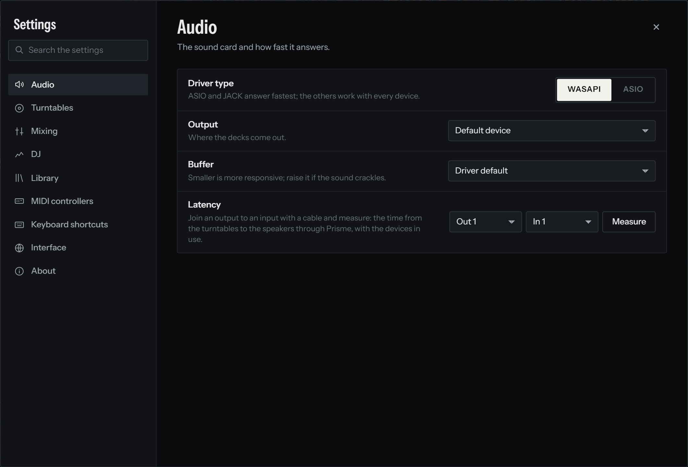

import { Aside } from '@astrojs/starlight/components';

Ouvrez les **Réglages** avec le bouton à droite de la barre de titre, ou avec <kbd>Ctrl</kbd>
<kbd>,</kbd> (<kbd>Cmd</kbd> <kbd>,</kbd> sur Mac). Les pages sont listées à gauche ;
**Chercher un réglage**, au-dessus, trouve n’importe quelle option par un mot de son nom ou de
sa description. La [palette de commandes](/fr/docs/interface/keyboard/) (<kbd>Ctrl</kbd>
<kbd>K</kbd>) trouve aussi les réglages et ouvre la fenêtre sur la bonne ligne.

La plupart des réglages s’appliquent tout de suite. Ceux qui redémarrent l’audio (le pilote,
les périphériques, le buffer, l’entrée des platines, le timecode, la platine simulée et le
mode de mixage) attendent dans une barre en bas, **L’audio redémarre pour appliquer ces
changements.**, jusqu’à ce que vous appuyiez sur **Appliquer** ; **Annuler** les abandonne.
La fenêtre ne se ferme pas tant que des changements attendent : la barre clignote à la place.

Tout ce que vous choisissez est conservé pour le prochain démarrage.

## Audio

La carte son et sa rapidité de réponse. Voir [Réglage de l’audio](/fr/docs/start/audio/).

| Réglage | Effet | Par défaut |
| --- | --- | --- |
| **Type de pilote** | Le système audio par lequel joue Prisme. **ASIO** et **JACK** répondent le plus vite ; les autres marchent avec tous les périphériques. Seuls ceux que propose votre système apparaissent : **WASAPI** et **ASIO** (avec un pilote ASIO installé) sur Windows, **Core Audio** sur Mac, **ALSA** et **JACK** sur Linux, **AAudio** et **USB** sur Android. | WASAPI sur Windows, Core Audio sur Mac, ALSA sur Linux, AAudio sur Android |
| **Sortie** | Où sortent les decks : un périphérique, avec son nombre de sorties et sa fréquence d’échantillonnage. Avec ASIO, c’est le **Pilote ASIO** (**Pilote par défaut** en premier), avec USB la **Carte son USB** (**La première branchée**). | **Périphérique par défaut** |
| **Buffer** | La taille d’une période audio, en échantillons et en millisecondes, de 32 à 2048 échantillons parmi ceux qu’accepte le pilote. Plus petit, c’est plus réactif ; augmentez-le si le son craque. | **Valeur du pilote** |
| **Latence** | Mesure l’aller-retour d’une sortie vers une entrée reliées par un câble : le temps qui va des platines aux enceintes en passant par Prisme. Choisissez **Out** et **In**, appuyez sur **Mesurer**. | — |

<Aside type="caution">
**Mesurer** joue des clics à plein niveau sur la sortie choisie pendant quelques secondes.
Débranchez-en d’abord les enceintes et le casque.
</Aside>

## Platines

Le signal timecode de chaque disque, et la façon dont il pilote son deck. Voir
[Configurer le vinyle timecode](/fr/docs/dvs/setup/).

| Réglage | Effet | Par défaut |
| --- | --- | --- |
| **Entrée (interface DVS)** | Le périphérique sur lequel les platines sont branchées. Le deck A lit les entrées 1-2, le deck B les entrées 3-4. Avec ASIO ou USB, c’est un interrupteur, **Platines branchées sur les entrées de ce pilote**. Indisponible tant que la platine simulée est activée. | **Aucune** |
| **Vinyle de contrôle** | Le timecode gravé sur vos disques : **Serato CV02 side A**, **Serato CV02 side B** ou **Serato control CD**. Un seul format pour toutes les platines. | Serato CV02 side A |
| **Platine simulée** | Une platine jouée par Prisme sur le deck A, pour essayer le contrôle vinyle sans platine : elle joue quatre secondes, puis scratche pendant deux. | Désactivée |

En dessous, un panneau par deck (**Platine A**, **Platine B**…) montre le signal sur un
oscilloscope avec ses indications **Signal**, **Niveau**, **Vitesse** et **Disque**, et
contient les réglages vinyle de ce deck. Ils s’appliquent tout de suite :

| Réglage | Effet | Par défaut |
| --- | --- | --- |
| **Contrôle vinyle** | Le deck suit son disque. | Désactivé |
| **REL** / **ABS** | Relatif : le disque ne pilote que la vitesse. Absolu : la vitesse et la position. | ABS |
| **Vitesse du disque** | **33** ou **45** : la vitesse à laquelle tourne le disque pour le tempo d’origine du morceau. | 33 |
| **Amorce (s)** | Où commence le morceau sur le disque en mode absolu. Vide : celle du disque (28 s sur les disques Serato, 0 sur le CD de contrôle). | Vide |
| **Inverser gauche / droite** | Pour des câbles gauche et droit croisés. | Désactivé |

## Mixage

Votre table de mixage ou celle de Prisme, et la façon dont elle sonne. Voir
[Table de mixage](/fr/docs/mixer/mixer/).

| Réglage | Effet | Par défaut |
| --- | --- | --- |
| **Mixage** | **Table de mixage externe : deck A sur les sorties 1-2, deck B sur 3-4**, chaque deck sur sa propre voie d’une table de mixage ; ou **Table de mixage logicielle : master sur les sorties 1-2**. Une table externe prend une paire de sorties par deck. Attend **Appliquer**. | Table externe sur ordinateur, table logicielle sur téléphone |
| **Casque** | Où la table logicielle joue les decks en pré-écoute : **Automatique**, une paire de sorties (**Sorties 3-4**…), ou **Pas de casque**. Automatique prend les sorties 3-4 d’une interface DJ, jamais les canaux surround d’un ordinateur. Avec une table externe, seul le morceau pré-écouté depuis la bibliothèque y joue, sur une paire qu’aucun deck n’utilise. La ligne indique où le casque se fait entendre en ce moment. | Automatique |
| **Retour cabine** | Les retours cabine : le master sur une paire à lui, à son propre niveau. Affiché quand le périphérique a une paire de libre. | **Pas de retour cabine** |
| **Micro** | L’entrée d’un micro, parmi celles que les platines laissent libres, mélangée au master ; sa touche est à côté du crossfader. Entendu au casque seulement s’il y est mis en pré-écoute. | **Aucune** |
| **Ligne aux** | Un téléphone, une platine CD ou une seconde table de mixage sur une paire d’entrées libre, mélangée au master. | **Aucune** |
| **Talkover** | Quand le micro est ouvert avec **TALK**, la musique baisse de **−6 dB**, **−12 dB**, **−18 dB** ou **−24 dB**. | −18 dB |
| **Courbe du crossfader** | **DOUCE** pour les enchaînements, **FRANCHE** pour le scratch (le son ne coupe qu’aux extrémités). | DOUCE |
| **Limiteur du master** | Pas de saturation sur le master, pour 1 ms de latence. | Activé |

Plus de détails sur les entrées dans [Entrées micro et aux](/fr/docs/mixer/inputs/), sur le
casque dans [Casque](/fr/docs/mixer/headphones/).

## DJ

Sync, fader de tempo, quantize et gain automatique.

| Réglage | Effet | Par défaut |
| --- | --- | --- |
| **Sync sur un disque en mode relatif** | Ce que fait SYNC quand un disque pilote le deck : **Ponctuelle : cale une fois, le fader de pitch reste actif**, ou **Verrouillée : suit le leader, le fader de pitch est ignoré**. Voir [SYNC sur un disque](/fr/docs/dvs/modes/#sync-sur-un-disque). | Ponctuelle |
| **Plage du fader de tempo** | La course des faders de tempo : **±8 %**, **±16 %** ou **±50 %**. Vaut pour tous les decks ; chaque deck peut ensuite avoir la sienne dans son menu d’options. | ±8 % |
| **Quantize** | Cues, boucles et sauts tombent sur le temps ; les stems se coupent et reviennent sur la mesure. | Activé |
| **Decks** | **2** ou **4**. Avec quatre decks sur une interface pour deux, C partage les sorties et la platine de A, D celles de B : le deck mis en **REL** ou **ABS** prend la platine, l’autre continue seul au tempo de son disque. Le changer redémarre l’audio tout de suite. Voir [Dispositions](/fr/docs/interface/layouts/). | 2 |
| **Gain automatique** | Chaque morceau joue au même volume perçu, mesuré au chargement. | Activé |
| **Potards aimantés** | Les potards d’égaliseur et de filtre marquent un temps d’arrêt au milieu quand on les fait passer par ce point. | Activé |
| **Casque sur la platine où un morceau est chargé** | Charger un morceau met ce deck seul au casque, pour le caler tout de suite. | Désactivé |
| **Ne jamais remplacer une platine qui joue** | Un morceau chargé sur un deck qui joue est refusé avec un message, plutôt que de vous demander. | Désactivé |
| **Contrôles sur l’écran verrouillé** | Android seulement. Lecture et pause de chaque deck depuis le lecteur de l’écran verrouillé. Désactivez-le pour une soirée : plus rien qu’une poche puisse déclencher. | Activé |

## Bibliothèque

Vos fichiers musicaux et ce que Prisme y écrit. Voir [Analyse](/fr/docs/library/analysis/)
et [Stems](/fr/docs/sound/stems/).

| Réglage | Effet | Par défaut |
| --- | --- | --- |
| **Écrire le tempo et la tonalité dans les tags des fichiers** | Pour que Serato, rekordbox et les autres les retrouvent. | Activé sur ordinateur, désactivé sur téléphone |
| **Remplacer ceux écrits par un autre logiciel** | Un tempo ou une tonalité que Mixed In Key ou un autre logiciel a mis dans un fichier est conservé, sauf si ce réglage est activé. Affiché quand le réglage précédent est activé. | Désactivé |
| **Mettre l’analyse de la bibliothèque en pause quand un deck joue** | Le processeur et le disque restent au son pendant un set. Un morceau copié entre-temps est analysé une fois les decks arrêtés, ou à son chargement. | Activé |
| **Séparation** | **Qualité** : les grands modèles, les stems les plus propres. **Rapide** : un seul petit modèle pour tous les stems, plusieurs fois plus rapide, pour un téléphone ou un ordinateur sans carte graphique adaptée. | Qualité sur ordinateur, Rapide sur téléphone |
| **Séparation voix / instru** | Qualité seulement. Le modèle des voix, téléchargé une fois avec son bouton **Télécharger** (sa taille indiquée). Un morceau prend quelques secondes avec une carte graphique récente, quelques minutes sur le processeur seul. | Non installée |
| **Séparation batterie / basse** | Qualité seulement. Sépare l’instru en batterie, basse et mélodie. Demande d’abord la séparation voix / instru, et prend deux à trois fois plus de temps. | Non installée |
| **Séparation en stems** | Rapide seulement. Voix, batterie, basse et mélodie par un seul petit modèle, téléchargé une fois. | Non installée |
| **Accélération matérielle** | La puce graphique sépare les morceaux, bien plus vite que le processeur seul. Indisponible là où il n’y a pas de puce graphique adaptée : **Pas de puce graphique adaptée ici : le processeur sépare.** | Activée |
| **Séparer les morceaux dès qu’ils sont chargés ou mis en préparation** | Un morceau chargé sur un deck est séparé tout de suite, à partir de là où il joue ; un morceau mis en Préparation, en arrière-plan. | Activé là où la puce graphique sépare, désactivé sinon, jusqu’à ce que vous choisissiez |
| **Séparer toute la bibliothèque** | **Séparer** met tous les morceaux en file d’attente. Les stems sont rangés à côté de chaque morceau dans un dossier `.prisme`, et voyagent donc avec votre musique. | — |

## Contrôleurs MIDI

Assignez les commandes d’un contrôleur en les bougeant. Voir
[Contrôleurs](/fr/docs/controllers/) et [MIDI learn](/fr/docs/controllers/learn/).

| Réglage | Effet | Par défaut |
| --- | --- | --- |
| **Contrôleurs** | Chaque contrôleur détecté, **Branché** ou **non branché**, avec un interrupteur pour l’utiliser. Un modèle que Prisme connaît indique **Reconnu comme…**. **Exporter en profil** enregistre ce qu’il pilote à présent comme un profil à vous. Sans contrôleur : **Aucun contrôleur MIDI branché.** et **Actualiser**. | Désactivé jusqu’à activation |
| **Horloge MIDI en sortie** | Envoie 24 tops par temps du leader de sync vers une sortie MIDI. | **Aucune** |
| **Profils de contrôleurs** | Le nombre de modèles que connaît Prisme. **Chercher des mises à jour** récupère les profils publiés depuis, comme Prisme le fait une fois par jour. | — |
| **Vos propres profils** | Ordinateur seulement. **Ouvrir le dossier** où vont vos propres profils ; **Relire** après avoir modifié un fichier. | — |

En dessous, chaque action est listée avec ce qui la pilote, et un bouton **Apprendre** pour
assigner une commande en la bougeant. Voir [Profils](/fr/docs/controllers/profiles/).

## Raccourcis clavier

Ordinateur seulement. Toutes les touches du clavier, groupées par fonction et nommées comme
elles sont imprimées sur votre clavier. La liste est en lecture seule ; voir
[Clavier](/fr/docs/interface/keyboard/).

## Interface

| Réglage | Effet | Par défaut |
| --- | --- | --- |
| **Langue** | **English** ou **Français**. Toute l’interface change aussitôt. | La langue de votre système : français s’il est en français, anglais sinon |
| **Platines sur l’écran du bas** | Ordinateur seulement. Avec un écran placé sous l’écran principal, la bibliothèque passe en haut et les decks en bas, sous les doigts. Indisponible sans cet écran : **Aucun écran sous celui-ci.** | Désactivé |

## À propos

| Réglage | Effet |
| --- | --- |
| **Version** | La version de Prisme. Prisme est un logiciel libre, sous licence GNU GPL v3. |
| **Mises à jour** | Prisme cherche une nouvelle version à chaque démarrage ; **Vérifier maintenant** cherche à nouveau. Quand une version est prête, **Installer et redémarrer**, aussi proposé dans la barre de titre. Pas pendant qu’un deck joue. |
| **Rapport de diagnostic** | **Enregistrer un rapport de diagnostic…** écrit les versions, la configuration audio et la fin du log dans un fichier texte, pour aider à comprendre un problème. Voir [Les logs et le rapport de diagnostic](/fr/docs/help/troubleshooting/#les-logs-et-le-rapport-de-diagnostic). |

## Réglé ailleurs

Certains choix se font hors de cette fenêtre, là où vous vous en servez, et sont eux aussi
conservés pour le prochain démarrage :

| Où | Quoi | Par défaut |
| --- | --- | --- |
| Chaque deck | **KEY LOCK** ; dans son menu d’options, le fader start et sa propre plage de fader de tempo | Désactivé, désactivé, la plage générale |
| Le sampler | Le son de chaque emplacement | Vide |
| La table de mixage logicielle | Mix et niveau du casque, casque séparé, crossfader inversé, niveau du master, balance, niveau du retour cabine, niveaux du micro et de l’aux, talkover | Cue seul, séparé désactivé, inversion désactivée, talkover désactivé |
| Auto DJ | La durée d’un enchaînement | 16 temps, ou 10 s entre les morceaux sans grille rythmique |
| La bibliothèque | Les colonnes affichées | Toutes |

Le micro et l’aux sont de nouveau coupés à chaque démarrage, tout comme l’Auto DJ.
