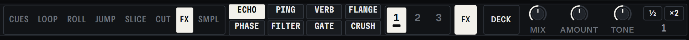

import { Steps, Aside } from '@astrojs/starlight/components';

Chaque deck a une chaîne de trois emplacements d’effet, joués l’un après l’autre. Huit effets sont
disponibles  écho, écho ping-pong, réverbération, flanger, phaser, filtre, gate et bitcrusher. Ils
suivent le tempo du deck, et peuvent jouer sur tout le morceau ou sur un seul de ses
[stems](/fr/docs/sound/stems/).

## Activer un effet

<Steps>

1. Sur le rail du deck, appuyez sur **FX** parmi les modes de pads (**CUES**, **LOOP**, **ROLL**…
   **FX**, **SMPL**). Les huit pads deviennent les huit effets et les potards des effets apparaissent
   à côté.

2. Choisissez un emplacement avec les touches **1**, **2** et **3**. Les pads et les potards agissent
   sur cet emplacement.

3. Appuyez sur un pad  son effet se place dans l’emplacement et démarre. Appuyez de nouveau pour
   l’arrêter.

4. Tournez **MIX**, **AMOUNT** et le second potard, et réglez la période avec **½** et **×2**.

</Steps>

La touche d’un emplacement est marquée tant que son effet joue  vous voyez d’un coup d’œil quels
emplacements sont actifs. La barre d’un pad s’atténue quand son effet joue dans un autre emplacement
de la chaîne. Les effets fonctionnent que le deck joue ou non, et avec l’une ou l’autre table.

## Les potards

| Commande | Ce qu’elle fait |
| --- | --- |
| **MIX** | Le niveau de l’effet. Pour les échos et la réverbération, le volume auquel l’effet s’ajoute au son intact  pour les autres, à quel point le son passe du son direct (`0 %`) au son entièrement traité (`100 %`). |
| **AMOUNT** | Le potard principal de l’effet  réinjection, taille de la pièce, profondeur… (voir plus bas). |
| Second potard | Son nom change avec l’effet  **TONE**, **DAMP**, **WIDTH**, **DEPTH**, **RESO**, **LENGTH** ou **HOLD**. Au milieu, l’effet sonne comme il sonnerait sans lui. |
| **½**, **×2** | La période, en temps, de 1/8 à 8  le temps entre deux échos, la durée d’un balayage ou d’un cycle de gate. |

Chaque emplacement garde ses propres réglages  l’effet, les potards et la période. Un nouvel
emplacement démarre avec un écho à mi-mix, mi-amount, le second potard au milieu et une période d’un
temps.

## Les huit effets

| Pad | Effet | **AMOUNT** | Second potard | Période |
| --- | --- | --- | --- | --- |
| **ECHO** | Écho  des répétitions sur le temps, les deux côtés ensemble | Réinjection  le nombre de répétitions | **TONE**  baissé, chaque répétition revient plus sourde, comme sur une bande  tout en haut, intacte | Temps entre deux répétitions |
| **PING** | Écho ping-pong  les répétitions rebondissent de gauche à droite | Réinjection | **TONE**, comme pour l’écho | Temps entre deux répétitions |
| **VERB** | Réverbération | Taille de la pièce | **DAMP**  l’amortissement de la pièce, une queue plus sombre en le montant | Sans effet |
| **FLANGE** | Flanger  un son de jet qui balaie | Réinjection | **WIDTH**  jusqu’où va le balayage | Un balayage dure quatre périodes |
| **PHASE** | Phaser  un son de creux qui balaie | Réinjection | **DEPTH**  la largeur du balayage | Un balayage dure quatre périodes |
| **FILTER** | Un passe-bas résonant qui balaie du haut vers le bas et revient | Profondeur  jusqu’où il descend | **RESO**  la résonance à la fréquence de coupure | Un balayage dure quatre périodes |
| **GATE** | Coupe le son en rythme | Profondeur  à quel point le son baisse quand le gate se ferme  à fond, silence | **LENGTH**  combien de temps le gate reste ouvert, d’un seizième de la période à presque toute la période  la moitié au milieu | Une ouverture et une fermeture |
| **CRUSH** | Bitcrusher  réduit la résolution | Écrasement  de 16 bits jusqu’à 4 | **HOLD**  le sous-échantillonnage, aucun en bas, plus grossier en le montant | Sans effet |

### Comment ils s’activent et se coupent

Les échos et la réverbération s’ajoutent au son  coupés, ils cessent de prendre du son et leur queue
s’éteint d’elle-même, comme sur le départ d’effets d’une table. Les autres effets montent en fondu à
l’activation et redescendent en fondu à la coupure. Changer l’effet d’un emplacement fait partir le
nouveau du silence.

### Calage

La période suit le tempo du deck, lu dans sa grille rythmique  à 128 BPM, un écho d’un temps se répète
toutes les 469 ms, et un changement de tempo emporte les effets avec lui. Un gate d’un temps ou moins
démarre sur le temps. Un morceau sans grille rythmique fait tourner ses effets à 120 BPM. Voir
[Analyse](/fr/docs/library/analysis/) pour la grille rythmique.

## La chaîne

Les trois emplacements jouent dans l’ordre  l’emplacement 1, puis le 2, puis le 3, chacun prenant ce
que lui donne le précédent. Un écho dans l’emplacement 1 suivi d’un filtre dans l’emplacement 2
filtre aussi les échos.

La touche **FX** à côté des touches d’emplacement active ou coupe toute la chaîne. Coupée, rien de la
chaîne ne sonne, mais chaque emplacement garde son propre interrupteur  appuyez de nouveau sur
**FX** et les mêmes effets reviennent. Servez-vous-en pour couper tous les effets sur un temps et les
faire revenir ensemble.

Où se place la chaîne dans le deck 

- Sur tout le deck, les effets viennent après l’EQ et le filtre de la
  [table de mixage logicielle](/fr/docs/mixer/mixer/) et avant le fader de voie. Les sons du
  [sampler](/fr/docs/decks/sampler/) passent aussi par eux. Avec une table externe, ils agissent sur
  ce que le deck envoie à ses sorties.
- Sur un stem, ils agissent sur cette seule partie du morceau, avant l’EQ.

## Sur un stem

Quand le morceau du deck est [séparé en stems](/fr/docs/sound/stems/), la touche à côté de **FX**
choisit où joue la chaîne. Elle affiche **DECK** pour tout le morceau  appuyez dessus pour passer
d’une partie à l’autre  **VOX** et **INST** pour un morceau séparé en voix et instru, ou **VOX**,
**DRUM**, **BASS** et **MELO** pour un morceau séparé en quatre, puis retour à **DECK**.

Un écho sur **VOX** seul donne un vocal throw pendant que le beat continue sans effet  un gate sur
**DRUM** hache seulement la batterie. Le reste du morceau joue sans être touché. Si vous chargez un
morceau qui n’a pas cette partie, la chaîne revient sur tout le deck.

## Depuis un contrôleur

Chaque emplacement répond aux actions **Effet 1 actif / coupé** (et **Effet 1 allumé**, **Effet 1
éteint**), **Effet 1 tant que c’est appuyé**, **Effet 1  effet suivant**, **Effet 1  effet
précédent**, **Effet 1  Écho actif / coupé** et ainsi de suite pour chaque effet, **Niveau de
l’effet 1** (**MIX**), **Intensité de l’effet 1**, **Second bouton de l’effet 1 (timbre, résonance…
selon l’effet)**, **Période de l’effet 1 (chaque cran la divise par deux ou la double)** pour un
encodeur, et **Période de l’effet 1, sur la course du bouton** et **Effet 1  l’effet, sur la course
du bouton** pour un potard classique. De même pour les effets 2 et 3. Pour toute la chaîne 
**Effets (toute la chaîne)** et **Effets sur la partie suivante**.

### Focus et les trois potards d’effet

Beaucoup de contrôleurs ont trois potards par unité d’effets. Prisme leur donne deux usages, comme
Mixxx 

- Sans emplacement pris, **Bouton d’effet 1** règle l’intensité de l’effet 1, **Bouton d’effet 2**
  celle de l’effet 2 et **Bouton d’effet 3** celle de l’effet 3.
- Appuyez sur une touche assignée à **Effet 1 pris par les boutons d’effet / relâché** (ou 2, ou 3) 
  les trois potards règlent alors l’intensité, le second potard et la période de cet emplacement. À
  l’écran, cet emplacement est choisi et sa touche est encadrée. Appuyez de nouveau sur la touche pour
  le relâcher.

### Super bouton

**Intensités des effets ensemble (super bouton)** tourne en même temps les intensités des trois
emplacements  montez toute une chaîne d’effets avec un seul potard, puis redescendez-la.

La reprise en douceur s’applique  le potard d’un contrôleur ne prend la main sur un réglage qu’une
fois arrivé à la valeur affichée à l’écran. Les actions d’effet sont listées avec les autres dans
[toutes les actions](/fr/docs/controllers/actions/)  la palette de commandes (<kbd>Ctrl</kbd>
<kbd>K</kbd>) lance celles qui sont des touches.
