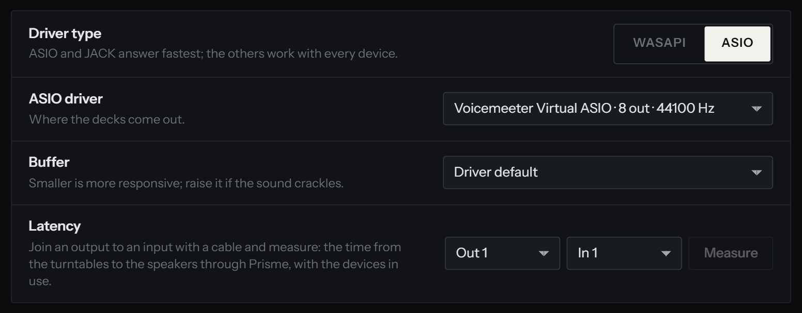

import { Steps, Aside } from '@astrojs/starlight/components';

Prisme joue sur une seule carte son à la fois. Vous la choisissez, avec son pilote et son buffer, dans **Réglages** > **Audio**  la sortie des decks et du casque se règle dans **Réglages** > **Mixage**. Ouvrez les réglages avec le bouton **Réglages** de la barre de titre ou <kbd>Ctrl</kbd> <kbd>,</kbd> (<kbd>⌘</kbd> <kbd>,</kbd> sur Mac).

## Appliquer et Annuler

La plupart des réglages s’appliquent aussitôt. Ceux qui redémarrent l’audio (le pilote, l’interface, le buffer, l’entrée des platines et le mode de mixage) attendent dans une barre en bas des réglages  **L’audio redémarre pour appliquer ces changements.** Appuyez sur **Appliquer** pour redémarrer l’audio avec eux, ou sur **Annuler** pour les abandonner. La fenêtre des réglages ne se ferme pas tant que des changements attendent  la barre clignote à la place.

<Aside type="caution">
Appliquer redémarre l’audio  le son se coupe un instant. Faites-le avant votre set, pas pendant.
</Aside>

## Type de pilote

La ligne **Type de pilote** liste les pilotes que propose votre système. ASIO et JACK répondent le plus vite  les autres marchent avec tous les périphériques.

| Pilote | Système | Ce que c’est |
| --- | --- | --- |
| **WASAPI** | Windows | L’audio partagé de Windows. Fonctionne avec tous les périphériques et laisse les autres applications jouer en même temps, avec plus de latence. Le choix par défaut sous Windows. |
| **ASIO** | Windows | Le pilote basse latence propre à la carte son, installé avec son logiciel. Un seul pilote porte à la fois les sorties et les entrées. |
| **Core Audio** | macOS | L’audio de macOS, basse latence tel quel. |
| **ALSA** | Linux | La carte son elle-même, ou le serveur de son via son périphérique `default`. Le choix par défaut sous Linux. |
| **JACK** | Linux | Le serveur JACK, ou PipeWire à sa place  basse latence, et partagé avec les autres applications audio. |
| **AAudio** | Android | L’audio d’Android  le téléphone lui-même, ou la carte son qui y est branchée. |
| **USB** | Android | Une carte son USB pilotée par Prisme lui-même, avec tous ses canaux, là où l’audio d’Android n’en atteint que certains. |

Choisir un autre pilote remet l’interface et le buffer aux valeurs par défaut de ce pilote.

### Windows  WASAPI ou ASIO

Avec une interface DJ, utilisez **ASIO** si son fabricant fournit un pilote ASIO  la latence est plus basse et les entrées des platines passent par le même pilote. Avec ASIO, la ligne de l’interface s’appelle **Pilote ASIO**, et sur la page **Platines** un interrupteur, **Platines branchées sur les entrées de ce pilote**, utilise les entrées de la même carte.

Avec **WASAPI**, les sorties et l’entrée des platines se choisissent séparément  la **Sortie** ici, l’**Entrée (interface DVS)** sur la page **Platines**. Quand la sortie est **Périphérique par défaut**, Prisme suit la sortie par défaut de Windows si vous la changez.

### Linux  ALSA et JACK

**ALSA** fonctionne sur tous les systèmes. Choisissez **JACK** pour la latence la plus basse, avec un serveur JACK lancé ou avec PipeWire et sa prise en charge de JACK (`pipewire-jack` sur la plupart des distributions).

### Android  AAudio et USB

**AAudio** joue là où Android envoie le son  le haut-parleur ou le casque du téléphone, ou une carte son USB branchée. Certaines cartes n’arrivent sur Android qu’avec une partie de leurs canaux  choisissez alors **USB**, et Prisme pilote la carte lui-même. Android vous demande d’autoriser Prisme à ouvrir la carte. Avec USB, la ligne de l’interface s’appelle **Carte son USB**, et **La première branchée** prend la première carte trouvée. Voir [Téléphone et tablette](/fr/docs/interface/phone/#cartes-son-usb).

## Sortie

La ligne **Sortie** liste les périphériques du pilote choisi, chacun avec son nombre de canaux et sa fréquence d’échantillonnage. **Périphérique par défaut** suit celui du système.

- **Deux sorties** (un portable, une carte USB simple)  les decks sont mixés par la table de mixage logicielle de Prisme sur les sorties 1-2.
- **Quatre sorties ou plus** (une interface DJ)  chaque deck peut aller sur sa propre paire de sorties, vers une table de mixage. Voir [plus bas](#sorties-par-deck-ou-table-de-mixage-logicielle).

Les entrées des platines se règlent sur la page **Platines**  le deck A lit les entrées 1-2, le deck B les entrées 3-4. Voir [Configurer le contrôle vinyle](/fr/docs/dvs/setup/).

## Buffer

Le buffer, c’est la quantité d’audio que Prisme calcule à la fois. Il fixe le délai entre un geste (une main sur le disque, un appui sur CUE) et ce que vous entendez.

La ligne **Buffer** propose **Valeur du pilote** et les tailles que l’interface accepte, de 32 à 2048 échantillons, chacune avec sa durée en millisecondes à la fréquence d’échantillonnage de l’interface. À 48 kHz, 256 échantillons durent 5,3 ms.

- **Plus petit, c’est plus réactif.** Scratcher en vinyle timecode demande un petit buffer.
- **Augmentez-le si le son craque.** Un buffer trop petit pour l’ordinateur provoque des décrochages  de courts trous qu’on entend comme des clics.

Pour trouver le vôtre, partez de **Valeur du pilote**, jouez deux decks avec stems et effets pendant quelques minutes, et surveillez le compteur **Décrochages** dans la barre de titre. Baissez le buffer d’un cran à la fois tant qu’il reste à zéro  remontez d’un cran dès qu’il bouge.

Avec JACK, le buffer est celui du serveur JACK  changez-le dans vos réglages JACK ou PipeWire.

## Mesurer la latence

La ligne **Latence** mesure l’aller-retour réel à travers votre carte son, avec les périphériques en service  le temps des platines aux enceintes en passant par Prisme.

<Steps>

1. Reliez une sortie de votre carte son à une entrée avec un câble.

2. Choisissez cette sortie dans **Sortie** et cette entrée dans **Entrée**, numérotées comme sur la carte.

3. Appuyez sur **Mesurer**. Prisme arrête l’audio, joue des clics pendant trois secondes, chronomètre leur retour, puis relance l’audio. Le résultat s’affiche en millisecondes.

</Steps>

<Aside type="danger">
Les clics sont joués à plein niveau. Débranchez vos enceintes et retirez votre casque de cette sortie avant de mesurer, et ne mesurez jamais pendant un set.
</Aside>

Le limiteur du master de la table de mixage logicielle ajoute 1 ms à ce que vous mesurez. Vous pouvez le désactiver dans **Réglages** > **Mixage** > **Limiteur du master**.

## Sorties par deck ou table de mixage logicielle

**Réglages** > **Mixage** > **Mixage** décide qui mixe 

| Choix | Ce qui sort |
| --- | --- |
| **Table de mixage externe  deck A sur les sorties 1-2, deck B sur 3-4** | Chaque deck sur sa propre paire, vers les voies d’une table de mixage. L’écran n’affiche pas de table, seulement le niveau envoyé aux sorties de chaque deck, un fin vumètre à côté de sa lettre. Le choix par défaut sur un ordinateur. |
| **Table de mixage logicielle  master sur les sorties 1-2** | Prisme mixe  une voie par deck avec gain, égaliseur, filtre et fader, un crossfader, le master sur les sorties 1-2 et le casque sur une autre paire. Le choix par défaut sur un téléphone. |

Si vous choisissez la table externe mais que l’interface n’a pas assez de sorties, c’est la table de mixage logicielle qui tourne, et la barre de titre indique **Table externe  4 sorties nécessaires** quand des platines sont configurées. Changer le mode de mixage attend **Appliquer**.

Avec quatre decks, une interface qui a une paire de sorties par deck donne la sienne à chacun (C sur 5-6, D sur 7-8). Sur une interface à quatre sorties, C partage les sorties et la platine de A, et D celles de B. Voir [Dispositions et decks](/fr/docs/interface/layouts/#quatre-decks).

La table de mixage logicielle elle-même est décrite dans [La table de mixage](/fr/docs/mixer/mixer/).

## Casque

**Réglages** > **Mixage** > **Casque** choisit la paire de sorties sur laquelle joue le casque 

- **Automatique** prend les sorties 3-4 d’une interface DJ, jamais les canaux surround d’un ordinateur.
- **Sorties 3-4**, **Sorties 5-6** et ainsi de suite le mettent sur la paire de votre choix.
- **Pas de casque** ne l’envoie nulle part.

Sous la ligne, Prisme indique où il s’entend sur l’interface en service (**En ce moment sur les sorties 3-4.**) ou qu’il n’y en a **Pas de casque sur ce périphérique.**

Avec la table de mixage logicielle, le casque joue les decks en pré-écoute et le master, mélangés ou séparés. Avec une table de mixage externe, la pré-écoute se fait sur la table  seule l’écoute d’un morceau de la bibliothèque joue sur la paire casque de Prisme, sur une paire qu’aucun deck n’utilise. Voir [Casque et pré-écoute](/fr/docs/mixer/headphones/).

Sur une interface à quatre sorties ou plus, **Retour cabine** envoie le master vers les enceintes de la cabine sur une paire à lui, à son propre niveau.

## La barre de titre

La gauche de la barre de titre montre d’un coup d’œil l’état de l’audio 

| Pastille | Signification |
| --- | --- |
| Pilote · interface, voyant vert | L’audio tourne sur ce pilote et cette interface. |
| **Buffer** 5,3 ms | La durée d’une période audio, telle que le pilote la fait vraiment tourner. |
| *n* **entrées** | Les entrées ouvertes pour les platines. |
| **platine simulée** | La platine simulée joue le deck A. |
| **Décrochages** *n* | Les périodes que le moteur n’a pas pu finir à temps depuis le démarrage de l’audio. En ambre dès le premier. |
| **audio arrêté** | Aucun audio ne tourne  ouvrez **Réglages** > **Audio**. |
| **interface audio perdue, reconnexion…** | L’interface a disparu. Prisme relance l’audio dès qu’elle revient. |
| **erreur du moteur audio** | Le moteur audio a échoué. Appliquez à nouveau les réglages pour le relancer. |

À côté, le vumètre du master  gris jusqu’à −6 dB, ambre au-dessus, son dernier segment rouge au maximum.

## Décrochages

Un décrochage, c’est une période audio que le moteur a mis plus de temps à calculer qu’elle ne dure  la carte son n’a rien reçu à temps, et vous pouvez entendre un clic. Survolez la pastille **Décrochages** pour lire la période la plus lente, en microsecondes.

Quand le compteur bouge 

<Steps>

1. Augmentez le buffer d’un cran dans **Réglages** > **Audio** et appliquez.

2. Fermez les autres applications gourmandes et, sur un portable, branchez le chargeur  sur batterie, le processeur peut ralentir.

3. Sur un ordinateur sans puce graphique adaptée, la séparation des stems utilise le processeur. Séparez vos morceaux avant le set, ou désactivez **Séparer les morceaux dès qu’ils sont chargés ou mis en préparation** dans **Réglages** > **Bibliothèque**. Voir [Stems](/fr/docs/sound/stems/).

4. Laissez activé **Mettre l’analyse de la bibliothèque en pause quand un deck joue**, dans **Réglages** > **Bibliothèque**, pour que l’analyse des nouveaux fichiers attende l’arrêt des decks.

</Steps>

## Quand l’interface disparaît

Si la carte son est débranchée ou s’arrête, Prisme affiche **interface audio perdue, reconnexion…** et réessaie, tout de suite puis toutes les quelques secondes. Quand la carte revient, l’audio redémarre avec les decks là où ils en étaient. Si la carte était éteinte au démarrage de Prisme, l’audio démarre sur les périphériques par défaut du système et passe sur votre carte dès qu’elle apparaît.

## Platine simulée

Pour essayer le contrôle vinyle sans platines, activez **Réglages** > **Platines** > **Platine simulée**  Prisme joue une platine sur le deck A, timecode compris, et la barre de titre indique **platine simulée**. L’entrée des platines est désactivée pendant ce temps. Voir [Configurer le contrôle vinyle](/fr/docs/dvs/setup/).
